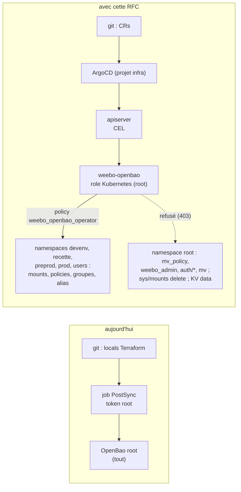
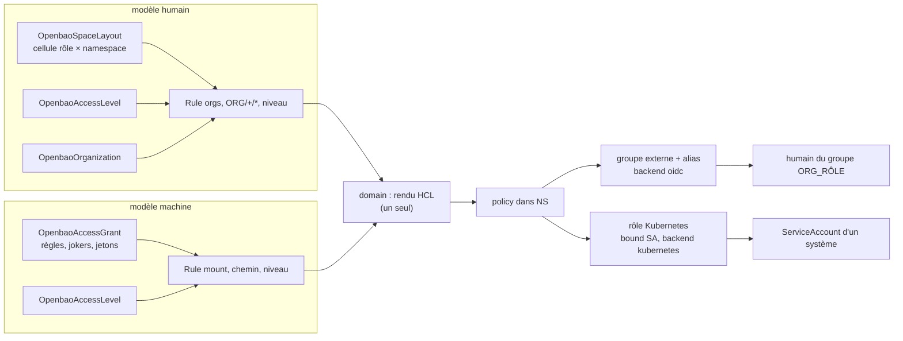
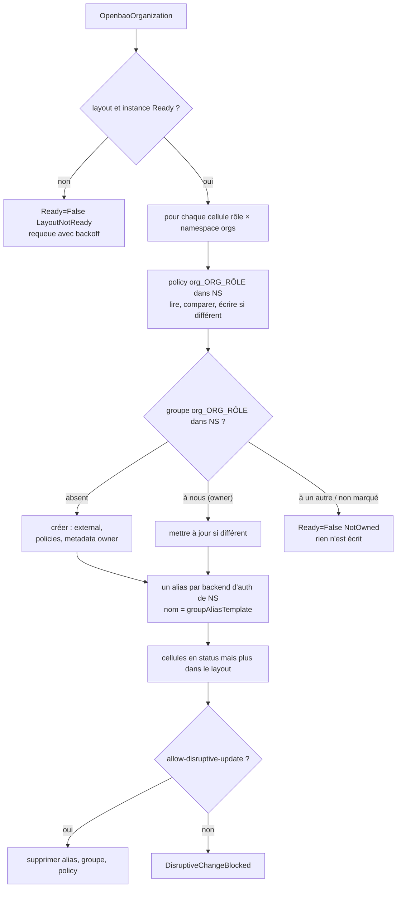
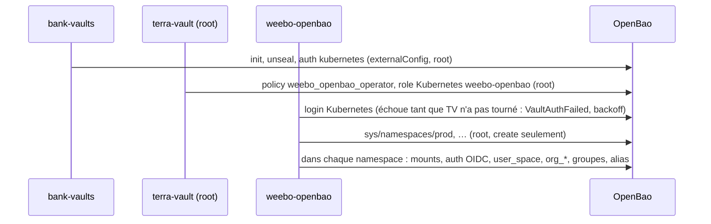
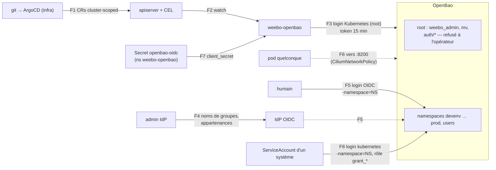

# RFC 0007 — Les espaces OpenBao en CRs : l'opérateur weebo-openbao

| Champ      | Valeur |
| ---------- | ------ |
| Statut     | Implemented (2026-11-14) |
| Court      | Espaces OpenBao déclaratifs |
| Tranche    | Qui crée les mounts, policies, groupes et alias des espaces humains d'OpenBao, dans quels namespaces OpenBao, avec quels droits Vault, sans lier l'opérateur à un fournisseur d'identité |
| Auteur     | Max Batleforc <maxleriche.60@gmail.com> |
| Co-auteur  | Claude Opus 5.5 |
| Créée      | 2026-11-06 |
| Révisée    | 2026-11-06 : décisions 1 à 21 (15 à 21 après la revue finale à six lentilles) ; phases 0 à 3 livrées, phase 4 poussée ; 2026-11-13 : phase 4 réconciliée, preuves n°5, 6 et 9 de §6.P faites ; phase 5 livrée, preuve n°7 faite ; phase 6 livrée sauf l'envoi des alertes, preuves n°11 et 12 faites ; 2026-11-14 : alertes vers ntfy, jetons Che dans `users` (captures `{name}` des `pathGrants`, kit v0.31.0), écarts de §17 reportés dans le texte, §17 devient le journal ; jeton Che relu dans `users`, notification ntfy reçue : Implemented |
| Remplace   | — |
| Touche     | `weebo-openbao` (nouveau dépôt, org `weebo-si-operator`, v0.1.0 à v0.1.5), weebo-operator-kit (`VaultAdditionalMount.vaultNamespace`, `.auth`, v0.29.0 ; `clusterSecrets`/`releaseSecrets` du chart, v0.30.0 ; captures `{name}` des `pathGrants`, v0.31.0), weebo-forgejo (`additionalMounts`, v0.10.0). Dans weebo-si : `2.terra/vault/terra-map/{weebo-openbao,auth-base}.tf`, `2.terra/vault/kustomization.yaml`, `2.terra/auth/terra-map/vault.tf`, `spaces.tf` et `vault-spaces.tf` supprimés ; `2.argo/helm/vault/{main,sub,spaces}` (opérateur, `OpenbaoInstance`, device d'audit, NetworkPolicy, les CRs des espaces) ; `2.argo/helm/auth/{main,sub}/values.yaml` (client OIDC `openbao`, groupes) ; `2.argo/helm/forgejo` et `2.helm/user-app` (mount `users`, jetons Che) ; `2.argo/helm/monitoring` (tableau de bord, alertes ntfy) ; `0.task/vault.yaml` (`vault:ntfy`) ; `2.argo/app/values.yaml` (AppProject) ; `0.docs/content/docs/Infra/openbao.mdx` |
| Risque     | high (§7) |

> Document de référence (~14 000 mots avec le code) : §1 à §3, §7.1 et §15
> suffisent pour décider. Le reste sert à construire et à relire.

---

## 1. Résumé

Les espaces humains d'OpenBao (`users/<username>/…` et
`orgs-<env>/<org>/<repo>/…`, doc dans `Infra/openbao.mdx`, section « Espaces
humains ») sont décrits aujourd'hui par deux fichiers Terraform non commités :
`2.terra/vault/terra-map/spaces.tf` (les cinq mounts KV v2) et
`2.terra/auth/terra-map/vault-spaces.tf` (la policy templatée `user_space`, et
pour chaque couple `<org>_<rôle>` une policy, un groupe d'identité externe et
un alias). Ajouter une organisation, c'est éditer une liste `locals` et
attendre un job PostSync qui `apply` avec le token root.

Cette RFC remplace ce Terraform par un opérateur, **weebo-openbao**, bâti sur
weebo-operator-kit. Le namespace root d'OpenBao reste celui de l'**infra**
(`mv`, `weebo_admin`, le backend `authentik` des admins, les rôles des
opérateurs) : l'opérateur n'y écrit rien. Les espaces passent dans des
**namespaces OpenBao** déclarés par CR, un par environnement (`devenv`,
`recette`, `preprod`, `prod`) et un pour les espaces personnels (`users`).

L'opérateur sert **deux modèles d'accès sur une même mécanique** :

- **humain** : un membre du groupe `<org>_<rôle>` de l'IdP se connecte par un
  backend `oidc` du namespace, et reçoit le niveau que la matrice donne à son
  rôle dans cet env ;
- **machine** : un ServiceAccount Kubernetes (weebo-forgejo, weebo-batlehub,
  weebo-angos, weebo-authentik, une CI…) se connecte par un backend
  `kubernetes` du namespace, et reçoit ce que des règles lui ouvrent : chemins
  avec `+` et `*`, jetons `{org}`, `{sa.namespace}` et `{sa.name}`, ces deux
  derniers rendus par OpenBao à partir des métadonnées de l'alias, comme
  `mv_reader_policy` le fait déjà dans le root (`auth-base.tf`).

Dans les deux cas, l'opérateur rend des **règles** (mount, chemin, niveau) en
une policy du namespace, et les lie à une identité : un alias de groupe pour
l'humain, un rôle Kubernetes pour la machine. Six CRs cluster-scoped :

| Kind | Porte |
| --- | --- |
| `OpenbaoInstance` | la connexion à OpenBao, et la liste des namespaces où l'opérateur a le droit d'écrire |
| `OpenbaoNamespace` | un namespace : ses types (`orgs`, `users`, un mount KV v2 chacun) et ses backends d'auth (`oidc`, `kubernetes`, extensible) |
| `OpenbaoAccessLevel` | un niveau d'accès (`read`, `write`, `owner`, `token-writer`…) : les capacités sur `data` et `metadata`, partagées par les deux modèles |
| `OpenbaoSpaceLayout` | le modèle humain commun : la matrice rôle → namespace → niveau, l'espace utilisateur, le gabarit des alias |
| `OpenbaoOrganization` | une organisation, rien d'autre que son nom tel qu'il apparaît dans les groupes de l'IdP |
| `OpenbaoAccessGrant` | le modèle machine : qui (ServiceAccounts), où (un namespace), quoi (des règles) |

L'opérateur ne lit ni n'écrit aucun secret des espaces, et **n'écrit rien
dans le root**. Sa policy, posée par Terraform dans le root, ne lui ouvre que
les namespaces listés. Il crée namespaces, mounts et backends, mais n'en
supprime jamais aucun. Il ne connaît aucun fournisseur d'identité et n'écrit,
ne lit ni ne surveille aucun objet d'une autre CRD : changer d'IdP, c'est
changer le bloc `auth` d'un `OpenbaoNamespace`.

### Avant / après

```text
# aujourd'hui : 2.terra/auth/terra-map/vault-spaces.tf
locals {
  vault_orgs = ["batleforc-org"]
  vault_org_roles = { owner = {...}, maintainer = {...}, dev = {...} }
}
# + un job PostSync, token root, terraform apply

# avec cette RFC : un fichier par org, dans le chart des espaces
apiVersion: openbao.weebo.io/v1alpha1
kind: OpenbaoOrganization
metadata:
  name: batleforc-org
spec:
  layoutRef: { name: weebo }
  name: batleforc-org          # le <org> des groupes <org>_<rôle> de l'IdP
```

```text
# et côté humain : un namespace par env
bao login -namespace=preprod -method=oidc -path=authentik   # -path : le name du backend
bao kv get -namespace=preprod -mount=orgs batleforc-org/weebo-si/x
```



Le chemin du bas montre ce qui change en sécurité : la main qui écrit n'a plus
le token root, et tout ce qu'elle pourrait abîmer est enfermé dans les
namespaces des espaces. Le refus vient d'OpenBao lui-même, pas de l'opérateur.

---

## 2. Motivation

1. **Ajouter une organisation est un acte d'administrateur Terraform.** Il
   faut éditer `vault_orgs` (`vault-spaces.tf`), committer, et le job
   `terra-job-*` applique avec le token root lu dans `openbao-unseal-keys`
   (`2.terra/vault/job.yaml`, `main.tf` : `file("/var/run/vault/vault-root")`).
   Le geste le plus fréquent des espaces passe par le privilège le plus large
   du cluster.
2. **La configuration des espaces est dispersée entre deux workspaces
   Terraform qui se référencent.** Les mounts sont dans `2.terra/vault`, les
   policies dans `2.terra/auth`, et la liste des envs est recopiée à la main
   (« Same list as vault_org_roles », `spaces.tf`). `forgejo.tf` lit
   `vault_mount.users.path`, et `vault.tf` lit `vault_policy.user_space.name`.
   Retirer un de ces blocs casse l'autre workspace, ou planifie une
   suppression.
3. **Terraform ne dit rien quand ça casse.** Un `apply` raté laisse un job en
   échec, sans condition par organisation, sans métrique, sans Event.
4. **Le motif « opérateur + CR » existe déjà et a fait ses preuves.**
   weebo-authentik (migration achevée le 2026-09-04), weebo-forgejo et
   weebo-angos partagent le kit, ses conditions, ses Events, ses métriques et
   son importeur. Les espaces sont le dernier bloc de configuration humaine
   d'OpenBao qui n'en profite pas.
5. **Les espaces vivent dans le namespace root, à côté de ce qui protège tout
   le reste.** `orgs-*`, `users` et les policies `org_*` partagent le root
   avec `weebo_admin` (`path "*"`), `mv_policy` et le mount `mv`. Quiconque
   écrit les policies des espaces écrit au même endroit que celles-là, et une
   erreur en `prod` se règle dans le même espace de noms qu'une erreur en
   `devenv`.
6. **Les espaces sont soudés à Authentik.** `vault-spaces.tf` lit l'accesseur
   du mount `authentik`, et les alias suivent la convention de nommage des
   groupes Authentik. Remplacer le fournisseur d'identité obligerait à
   réécrire la configuration des espaces, et non le seul backend d'auth.
7. **Donner à un système l'accès à un espace est un acte du root.** Pour que
   weebo-forgejo range un jeton dans `users/<nom>/forgejo-token`, il a fallu
   un bloc dans `forgejo_operator_policy` (`forgejo.tf`). Chaque futur système
   (weebo-batlehub, une CI qui lit les secrets de son repo) demanderait le
   sien, à la main, sans le gabarit par namespace que `mv_reader_policy`
   offre déjà pour `mv`.

---

## 3. Objectifs / non-objectifs

**Objectifs**

- Déclarer une organisation par une CR, sans toucher à Terraform.
- Garder la matrice rôle → env → niveau comme configuration, en un seul
  endroit, et la changer sans réécrire de HCL.
- Donner à l'opérateur le minimum de droits Vault, bornés par la policy Vault
  et non par son code, et **aucun droit d'écriture dans le namespace root**.
- Un namespace OpenBao par environnement : une erreur ou une compromission en
  `devenv` n'atteint pas `prod`, ni le root.
- **Ne dépendre d'aucun fournisseur d'identité ni d'aucune autre CRD.** L'IdP
  n'est vu qu'à travers un mount d'auth OpenBao nommé et un gabarit de nom
  d'alias, deux paramètres. Chaque brique (IdP, forge, opérateurs voisins)
  peut être remplacée sans toucher à l'opérateur.
- **Deux modèles d'accès, humain et machine, sur une même mécanique** :
  des règles `(mount, chemin, niveau)` rendues en policy, liées à un alias de
  groupe ou à un rôle Kubernetes. Donner à un système (weebo-forgejo,
  weebo-batlehub, weebo-angos, weebo-authentik, une CI) le droit d'écrire
  dans les espaces d'une org est une CR, avec des jokers et des gabarits sur
  les métadonnées du ServiceAccount, sans Terraform.
- Ne perdre aucun secret pendant la bascule (§13).
- Rendre chaque échec visible : condition, Event, log `info`/`warn`, métrique.
- Ne pas ajouter de dépendance au redémarrage du cluster.

**Non-objectifs**

- **Supprimer un namespace, un mount ou un backend d'auth.** Les deux
  premiers détruisent des secrets, le troisième coupe un IdP d'un coup. Ce
  sont des gestes humains, en root (§4.2).
- **Gérer le namespace root, qui reste celui de l'infra** : son backend OIDC
  `authentik` et ses rôles `reader`/`weebo_admin` (`vault.tf`), `mv`,
  `mv_policy`, `mv_reader_policy`, les rôles Kubernetes des opérateurs. Ils
  restent dans Terraform.
- **Accorder des droits à une identité du root.** Ce serait écrire une policy
  root. Une machine qui a besoin d'un espace se connecte dans le namespace,
  par son backend `kubernetes`, avec le rôle qu'un `OpenbaoAccessGrant` y crée
  (§6.4).
- **Lire, écrire ou supprimer des secrets dans `users` et `orgs`.** Les
  secrets appartiennent aux humains. L'opérateur n'a aucun droit sur
  `<mount>/data/*`, et c'est voulu (§7.2).
- **Déclarer les repos.** La policy utilise `+` pour le segment repo, comme
  aujourd'hui. Une liste de repos dans la CR devrait suivre Forgejo, et un
  retard bloquerait des écritures légitimes. Des rôles par repo seraient une
  autre RFC.
- **Créer les groupes chez le fournisseur d'identité, ou écrire, lire ou
  surveiller l'objet d'une autre CRD** (`AuthentikGroup` ou autre).
  L'opérateur ne connaît que des noms d'alias. Ce sont les charts de weebo-si
  qui posent, à côté de l'`OpenbaoOrganization`, les groupes de l'IdP du
  moment (question 6). Un opérateur qui écrirait ou lirait les CRs d'un autre
  serait lié à ce produit, et changer d'IdP voudrait dire changer l'opérateur.
- **Des CRs namespacées, en libre-service pour les équipes.** Une organisation
  accorde des droits sur un mount partagé. La déclarer doit rester un geste
  d'administrateur (§7.2).
- **Resserrer `mv_policy`.** La policy du rôle `auth` (`auth-base.tf`) donne à
  l'opérateur Authentik `identity/*` et `sys/policies/acl/*` avec `sudo`. C'est
  un problème plus large que celui-ci, voir la question 9.

---

## 4. Conception côté utilisateur

### 4.1 Configuration

Les six CRs, qui reproduisent la matrice du Terraform actuel dans des
namespaces, plus deux accès machine : l'écrivain forgejo d'aujourd'hui, et le
motif « chaque namespace Kubernetes lit son sous-arbre » de
`mv_reader_policy`.

```yaml
apiVersion: openbao.weebo.io/v1alpha1
kind: OpenbaoInstance
metadata:
  name: main
spec:
  address: https://openbao.vault:8200
  tls:
    caSecretRef: { namespace: vault, name: openbao-tls, key: ca.crt }
  auth:
    kubernetes: { mount: kubernetes, role: weebo-openbao }   # login dans le root
  bounds:                         # miroir de la policy Vault, voir 6.1
    namespaces: [devenv, recette, preprod, prod, users]
---
apiVersion: openbao.weebo.io/v1alpha1
kind: OpenbaoNamespace
metadata:
  name: prod                      # le chemin du namespace OpenBao
spec:
  instanceRef: { name: main }
  types: [orgs]                   # v1 : orgs, users. Plusieurs par namespace
  auth:                           # un backend par entrée, un seul champ de type
    - name: authentik
      oidc:
        discoveryUrl: https://auth.weebo.poc/application/o/openbao/
        clientId: openbao
        clientSecretRef: { name: openbao-oidc, key: client-secret }
        scopes: [openid, profile, groups]
        userClaim: sub
        groupsClaim: groups
        redirectUris:
          - https://vault.weebo.poc/ui/vault/auth/authentik/oidc/callback?namespace=prod
          - http://localhost:8250/oidc/callback
    - name: kubernetes
      kubernetes: {}              # défaut : l'apiserver du cluster, CA et jeton du pod OpenBao
# devenv, recette, preprod : même forme. users : types: [users], mêmes backends.
---
apiVersion: openbao.weebo.io/v1alpha1
kind: OpenbaoAccessLevel
metadata:
  name: read                      # le nom que les cellules et les règles citent
spec:
  data: [read]
  metadata: [read, list]
# write :        data [create, read, update, patch],         metadata [read, list]
# owner :        data [create, read, update, patch, delete], metadata [read, list, delete], versions: true
# token-writer : data [create, read, update, delete],        metadata [create, read, update, delete]
#                (pour les grants : une feuille, et la custom_metadata du kit)
---
apiVersion: openbao.weebo.io/v1alpha1
kind: OpenbaoSpaceLayout
metadata:
  name: weebo
spec:
  instanceRef: { name: main }
  groupAliasTemplate: "{org}_{role}"   # défaut, le nom des groupes côté IdP
  roles:                          # rôle → OpenbaoNamespace de type orgs → OpenbaoAccessLevel
    owner:      { prod: owner, preprod: owner, recette: owner, devenv: owner }
    maintainer: { prod: write, preprod: write, recette: write, devenv: write }
    dev:        { preprod: read, recette: write, devenv: write }
  users:                          # requis dès qu'un namespace a le type users
    usernameClaim: preferred_username
    aliasMetadataKey: username
---
apiVersion: openbao.weebo.io/v1alpha1
kind: OpenbaoOrganization
metadata:
  name: batleforc-org
spec:
  layoutRef: { name: weebo }
  name: batleforc-org
  # aliasNames: { owner: batleforc-org_owner }   # par défaut groupAliasTemplate
---
apiVersion: openbao.weebo.io/v1alpha1
kind: OpenbaoAccessGrant
metadata:
  name: forgejo-user-tokens
spec:
  instanceRef: { name: main }     # ne dépend pas du layout : les niveaux sont des kinds
  namespace: users
  auth: kubernetes                # un backend kubernetes de ce namespace
  subjects:
    - { namespace: weebo-forgejo, name: weebo-forgejo }
  rules:
    - { mount: users, path: "+/forgejo-token", level: token-writer }
---
apiVersion: openbao.weebo.io/v1alpha1
kind: OpenbaoAccessGrant
metadata:
  name: repo-workloads-read-own
spec:
  instanceRef: { name: main }
  namespace: devenv
  auth: kubernetes
  subjects:
    - { namespace: "*", name: "*" }   # permis : chaque règle est bornée par {sa.namespace}
    # ou, plus étroit : { namespaceSelector: "weebo.io/org=batleforc-org", name: "*" }
  rules:
    - mount: orgs
      path: "{org}/{sa.namespace}/*"  # un workload du namespace weebo-si lit <org>/weebo-si/*
      organizations: [batleforc-org]  # {org} se déplie sur cette liste
      level: read
```

- **Le root, c'est l'infra.** Aucun kind ne le décrit, et `root` comme
  `infra` sont refusés comme nom de namespace. Les accès des opérateurs à
  `mv` (les rôles Kubernetes du root, `mv_policy`, `mv_reader_policy`)
  restent dans Terraform.
- **Un namespace, plusieurs types.** Chaque type a son mount KV v2, nommé
  comme lui : `orgs` (`<ns>/orgs/<org>/<repo>/…`) et `users`
  (`<ns>/users/<username>/…`). La liste des types est une énumération fermée :
  un type de plus (`cicd` par exemple) est une nouvelle version de la CRD, avec
  sa RFC.
- **Un namespace, plusieurs backends d'auth**, chacun avec un seul champ de
  type parmi `oidc` et `kubernetes`. Un type de plus (`jwt`, `ldap`,
  `approle`) est un champ de plus du même `oneOf`, sans rien changer aux
  autres. Les alias des orgs vont sur **chaque** backend `oidc` du namespace :
  deux IdP en parallèle, le temps d'une migration, donnent les mêmes droits aux
  mêmes noms de groupes. Les rôles des grants vont sur le backend `kubernetes`
  qu'ils nomment.
- **Une règle** (layout ou grant) vaut `(mount, chemin, niveau)`. Le chemin
  suit le `PATH_PATTERN` du kit (`+` : un segment, `*` : le reste, en dernier),
  plus trois jetons :
  - `{org}` : déplié par l'opérateur, un bloc par org de `organizations`
    (`["*"]` : toutes les `OpenbaoOrganization` du layout) ;
  - `{sa.namespace}`, `{sa.name}` : rendus en gabarit OpenBao,
    `{{identity.entity.aliases.<accesseur>.metadata.service_account_namespace}}`
    et `…service_account_name`, comme `mv_reader_policy`. C'est OpenBao, à
    chaque requête, qui les remplace par le namespace et le nom du
    ServiceAccount connecté.
  Le bloc `metadata` d'une règle porte sur le même chemin, sauf
  `metadataPath` explicite. La matrice du layout n'est qu'un cas particulier :
  chaque cellule est la règle `{mount: orgs, path: "{org}/+/*",
  metadataPath: "{org}/*", level}` liée à un alias de groupe, exactement le
  rendu actuel de `vault-spaces.tf`.
- **Un sujet** nomme des ServiceAccounts par `namespace` et `name` (globs
  `*` en tête ou en fin, comme `bound_service_account_*` d'OpenBao), ou par
  `namespaceSelector`, un `matchLabels` non vide rendu en JSON dans
  `bound_service_account_namespace_selector`. **Un rôle Kubernetes par
  sujet**, `grant_<nom>_<i>` (décision 18) : OpenBao compare nom et
  namespace à deux listes séparées, un rôle à plusieurs sujets en
  accepterait les combinaisons croisées. Un sujet à sélecteur compte comme un
  sujet large (§4.3, règles à `{sa.namespace}`). Le sélecteur est la forme la
  plus étroite pour « les workloads d'une org » : seuls les namespaces portant
  le label passent. Il demande au ServiceAccount d'OpenBao `get` sur les
  namespaces (TokenReview fait déjà partie de ses droits).
- **Absent ≠ vide, partout où ça supprime ou ouvre quelque chose.** Un rôle
  absent de `roles` n'a pas d'objets, et le retirer les supprime (§4.2). Un
  rôle présent avec `{}` n'a d'objet dans aucun namespace. `auth: []` donne un
  namespace où personne ne se connecte : fermé, et légal. `organizations`
  absent sur une règle à `{org}` : refusé (CEL), il faut écrire `["*"]`.
- **Un niveau est un `OpenbaoAccessLevel`**, partagé par la matrice du
  layout et par les règles des grants : un seul vocabulaire, relu à un seul
  endroit, et le modèle machine ne dépend pas du modèle humain (question 11).
  `versions: true` ajoute les chemins `delete`, `undelete` et `destroy` en
  `update`, exactement comme le bloc `level != "owner"` de `vault-spaces.tf`.
- `aliasNames` est vide par défaut : l'alias vaut `groupAliasTemplate` rendu
  avec `{org}` = `spec.name` et `{role}`. Le champ ne sert qu'à suivre un
  groupe renommé côté IdP.
- `clientSecretRef` désigne un Secret du namespace Kubernetes de l'opérateur,
  et seulement de lui (RBAC, §6.6). Le poser là revient aux charts de
  weebo-si (le provider de l'IdP, ou ESO depuis `mv`).
- **Défauts de sécurité.** `bounds` vaut par défaut exactement ce que la
  policy de bootstrap autorise. `OpenbaoInstance` n'a pas d'option
  `insecureSkipVerify`. `discoveryUrl` est en `https` seulement. Le rôle OIDC
  `default` a `token_policies` vide, sauf `user_space` dans un namespace
  `users` : un login sans groupe connu n'ouvre rien. Un backend `kubernetes`
  n'a aucun rôle tant qu'aucun grant ne le nomme. Les tokens humains durent
  1 h (8 h au plus), ceux des machines `tokenTtlSeconds` du grant (900 par
  défaut), sans renouvellement au-delà : le login suivant en refait un.

### 4.2 Règles de comportement

- **Création, toujours dans cet ordre** : namespace, mounts, backends d'auth
  (config puis rôle `default` pour `oidc`), `user_space`, puis pour chaque
  liaison : policy, groupe, alias (humain) ou policy, rôle Kubernetes
  (machine). L'accès n'existe que par le dernier objet. Il n'apparaît donc que
  quand ce qu'il accorde est en place.
- **Suppression, toujours dans l'ordre inverse** : alias, groupe, policy, ou
  rôle Kubernetes, policy. Le premier appel coupe l'accès. Si l'opérateur
  s'arrête au milieu, ce qui reste n'accorde rien.
- **Jamais supprimés par l'opérateur : un namespace, un mount, un backend
  d'auth.** Les deux premiers détruisent des secrets, le troisième couperait
  tout un IdP ou toutes les machines d'un coup. Supprimer un
  `OpenbaoNamespace`, retirer un type ou un backend : les objets restent, et
  le status les liste (`orphanedNamespaces`, `orphanedMounts`, `orphanedAuth`,
  advisories du même nom). Les supprimer reste un geste humain, en root.
- **Organisation supprimée** (finalizer `openbao.weebo.io/cleanup`) : ses
  alias, groupes et policies disparaissent de tous les namespaces, et les blocs
  `{org}` de ce nom disparaissent des grants. **Ses secrets restent** dans
  `<ns>/orgs/<org>/`. Un Event `Normal` le dit. Recréer la CR rend l'accès aux
  mêmes secrets. L'annotation du kit `openbao.weebo.io/force-orphan: "true"`
  libère le finalizer sans rien supprimer dans OpenBao.
- **Grant supprimé** (même finalizer) : son rôle Kubernetes puis sa policy
  disparaissent. Ce qu'il a écrit reste.
- **Toute autre suppression d'accès humain exige
  `openbao.weebo.io/allow-disruptive-update: "true"` sur le layout** (annotation
  du kit, `ALLOW_DISRUPTIVE_UPDATE`) : un rôle retiré, une cellule retirée, un
  namespace ou un type `orgs` retiré, un backend `oidc` retiré (ses alias).
  Sans elle, `Ready=False`, raison `DisruptiveChangeBlocked`, et rien n'est
  supprimé. C'est la leçon Authentik sur les listes. Un grant, lui, se
  réécrit sans annotation : il ne porte qu'un accès, et sa liste de règles est
  courte.
- **Niveau changé** (un `OpenbaoAccessLevel` édité, ou une cellule qui en
  cite un autre) : seules les policies qui le citent sont réécrites, dans tous
  les namespaces. Groupes, alias et rôles ne bougent pas. Un Event `Warning`
  `LevelChanged` sur le niveau donne le nombre de policies réécrites : un
  niveau élargi élargit tout ce qui le cite, ça se relit.
- **Niveau supprimé ou absent** : les CRs qui le citent passent `Ready=False`,
  raison `LevelNotFound`, et **leurs policies restent dans leur dernier état**
  (ni élargies, ni supprimées). Le finalizer `openbao.weebo.io/in-use` retient
  un niveau encore cité, et son status liste qui le cite.
- **Rien n'a changé** : l'opérateur lit, compare et n'écrit rien (RFC 0003).
  Le requeue est celui du kit, 5 min. En régime établi, le compteur
  d'écritures OpenBao reste plat (§10.1). Le `client_secret` ne se relit pas
  dans OpenBao : l'opérateur compare l'empreinte SHA-256 du Secret à celle
  qu'il a gardée dans le status, et ne réécrit la config que si elle change.
- **Dérive manuelle** : une policy, un groupe, un alias, une config ou un rôle
  édités à la main sont réécrits au prochain passage. Un Event `Warning`
  `DriftCorrected` nomme l'objet. Les champs que la CR ne modélise pas ne sont
  pas envoyés.
- **Mount ou backend existant d'un autre type** (KV v1 à `orgs`, `userpass` à
  `authentik`) : erreur dure `MountTypeMismatch`, aucune action. Le corriger
  demanderait un `disable`.
- **Namespace hors `bounds`**, ou référence à un `OpenbaoNamespace` absent ou
  non prêt : `OutOfBounds` ou `NamespaceNotReady`, avant tout appel, sur la CR
  qui le nomme.

### 4.3 Validation

Refusé par l'apiserver (CEL dans le CRD, pas de webhook, voir §6.5) :

| Condition | Raison |
| --- | --- |
| `spec.name` d'une org hors `^[a-z0-9]([a-z0-9._-]{0,38}[a-z0-9])?$`, ou `.`/`..` | Il est interpolé dans du HCL et dans des chemins. La regex exclut `"`, `{`, `}`, `*`, `+`, `/`, les retours à la ligne et les majuscules (OpenBao compare les chemins à la casse près) |
| un nom de namespace (`metadata.name` d'un `OpenbaoNamespace`) ou de backend hors `^[a-z]([a-z0-9-]{0,14}[a-z0-9])?$`, ou `root`, `infra`, `sys`, `identity`, `auth`, `cubbyhole` | Pas de `/` : pas de namespace imbriqué. Le root reste l'infra. Les noms réservés d'OpenBao ne peuvent pas devenir un chemin |
| un backend d'auth avec zéro ou plusieurs champs de type (`oidc`, `kubernetes`) | Un `oneOf` : un backend a exactement un type |
| un nom de rôle hors `^[a-z]{1,16}$` | Sans `_` dans les rôles, `<org>_<rôle>` se découpe sans ambiguïté par la droite |
| `types` vide, en double, ou hors `orgs`, `users` | Un namespace sans type n'a rien à gérer. Un type inconnu accorderait « rien » en silence |
| deux backends d'un namespace de même nom | Ce sont des chemins |
| une capacité de niveau hors `create, read, update, patch, delete, list` | `sudo`, `deny` et `subscribe` n'ont rien à faire dans un espace |
| un chemin de règle hors `PATH_PATTERN` du kit une fois les jetons retirés, ou un jeton autre que `{org}`, `{sa.namespace}`, `{sa.name}`, ou un jeton qui ne remplit pas un segment entier | Pas d'injection HCL ni de chemin, pas de `{{…}}` écrit à la main. Un jeton occupe un segment : `{org}x/` ne peut pas viser l'org voisine |
| `{org}` sans `organizations`, ou `{sa.*}` sur un backend qui n'est pas `kubernetes` | Une règle doit dire à quelles orgs elle s'étend. Les métadonnées `service_account_*` n'existent que sur un alias Kubernetes |
| un grant dont un sujet a `namespace: "*"` (ou un glob) et dont une règle ne contient pas `{sa.namespace}` | Moindre privilège : un sujet large n'est permis que si chaque règle le ramène à son propre sous-arbre, comme `mv_reader_policy` |
| une règle de grant `users` avec `{org}` | Une faute de frappe accorderait « rien » en silence |
| `discoveryUrl` hors `https://`, une `redirectUris` hors `https://` ou `http://localhost:<port>/` | Le code d'autorisation OIDC ne doit pas voyager en clair hors de la machine de l'humain |
| `tokenTtl`/`tokenMaxTtl` au-delà de 24 h (humain) ou 1 h (machine), ou `tokenTtl` > `tokenMaxTtl` | Un token long survit à un départ, à une fuite de poste ou à un pod compromis |
| `groupAliasTemplate` sans `{org}` et `{role}`, ou avec un autre caractère que `[a-z0-9._-]` hors des deux jetons | Deux orgs rendraient le même alias, ou l'alias sortirait de la regex des noms |
| `spec.name`, `layoutRef`, `instanceRef`, `namespace` ou `auth` d'un grant modifiés (`self == oldSelf`) | Changer d'org, de namespace ou de backend, c'est supprimer puis recréer. Il faut le faire exprès, avec une nouvelle CR |
| plus de 4 backends par namespace, 16 rôles, 16 sujets ou 16 règles par grant, 32 orgs nommées par règle, ou `roles` vide (`minProperties: 1`) ; un `OpenbaoAccessLevel` sans aucune capacité | Bornes de coût CEL, une policy reste lisible, et un `roles: {}` rendu par erreur ne peut pas atteindre l'opérateur |

Ce que CEL ne peut pas voir, parce qu'il faudrait lire un autre objet, est une
erreur dure à la réconciliation, sans aucune écriture : une cellule ou une
règle qui cite un namespace inconnu ou sans le type visé (`NamespaceNotReady`),
un niveau inconnu (`LevelNotFound`), un mount absent des types du namespace
(`MountNotDeclared`).

Avertissements, et où on les voit :

| Condition | Comportement | Visible dans |
| --- | --- | --- |
| un namespace, un mount ou un backend d'auth n'est plus déclaré | rien n'est supprimé | `status.orphaned*`, advisories `NamespaceOrphaned`, `MountOrphaned`, `AuthOrphaned` |
| un grant avec `organizations: ["*"]`, ou un sujet `name: "*"` | appliqué | advisory `BroadGrant` sur le grant, Event `Warning` à chaque changement de génération : c'est voulu, mais ça se relit |
| une org de `organizations` sans `OpenbaoOrganization` | la règle ne s'étend pas à elle | advisory `UnknownOrganization` sur le grant |
| deux orgs avec le même `spec.name` | la seconde n'écrit rien | `Ready=False`, raison `Conflict`, sur la seconde |
| `discoveryUrl` injoignable ou refusée par OpenBao à l'écriture de la config | le backend reste dans son dernier état, les autres avancent | `Ready=False`, raison `AuthConfigRejected`, sur l'`OpenbaoNamespace`, Event `Warning`, log `warn` |

**Ce que l'opérateur ne vérifie pas, exprès** : qu'un groupe `<org>_<rôle>`
existe chez l'IdP, ou qu'un ServiceAccount d'un grant existe. Il faudrait
lire l'IdP ou l'apiserver hors de ses kinds, ce que la neutralité et le moindre
privilège interdisent (§3). Un alias sans groupe, ou un rôle sans
ServiceAccount, n'accorde rien (fermé).

### 4.4 Surface d'API

Aucune API HTTP nouvelle. La surface est celle des six CRDs (§4.1), plus
l'endpoint `/metrics` et les sondes du kit, sans authentification, sur le port
interne du pod comme chez les opérateurs frères.

---

## 5. Architecture

### 5.1 Ce que chaque couche fait

Même découpage hexagonal que weebo-forgejo (`crates/domain`, `api`,
`application`, `adapters-inbound`, `adapters-outbound`, `operator`, `crdgen`,
`testkit`), généré par `cargo generate … templates/operator` du kit. Pas de
crate `importer` : il n'y a rien à reprendre (§13).

- `domain` : le type `Rule { mount, path, level }` et son rendu en HCL, un
  seul rendu pour les deux modèles (§5.2), plus `user_space` et les corps de
  config et de rôle des backends `oidc` et `kubernetes`. Pur et déterministe,
  c'est le seul endroit qui écrit du HCL, et il n'interpole que des valeurs
  déjà validées. Le chemin réutilise `PATH_PATTERN` et le découpage en
  segments de `weebo-kit-api`/`weebo-kit-domain` (`PathGrant`), pour que
  `+` et `*` aient le même sens que dans les `pathGrants` des opérateurs.
- `application` : les use-cases `reconcile_namespace` (namespace, mounts,
  backends), `reconcile_layout` (`user_space`, orphelins),
  `reconcile_organization` et `reconcile_grant`, sur un port `SpaceAdmin`
  dont chaque méthode prend le namespace en premier argument.
- `adapters-outbound` : `OpenbaoSpaceAdmin`, sur `vaultrs` 0.8, la même
  dépendance que `weebo-kit-adapters::secret_vault`, avec la même connexion
  (login Kubernetes du kit dans le root, `caSecretRef`, `REQUEST_TIMEOUT` de
  30 s). Un `VaultClient` par namespace, construit avec
  `VaultClientSettingsBuilder::set_namespace` et le même token : l'en-tête
  `X-Vault-Namespace` fait le reste. `vaultrs` 0.8 couvre `sys::auth`,
  `sys::mount`, `auth::oidc::{config, role}`,
  `auth::kubernetes::{configure, role}`, `identity::group` et
  `identity::group_alias`. L'adaptateur appelle lui-même trois chemins :
  `sys/namespaces/<ns>` (absent de `vaultrs`), `sys/policies/acl/<name>`
  (`sys::policy::set` frappe le chemin historique `sys/policy/<name>`, et la
  policy de l'opérateur n'a qu'une surface), et la recherche d'alias par nom
  (`vaultrs` ne cherche que par ID : l'adaptateur lit le groupe par nom, qui
  contient ses alias). Le `client_secret` se lit avec `read_secret_key` du
  kit.
- **Kit** (périmètre fixé par la décision 19 : login par mount à la première
  utilisation et échec confiné à ce mount, unicité de `(vaultNamespace,
  mount)` et `vaultNamespace` sur `SecretTarget`, une session Vault publique
  réutilisée par weebo-openbao) : deux champs optionnels sur
  `VaultAdditionalMount`, pour qu'un
  opérateur écrive dans un namespace avec l'identité qu'un grant y a créée
  (§6.4) :
  - `vaultNamespace` : l'en-tête `X-Vault-Namespace` des requêtes vers ce
    mount ;
  - `auth: { kubernetes: { mount, role } }` : le login de ce mount, dans ce
    namespace. Absent : le login de l'instance (root). Un champ de type par
    méthode, comme les backends de §4.1, pour en ajouter d'autres plus tard.
  `VaultSecretStore` garde un client par couple (namespace, login), chacun
  avec son `with_relogin`. Le kit ne nomme ni OpenBao ni aucun namespace.
  Rien ne change dans `VaultConfig`, que les opérateurs construisent : les
  champs arrivent par `additional_mounts`, déjà un `Vec<VaultAdditionalMount>`,
  avec `#[serde(default)]` et le `Default` dérivé. Aucun opérateur ne
  construit `VaultAdditionalMount` à la main (seuls les tests du kit le font) :
  un `feat` du kit, pas une rupture (§13).

### 5.2 Deux modèles, une mécanique



Le diagramme montre que les deux modèles ne diffèrent que par la liaison.
Les mêmes règles, le même rendu et les mêmes tests de propriété
(`rendered_paths_stay_in_spaces`) bornent ce que l'un et l'autre peuvent
ouvrir.

La réconciliation d'une organisation :



L'invariant : **parce qu'un alias n'est créé qu'après son groupe et sa policy,
et supprimé avant eux, aucun état intermédiaire n'accorde plus que l'état
déclaré.** Un arrêt à n'importe quelle flèche laisse moins d'accès, jamais
plus. Le second invariant tient à OpenBao, pas au code : **un objet écrit dans
un namespace n'accorde rien hors de ce namespace** (§6.P n°2 le vérifie sur la
2.7.1).

### 5.3 La propriété d'un objet OpenBao

Les objets OpenBao n'ont pas de propriétaire, et `create_or_update_by_name`
écrase n'importe quel groupe. L'opérateur pose donc une marque et la vérifie
avant toute écriture :

- **groupe** : `metadata = { managed-by = "weebo-openbao", owner =
  "OpenbaoOrganization/<metadata.name>" }` ;
- **policy** : une première ligne `# managed-by: weebo-openbao owner:
  <kind>/<metadata.name>` ;
- **alias** : pas de métadonnées utiles. L'alias appartient à qui possède le
  groupe vers lequel pointe son `canonical_id` ;
- **namespace, mount, backend d'auth** : la `custom_metadata` du namespace et
  la `description` du mount et du backend portent la même marque, posée à la
  création, pour l'humain qui lit `bao secrets list`. L'opérateur ne la
  vérifie pas et ne la repose jamais (son `update` sur ces chemins ne sert qu'à
  la création, un objet existant répond 400 ; il n'a pas `update` sur ces
  chemins). Il les identifie par leur chemin et leur type, et ne fait que les
  créer : un mount ou un backend déjà là au bon type est utilisé tel quel
  (c'est le cas d'un layout recréé).

La marque est `<kind>/<name>`, pas l'UID de la CR. Après une reconstruction
du cluster et une restauration du snapshot raft, les CRs reviennent avec de
nouveaux UIDs mais les mêmes noms, et l'opérateur retrouve ses objets. L'unicité
tient au fait que les CRs sont cluster-scoped : deux CRs ne peuvent pas porter
le même nom.

### 5.4 Amorçage et ordre de démarrage



Le diagramme montre qu'il n'y a pas de cycle, et que Terraform ne dépend plus
de l'opérateur ni de l'IdP pour les espaces : il ne pose que la policy et le
rôle de l'opérateur, dans le root, sans lire d'accesseur. Le backend OIDC
`authentik` du root (administrateurs, `weebo_admin`) ne change pas.

---

## 6. Conception détaillée

### 6.1 La policy de l'opérateur (Terraform, à vie)

L'opérateur ne peut pas s'accorder ses propres droits, et c'est le but. Sa
policy reste dans Terraform, dans `2.terra/vault/terra-map/weebo-openbao.tf`
avec son rôle (un fichier par consommateur, comme `forgejo.tf` ou
`angos.tf`), et ne dépend plus de `2.terra/auth`. `vault-spaces.tf` et
`spaces.tf` disparaissent. Rendue pour les cinq namespaces, elle compte 85
chemins :

```hcl
locals {
  # Miroir de OpenbaoInstance.spec.bounds.namespaces. Ajouter un namespace
  # passe par ici, une fois : c'est un acte du root.
  spaces_namespaces = ["devenv", "recette", "preprod", "prod", "users"]
}

resource "vault_policy" "weebo_openbao_operator" {
  name   = "weebo_openbao_operator"
  policy = join("\n", [for ns in local.spaces_namespaces : <<EOT
# Root : créer et lire ce namespace. OpenBao exige update (pas create) pour
# créer un namespace ou un mount, et update + sudo pour un backend d'auth
# (mesuré sur 2.7.1, §6.P n°3). Ni list, ni patch, ni delete.
path "sys/namespaces/${ns}" { capabilities = ["update", "read"] }

# Mounts : les seuls noms possibles sont les types (énumération fermée).
path "${ns}/sys/mounts"       { capabilities = ["read"] }
path "${ns}/sys/mounts/orgs" {
  capabilities       = ["update", "read"]
  allowed_parameters = { "type" = ["kv-v2"], "*" = [] }   # décision 16
}
path "${ns}/sys/mounts/users" {
  capabilities       = ["update", "read"]
  allowed_parameters = { "type" = ["kv-v2"], "*" = [] }
}

# Backends d'auth : activer, configurer, un rôle. "+" et non "*" : le glob
# couvrirait <nom>/tune.
path "${ns}/sys/auth"           { capabilities = ["read"] }
# Seuls oidc et kubernetes (décision 16) : ni approle, ni userpass.
path "${ns}/sys/auth/+" {
  capabilities       = ["update", "read", "sudo"]
  allowed_parameters = { "type" = ["oidc", "kubernetes"], "*" = [] }
}
path "${ns}/auth/+/config"      { capabilities = ["create", "read", "update"] }
# Rôle OIDC des humains : aucune policy portée par le rôle, sauf user_space.
path "${ns}/auth/+/role/default" {
  capabilities       = ["create", "read", "update"]
  allowed_parameters = { "*" = [], "token_policies" = ["user_space"] }
  denied_parameters  = { "policies" = [] }   # alias historique de token_policies
}
# Rôles Kubernetes des grants : ne portent que leur policy grant_*.
path "${ns}/auth/+/role/grant_*" {
  capabilities       = ["create", "read", "update", "delete"]
  allowed_parameters = { "*" = [], "token_policies" = ["grant_*"] }
  denied_parameters  = { "policies" = [] }
}

# Policies : les trois familles que l'opérateur rend, et elles seules.
# list : des noms seulement, pour retrouver les objets marqués sans CR
# (décision 20, revient sur « aucun list »).
path "${ns}/sys/policies/acl"   { capabilities = ["list"] }
path "${ns}/identity/group/name" { capabilities = ["list"] }
path "${ns}/sys/policies/acl/user_space" { capabilities = ["create", "read", "update", "delete"] }
path "${ns}/sys/policies/acl/org_*"      { capabilities = ["create", "read", "update", "delete"] }
path "${ns}/sys/policies/acl/grant_*"    { capabilities = ["create", "read", "update", "delete"] }

# Groupes : externes, nommés org_*, ne portant que des policies org_*.
path "${ns}/identity/group/name/org_*" {
  capabilities       = ["create", "read", "update", "delete"]
  allowed_parameters = { "type" = ["external"], "policies" = ["org_*"], "metadata" = [] }
}

# Alias : par ID seulement (l'adaptateur les retrouve par la lecture du groupe).
path "${ns}/identity/group-alias"      { capabilities = ["create", "update"] }
path "${ns}/identity/group-alias/id/*" { capabilities = ["read", "update", "delete"] }
EOT
  ])
}
```

Ce que cette policy refuse, et que §6.P vérifie un par un :

- **tout le namespace root** hors `sys/namespaces/<ns>` en création et
  lecture : ni `mv_policy`, ni `weebo_admin`, ni `auth/*`, ni le mount `mv`, ni
  la liste des namespaces ;
- tout namespace absent de la liste, et tout namespace imbriqué
  (`<ns>/sys/namespaces/*` n'est pas ouvert) ;
- aucun `<mount>/data/*` ni `<mount>/metadata/*`, dans aucun namespace : pas un
  secret lisible ;
- aucun `delete` sur `sys/namespaces/*`, `sys/mounts/*` ou `sys/auth/*`, ni
  `sys/remount`, ni `…/tune` : pas de perte de données, pas d'IdP coupé d'un
  coup, pas de réglage d'un mount après sa création. `update` y sert à la
  création seulement : sur un objet existant, OpenBao répond `path is already
  in use` (400) sans rien changer, et recréer un namespace existant est
  refusé (403), mesuré en §6.P n°3 ;
- aucun mount hors `orgs` et `users`, aucun rôle d'auth hors `default` et
  `grant_*`, aucune policy hors `user_space`, `org_*` et `grant_*`, aucun
  groupe hors `org_*` : un
  objet posé à la main dans un namespace, pour un besoin que l'opérateur ne
  modélise pas, lui est hors de portée ;
- `type = internal` refusé : un groupe interne prend des membres, dont
  l'entité de l'opérateur lui-même ; un groupe externe ne tient que par son
  alias. Les familles ne se croisent pas : un rôle `grant_*` ne porte que
  `grant_*`, le rôle `default` que `user_space`, un groupe que `org_*`.
  **Limite mesurée, corrigée en revue finale** : contre un glob,
  `allowed_parameters` ne compare que des chaînes. Une liste JSON est
  **toujours** refusée, même `["org_a"]` seul (constaté le 2026-11-06 sur
  2.7.1, `valueInSlice` dans `internal/vault/policy/acl.go`), et une chaîne
  `"org_a,grant_x"` est comparée en entier, acceptée, puis découpée.
  L'adaptateur doit donc envoyer chaque policy **en chaîne seule, sans
  virgule** (le domaine refuse `,` dans les noms), hors des requêtes typées
  de `vaultrs`, qui sérialisent des listes et ajoutent `name` au corps du
  groupe (refusé lui aussi). La séparation des familles n'est donc pas une
  frontière, même contre un bug : question 16 et T15 ;
- aucun `list` hors des noms de policies et de groupes de chaque namespace
  (décision 20, pour le nettoyage des objets marqués sans CR) : il ne liste
  ni mounts, ni backends, ni rôles, ni alias, ni données ;
- aucun `type` de backend hors `oidc` et `kubernetes`, aucun mount hors
  `kv-v2` (décision 16) : ni `approle`, ni `userpass`.

`sudo` sur `<ns>/sys/auth/+` est exigé par OpenBao pour activer un backend.
Il ne vaut que dans le namespace (§6.P n°2). `mount_accessor` des alias n'est
pas borné : l'accesseur naît quand l'opérateur crée le backend, Terraform ne
le connaît pas. Le namespace borne l'alias à la place (T2).

Le rôle Kubernetes, dans `2.terra/vault/terra-map/auth-base.tf` :

```hcl
resource "vault_kubernetes_auth_backend_role" "weebo-openbao" {
  role_name                        = "weebo-openbao"
  bound_service_account_names      = ["weebo-openbao"]
  bound_service_account_namespaces = ["weebo-openbao"]
  token_ttl                        = 900
  token_policies                   = ["weebo_openbao_operator"]
}
```

`token_ttl` vaut 15 min, contre 1 h pour les autres rôles : un token volé
expire vite, et le kit se reconnecte de lui-même (`with_relogin`).

### 6.2 Le rendu des policies et des rôles

Pour `batleforc-org`, rôle `dev`, namespace `preprod`, le domaine rend le
contenu actuel de `vault_policy.org["batleforc-org_dev"]` restreint à cet env,
avec le mount `orgs` du namespace à la place de `orgs-preprod` :

```hcl
# managed-by: weebo-openbao owner: OpenbaoOrganization/batleforc-org
path "orgs/data/batleforc-org/+/*" { capabilities = ["read"] }
path "orgs/metadata/batleforc-org/*" { capabilities = ["read", "list"] }
```

La comparaison avant écriture porte sur un texte normalisé (lignes triées,
espaces réduits). `user_space` se rend dans chaque namespace `users`, avec un
bloc par backend d'auth du namespace, à partir de son accesseur (lu dans
`<ns>/sys/auth`) et de `users.aliasMetadataKey`, comme le `heredoc` actuel.

Le rôle `default` de chaque backend : `user_claim`, `groups_claim`,
`oidc_scopes`, `allowed_redirect_uris`, `bound_audiences = [clientId]`,
`token_ttl` et `token_max_ttl` (champs `tokenTtl`, `tokenMaxTtl` du bloc
`auth`, 1 h et 8 h par défaut, 24 h au plus par CEL), et
dans un namespace `users` `claim_mappings = { <usernameClaim> =
<aliasMetadataKey> }` et `token_policies = ["user_space"]`. La config du
backend : `oidc_discovery_url`, `oidc_client_id`, `oidc_client_secret`,
`default_role = "default"`.

Un backend `kubernetes` : `kubernetes_host` (par défaut
`https://kubernetes.default.svc`), et la CA et le jeton du pod OpenBao pour
la TokenReview (`disable_local_ca_jwt = false`), comme le backend
`kubernetes` du root que bank-vaults configure. Pas de `host` ni de
`caCertRef` en v1 (décision 18) : le jeton du pod OpenBao partirait vers
l'hôte nommé.

Le grant `repo-workloads-read-own` de §4.1 donne, dans `devenv`, la policy et
le rôle :

```hcl
# managed-by: weebo-openbao owner: OpenbaoAccessGrant/repo-workloads-read-own
path "orgs/data/batleforc-org/{{identity.entity.aliases.auth_kubernetes_1a2b.metadata.service_account_namespace}}/*" { capabilities = ["read"] }
path "orgs/metadata/batleforc-org/{{identity.entity.aliases.auth_kubernetes_1a2b.metadata.service_account_namespace}}/*" { capabilities = ["read", "list"] }
```

```text
auth/kubernetes/role/grant_repo-workloads-read-own_0
  bound_service_account_names      = ["*"]
  bound_service_account_namespaces = ["*"]
  token_policies                   = ["grant_repo-workloads-read-own"]
  token_ttl = 900, token_max_ttl = 900   # tokenTtlSeconds du grant
```

Le rôle ne pose pas d'`audience` : OpenBao accepte le jeton de ServiceAccount
projeté par défaut (audience de l'apiserver), celui que le pod monte déjà.
Borner l'audience demanderait un volume projeté par consommateur, sans rien
gagner contre un ServiceAccount déjà autorisé par nom et namespace.

Un rôle par sujet, `grant_<metadata.name>_<index>` (OpenBao compare nom et
namespace du ServiceAccount séparément, décision 18), et c'est lui que
l'opérateur consommateur déclare dans son `additionalMounts[].auth` (§6.4).
`status.roles` les liste dans l'ordre des sujets, pour qu'on les copie sans
les deviner.

### 6.3 Status et conditions

```yaml
status:                         # OpenbaoOrganization
  observedGeneration: 3
  conditions:
    - type: Ready
      status: "True"
      reason: Reconciled
  cells:                        # ce que l'org a écrit : la passe suivante et le finalizer retirent exactement ça
    - namespace: preprod
      role: dev
      policy: org_batleforc-org_dev
      groups:                   # un groupe externe par backend OIDC du namespace
        - { backend: authentik, name: batleforc-org_dev, id: 4f1c…, aliasId: 9a07… }
```

```yaml
status:                         # OpenbaoAccessGrant
  conditions: [{ type: Ready, status: "True", reason: Reconciled }]
  policy: grant_forgejo-user-tokens
  roles: [grant_forgejo-user-tokens_0]   # un par sujet, dans l'ordre de subjects
```

Le consommateur copie son rôle depuis `status.roles` : un rôle par sujet,
`grant_<nom>_<index>`, l'index étant la position du sujet dans `subjects`
(décision 18). Un sujet nouveau s'ajoute à la fin, sinon les rôles des
suivants changent de nom.

Un `OpenbaoNamespace` porte `status.auth[] { name, kind, accessor,
clientSecretDigest }`, `status.orphanedMounts[]`, `status.orphanedAuth[]` et
`status.leftOver[]` (policies et groupes marqués pour une org ou un grant
disparus, décision 20). Les autres kinds ne portent que les conditions.

`kubectl get` affiche `Ready` et `Reason` sur tous les kinds sauf
`OpenbaoAccessLevel` (qui montre `Data` et `Metadata`, il n'a pas de
reconcile propre), plus `Address` sur l'instance, `Types` sur un namespace,
`Name` sur une organisation et `Namespace` sur un grant.

Raisons (`ReasonCode`, `crates/domain/src/error.rs` de weebo-openbao, une par
variante, avec sa doc qui part dans le site). Un changement de `Ready` donne
un Event, `Normal` vers `True`, `Warning` vers `False` (kit,
`conditions.rs`) ; une erreur qui interrompt un reconcile donne un `Warning`.

| Raison | Ready | Event | Remède |
| --- | --- | --- | --- |
| `Reconciled` | True | Normal | — |
| `InstanceNotFound` | False | Warning | créer l'`OpenbaoInstance` nommée, ou corriger `instanceRef` |
| `TokenSecretMissing` | False | Warning | créer le Secret de `tokenSecretRef` ou sa clé |
| `InvalidSpec` | False | Warning | corriger la CR (une `address` invalide…) : seul un changement de spec l'efface |
| `InstanceUnreachable` | False | Warning | réseau vers OpenBao (NetworkPolicy, Service) ; réessayé |
| `InstanceUnauthorized` | False | Warning | le login de l'opérateur est refusé : rôle `weebo-openbao` du root, Terraform |
| `RemoteError` | False | Warning | erreur inattendue d'OpenBao, le message la cite ; réessayé |
| `VaultSealed` | False | Warning | desceller OpenBao ; rien n'est écrit entre-temps (§6.P n°11) |
| `PermissionDenied` | False | Warning | la policy de bootstrap (§6.1) et `bounds` divergent : les réaligner, en Terraform |
| `OutOfBounds` | False | Warning | ajouter le namespace aux `bounds` **et** à la policy de §6.1, ou retirer la CR |
| `MountTypeMismatch` | False | Warning | un mount ou un backend du même nom et d'un autre type existe : le retirer à la main |
| `SecretUnavailable` | False | Warning | le Secret de `clientSecretRef` manque dans `weebo-openbao` (ExternalSecret `openbao-oidc`) ; seul ce backend attend |
| `AuthConfigRejected` | False | Warning | OpenBao refuse la config OIDC (`discoveryUrl` injoignable…) ; le backend garde la précédente |
| `NotOwned` | False | Warning | un objet du même nom existe sans la marque `managed-by` : le renommer ou l'adopter à la main |
| `LevelNotFound` | False | Warning | créer l'`OpenbaoAccessLevel` cité ; la policy reste en l'état |
| `NamespaceNotReady` | False | Warning | l'`OpenbaoNamespace` visé est absent, pas prêt ou sans le type de mount voulu |
| `DisruptiveChangeBlocked` | False | Warning | poser `openbao.weebo.io/allow-disruptive-update: "true"`, synchroniser, puis le retirer |
| `LayoutNotFound` | False | Warning | créer le layout de `layoutRef` |
| `InUse` | False | Warning | la suppression attend que plus rien ne cite l'objet (ou `force-orphan`) |
| `KubernetesApiError` | False | Warning | appel à l'apiserver échoué ; réessayé |
| `LeavesWatchScope` | — | — | refus d'admission : remettre le label du sélecteur |
| `MountOrphaned`, `AuthOrphaned`, `LeftOver` | True (advisory) | — | objets laissés en place ; `leftOver` se retire sous `allow-disruptive-update` |
| `Created`, `DriftCorrected`, `Deleted`, `Released` | — | Normal | Events seuls : un `DriftCorrected` qui revient à chaque passe sur le même champ est un bug de comparaison |

`PermissionDenied` (un 403 avec un token valide) n'est jamais réessayé en
boucle serrée. Écarts au premier jet de cette liste, qui citait `Synced`,
`Conflict`, `BroadGrant`, `LevelChanged`… : les codes sont ceux de l'enum
livrée, `DriftCorrected` est un Event `Normal` et non un `Warning` (§10.1),
et quatre codes du template sans usage ont été retirés (weebo-openbao
`4dfa0ab`).

### 6.4 Le modèle machine : un système qui écrit dans les espaces

Un système (weebo-forgejo, weebo-batlehub, weebo-angos, weebo-authentik, une
CI) reçoit un accès par un `OpenbaoAccessGrant`, et s'en sert en se
connectant **dans le namespace**, avec le rôle `grant_<nom>_<index>` de son
sujet, sur le backend `kubernetes`. Rien ne passe par le root, ni par
Terraform.

Exemple, l'écrivain forgejo (`forgejo-user-tokens`, §4.1), tel que livré
(weebo-si `2.argo/helm/forgejo/values.yaml`). Côté weebo-forgejo, une seule
entrée de plus dans sa CR d'instance, avec les deux champs que le kit gagne
(`vaultNamespace`, `auth`, kit v0.29.0) :

```yaml
secretStore:
  vault:
    additionalMounts:
      - mount: users
        vaultNamespace: users
        auth: { kubernetes: { mount: kubernetes, role: grant_forgejo-user-tokens_0 } }
        pathGrants:
          - namespaces: [forgejo]
            paths: ["+/forgejo-token"]
          - namespaces: ["dev-ws-{user}"]          # un workspace Che
            paths: ["{user}/forgejo-token"]        # le sien, pas celui d'un autre
```

Le jeton Forgejo d'un workspace Che (`ForgejoAccessToken/che-workspace` dans
`dev-ws-<username>`, `2.helm/user-app`) va dans le Secret que lit Che **et**
dans `users/<username>/forgejo-token`. `dev-ws-*` seul aurait ouvert à tout
workspace le jeton de tous les autres : le motif `dev-ws-{user}` capture le
nom, et le segment `{user}` du chemin ne vaut que cette valeur (kit v0.31.0,
`vault_paths.rs`, `a_capture_binds_the_path_to_the_writer_namespace` ;
weebo-forgejo v0.10.0).

Deux bornes indépendantes tiennent : la policy du grant dans OpenBao
(`users/data/+/forgejo-token`, et rien d'autre), et les `pathGrants` du kit
côté forgejo, refusés dès l'admission par le webhook de weebo-forgejo. Chaque capacité du niveau `token-writer` y sert :
`create`/`update` écrivent le jeton, `read` compare avant d'écrire
(RFC 0003), `delete` le retire au départ de l'utilisateur, et `metadata`
porte la `custom_metadata` de propriété que le kit pose et vérifie
(`secret_vault.rs`, `metadata`). Pas de `list`.

Le motif de `mv_reader_policy` (« un workload lit le sous-arbre de son propre
namespace Kubernetes ») s'écrit avec `{sa.namespace}` (§4.1,
`repo-workloads-read-own`). C'est la seule forme où un sujet large (`"*"`) est
permis (§4.3) : OpenBao, et non l'opérateur, remplace le jeton par le
namespace du ServiceAccount connecté, à chaque requête.

Ce que le modèle machine **ne fait pas** :

- il ne crée pas le ServiceAccount, ni ne vérifie qu'il existe (§4.3) ;
- il n'écrit rien dans la CR du système consommateur (§3) : c'est le chart
  weebo-si de ce système qui y met le nom de rôle, lu dans le status du grant ;
- il ne porte pas l'accès à `mv` : un opérateur qui lit sa config dans `mv`
  garde son rôle Kubernetes du root, en Terraform.

### 6.5 Pourquoi CEL et pas un webhook d'admission

Toutes les règles de §4.3 portent sur un seul objet, CEL suffit. Les seuls
contrôles qui touchent à plusieurs objets (deux orgs avec le même `spec.name`,
un namespace hors des `bounds` de l'instance) sont faits au moment d'écrire,
par la marque de propriété (§5.3) et par la lecture de l'instance. Sans
webhook, l'opérateur ne met aucun pod dans le chemin d'admission d'aucun
objet. Son absence ne bloque la création de rien, et il n'ajoute rien au
cycle kyverno ↔ vault-webhook du démarrage.

### 6.6 RBAC Kubernetes et déploiement

- Namespace `weebo-openbao`, un réplica, élection de leader du kit (deux
  réplicas possibles plus tard, sans changement de design).
- ClusterRole de l'opérateur : `get/list/watch` sur ses six kinds,
  `update/patch` sur leur `status` et leurs finalizers, `create` d'Events.
  **Aucune règle sur les Secrets** (`clusterSecrets: false` du chart de
  bibliothèque, kit v0.30.0) et **aucun droit sur une autre CRD**, même en
  lecture.
- Role dans le namespace `weebo-openbao` seulement : `get` des Secrets
  `openbao-oidc` et `openbao-tls`, par `resourceNames` (`releaseSecrets` du
  chart). La CA se lit dans la copie de `openbao-tls` que bank-vaults pose
  dans chaque namespace (`caNamespaces: "*"`), pas dans `vault`. Pas de
  `list` ni de `watch` : le Secret est relu à chaque
  reconcile (5 min au plus pour voir une rotation). Un autre Secret donne
  `SecretUnavailable`.
- Les six kinds rejoignent le `clusterResourceWhitelist` du projet `infra`
  (`2.argo/app/values.yaml`), **et de lui seul**. Aucun ClusterRole livré ne
  porte les labels `rbac.authorization.k8s.io/aggregate-to-*`.
- `weebo-openbao` rejoint `networkPolicy.allowedNamespaces` de
  `2.argo/helm/vault/sub/values.yaml`, et `weebo-forgejo` aussi (son mount
  `users`, weebo-si `f92d6263`) : chaque namespace sujet d'un grant doit y
  être. Sans ça, la CiliumNetworkPolicy d'OpenBao rejette la connexion, et le
  consommateur ne voit qu'une erreur d'envoi HTTP qui ne dit pas pourquoi.
- Le pod ne porte aucune variable `vault:` : le webhook bank-vaults ne le
  mute pas. Il lit sa CA par `caSecretRef`, comme weebo-authentik.
- Pod du template du kit : non-root, `readOnlyRootFilesystem`, toutes les
  capabilities retirées, `seccompProfile: RuntimeDefault`. Le jeton du
  ServiceAccount est monté (il sert au login Kubernetes d'OpenBao), avec
  l'audience par défaut.
- Egress de l'opérateur : DNS, l'apiserver et `openbao.vault:8200`, rien
  d'autre. C'est la CiliumNetworkPolicy du chart de l'opérateur
  (`networkPolicy.kind: CiliumNetworkPolicy`, kit v0.32.0), et non sa
  NetworkPolicy : sur Cilium, un `ipBlock` ne désigne pas l'identité
  `kube-apiserver`. weebo-si lui passe ses règles
  (`operatorNetworkPolicy` de `2.argo/helm/vault/main`). Les autres
  opérateurs weebo ont la leur, chacun vers ses seuls systèmes. L'opérateur ne contacte jamais
  l'IdP :
  c'est OpenBao qui lit la `discoveryUrl`, et l'egress d'OpenBao vers l'IdP
  existe déjà pour le backend du root.
- Le chart weebo-si des espaces pose, à côté des CRs, ce qui appartient à
  l'IdP du moment : le client OIDC avec les redirect URIs de §4.1, ses
  groupes `<org>_<rôle>`, et le Secret `openbao-oidc`. weebo-openbao n'en sait
  rien.

### 6.P Preuve avec un vrai client

Clients : `bao` 2.7.1 (le CLI d'OpenBao, la même version que le serveur,
`vaultInstance.version` dans `2.argo/helm/vault/sub/values.yaml`), l'UI
OpenBao, `kubectl` 1.36 par `task k --`. Les observations 2 à 4, 8 et 10 se
rejouent aussi dans `task test:live-openbao` du nouveau dépôt, contre un
OpenBao 2.7.1 jetable en podman avec un IdP OIDC jetable (Dex). Les autres sont
une preuve d'exploitation sur le lab. Toutes sont faites ; ce qu'elles ont
observé, avec dates et écarts, est au journal de §17.

1. **Les espaces existent-ils en live ?** `spaces.tf` et `vault-spaces.tf`
   ne figurent dans aucune `kustomization.yaml`, et le job PostSync ne voit
   que le ConfigMap rendu depuis git. `bao secrets list | grep -E '^(users|orgs-)'` et
   `terraform state list | grep -E 'vault_(mount|policy|identity)'` sur les
   PVC `terra-job-vault` et `terra-job-authentik`. Attendu : rien (branche A,
   question 2). Sinon, §13 décrit la copie.
2. **Les namespaces bornent vraiment.** *Constaté le 2026-11-06* sur
   `openbao/openbao:2.7.1` (mode dev, podman), avec un backend `jwt` par
   namespace qui joue l'IdP. Dans `prod`, un groupe externe `org_evil` porte
   `path "*" { capabilities = [… "sudo"] }`. Son membre, connecté dans `prod`,
   lit `prod/orgs/…` (attendu), et reçoit 403 sur : `preprod/orgs/…`, le KV
   du root, `policy read root`, `policy write weebo_admin`, la policy de
   l'opérateur (y compris par `prod/../sys/…`), `namespace list`,
   `token create -policy=root`, un groupe de `preprod`. Il peut créer un
   namespace **sous** `prod` : sans effet hors de `prod`. Un membre de
   `org_a_dev` lit `prod/orgs/a/+/*`, et reçoit 403 en écriture et sur
   `preprod`. `user_space` templatée sur `metadata.username` d'un alias, dans
   `users` : `alice` écrit `users/alice/a`, reçoit 403 sur `users/bob/a` et sur
   un chemin qui contient littéralement `{{…}}`.
3. **Policy de bootstrap.** *Constaté le 2026-11-06*, même instance, avec la
   policy de §6.1 chargée telle quelle et un token
   `bao token create -policy=weebo_openbao_operator`. **Réussissent** : créer
   un namespace listé, `secrets enable -path=orgs kv-v2`, `auth enable` de
   `oidc`, `kubernetes` et `jwt`, écrire `org_*`, `grant_*`, un groupe externe
   `org_*`, le rôle `default` avec `token_policies=user_space`, un rôle
   `grant_x` avec `token_policies=grant_x`. **Répondent 403** : `namespace
   create autre`, `namespace delete prod`, `namespace list`, `policy write
   mv_policy`, `secrets enable -path=autre`, `secrets disable orgs`, `secrets
   tune orgs`, `auth disable`, `auth tune`, le rôle `default` ou `grant_*` avec
   `token_policies=org_x_owner`, un rôle hors `default`/`grant_*`, une policy
   hors familles, un groupe `internal`, nommé hors `org_*` ou portant
   `grant_x` en liste JSON, `list identity/group/name`, `read
   orgs/data/…` et `orgs/metadata/…`, `namespace create -ns=prod sub`. Trois
   corrections faites à la policy par cette mesure : `update` et non
   `create` pour créer namespaces et mounts, `update` + `sudo` pour un backend
   d'auth, `sys/auth/+` et non `sys/auth/*` (sinon `auth tune` passe). Deux
   contournements trouvés : le paramètre historique `policies` passait par le
   `"*"` d'`allowed_parameters` (fermé par `denied_parameters`, refus
   constaté), et une liste en chaîne à virgules passe les globs (non fermable
   par la policy, voir §6.1 et T15). **Erreur de cette sonde, relevée en revue
   finale** : les refus « en liste JSON » ne prouvaient rien, toute liste JSON
   est refusée (`["org_a"]` seul compris), et le corps d'un groupe envoyé par
   `vaultrs` (avec `name`) aussi. Constaté en plus le même jour : l'opérateur
   peut activer un backend `approle` (`sys/auth/+` sans contrainte de type).
4. **Succès de la policy de bootstrap.** Le même token crée le namespace
   `test`, son mount `orgs`, un backend OIDC vers l'IdP jetable,
   `org_test_dev`, le groupe et l'alias, puis supprime alias, groupe et
   policy. Namespace, mount et backend restent (cf. 3).
5. **Parité du rendu.** Le rendu de `org_batleforc-org_*` dans chaque
   namespace, mis bout à bout, couvre exactement les chemins de
   `vault_policy.org["batleforc-org_*"]` du Terraform, `orgs-<env>` devenant
   `<env>/orgs`. Test unitaire sur la fixture tirée de `vault-spaces.tf`.
6. **Un humain, au travers du vrai login.** Un compte membre de
   `batleforc-org_dev` seul : `bao login -namespace=devenv -method=oidc
   -path=authentik`, puis `bao kv put -namespace=devenv -mount=orgs
   batleforc-org/weebo-si/x a=b` (succès). Avec un login dans `preprod` :
   `get` est accordé (404 « No value found » sur un chemin vide, 403 sur
   une autre org), `put` répond 403. Dans `prod` : le login réussit, `get`
   répond 403. Dans `users` : `bao kv put -mount=users <moi>/a b=c` réussit,
   `bao kv get -mount=users <autre>/a` répond 403.
7. **Accès machine.** Le grant `forgejo-user-tokens` en place, depuis le pod
   de weebo-forgejo : `bao write -namespace=users auth/kubernetes/login
   role=grant_forgejo-user-tokens_0 jwt=@token` réussit, puis
   `bao kv put -namespace=users -mount=users alice/forgejo-token t=1` réussit,
   `bao kv put … alice/autre t=1` et `bao kv get … alice/autre` répondent 403.
   Le même login depuis un pod d'un autre ServiceAccount répond
   `Code: 403` (« service account name not authorized »). Le grant
   `repo-workloads-read-own` : un pod du namespace Kubernetes `weebo-si` lit
   `devenv/orgs/batleforc-org/weebo-si/x` et reçoit 403 sur
   `devenv/orgs/batleforc-org/autre/x` : c'est OpenBao qui a rendu
   `{sa.namespace}`. Avec un token `weebo_openbao_operator`, `bao write
   -namespace=devenv auth/kubernetes/role/grant_x token_policies=org_a_owner`
   répond 403 (les familles ne se croisent pas, §6.1).
8. **Refus de l'opérateur.** Une seconde `OpenbaoOrganization`
   `spec.name: batleforc-org` passe `Ready=False`, `Conflict`, et le compteur
   `weebo_openbao_remote_writes_total` ne bouge pas. Un layout dont on retire
   `dev` sans l'annotation passe `DisruptiveChangeBlocked`, et le nombre
   d'alias ne bouge pas. Un `OpenbaoNamespace` `autre`, absent de `bounds`,
   passe `OutOfBounds` sans aucun appel à OpenBao.
9. **Suppression.** Supprimer la CR de test `test` : l'alias disparaît le
   premier (`bao read -namespace=devenv identity/group-alias/id/<id>` en 404
   avant le groupe), et un `bao kv get` du membre, avec un token émis **avant**
   la suppression, échoue en 403 : les policies d'identité se résolvent à
   chaque requête. Les secrets de `devenv/orgs/test/` sont toujours là pour
   le root.
10. **Changement d'IdP.** *Invalidé en revue finale* : un groupe externe
    d'OpenBao 2.7.1 ne porte qu'**un** alias, un second le remplace
    (constaté le 2026-11-06 : deux alias `z_dev` sur `idp` puis `idp2`, il ne
    reste que celui d'`idp2`). Deux backends `oidc` dans un namespace
    donneraient une boucle de réécriture. La forme qui marche est la
    question 15.
11. **Scellé.** Sur l'instance jetable : `bao operator seal`. Les CRs passent
    `VaultSealed` en moins d'un cycle, aucune écriture n'est tentée, un log
    `warn` par CR et par backoff. Après `unseal`, `Ready=True` sans aucune
    écriture (rien n'avait changé).
12. **Calme.** Une heure après `Ready`, `weebo_openbao_remote_writes_total` est
    identique : aucune réécriture en régime établi, y compris du
    `client_secret`.

**Délibérément non touché**, pour que la revue n'aille pas le chercher :

- `2.terra/auth/terra-map/vault.tf` : backend OIDC `authentik` du root, rôles
  `reader` et `weebo_admin`, groupes `reader` et `weebo_admin` et leurs alias.
  Le rôle `reader` perd `user_space` dans ses `token_policies` : l'espace
  personnel vit maintenant dans le namespace `users`.
- `2.terra/vault/terra-map/auth-base.tf` : `mv_policy` et les rôles
  existants. Le rôle et la policy `weebo-openbao` s'ajoutent à côté.
- `2.argo/helm/vault/sub/templates/vaultInstance/instance.yaml` :
  `externalConfig` de bank-vaults inchangé, sans `purgeUnmanagedConfig`.
- Le mount `mv` et tout ce qui y écrit (ESO, opérateurs authentik et forgejo).

---

## 7. Sécurité

**Note :** high. L'opérateur crée des namespaces, des backends d'auth, des
policies et des alias d'identité dans OpenBao, et lit le `client_secret` de
l'IdP. Les namespaces enferment ce qu'il peut abîmer : **un opérateur
compromis vaut l'ensemble des espaces** (il peut ouvrir n'importe quel espace
à n'importe quel groupe, ou pointer un backend vers un IdP qu'il contrôle),
**mais ni le root, ni `mv`, ni `weebo_admin`**. Il **peut** lire tous les
secrets des espaces : en se liant lui-même par un rôle `grant_*` à son
propre ServiceAccount, ou par un backend qu'il active (revue finale,
`approle` constaté activable sur 2.7.1). La question 16 borne ce qui peut
l'être, l'audit (question 5) détecte le reste (T1, T2).

### 7.1 Modèle de menace

Actifs : les secrets des espaces, l'intégrité du namespace root (dont
`weebo_admin`, `path "*"`), la disponibilité de l'accès humain, le token
OpenBao de l'opérateur, le `client_secret` OIDC.

Acteurs : un auteur de manifeste dans git (ArgoCD, projet `infra`), un
administrateur du cluster, un administrateur de l'IdP, un membre d'un groupe
`<org>_<rôle>`, un pod quelconque, l'opérateur s'il est compromis.



| # | Menace (STRIDE) | Où | Mitigation | Risque résiduel |
| --- | --- | --- | --- | --- |
| T1 | Élévation : l'opérateur (compromis) atteint le root, par exemple un alias vers le groupe `weebo_admin` | F3 | La policy de §6.1 n'ouvre aucun chemin du root hors `sys/namespaces/<ns>`. Un alias créé dans un namespace ne vise que les groupes de ce namespace (§6.P n°2, n°3) | Aucun connu, sous réserve de §6.P n°2 sur la 2.7.1. Accepté par Max (question 1) |
| T2 | Élévation : une policy ou un backend d'un namespace écrit pour ouvrir tous ses espaces (`path "*"`, ou un backend OIDC vers un IdP de l'attaquant) | F3 | Rendu dans `domain` à partir d'un gabarit fermé : chaque `path` commence par `orgs/` ou `users/`, prouvé par un test de propriété (`rendered_paths_stay_in_spaces`) et par une fuzz target sur la validation des noms. `discoveryUrl` en `https`, Event et log `info` à chaque écriture de config d'auth | **Entier pour les espaces si l'opérateur est compromis** : OpenBao ne borne ni le contenu d'une policy ni la cible d'un backend. Borné aux namespaces des espaces. Accepté par Max (question 1) |
| T3 | Élévation par la CR : quelqu'un déclare une org ou un namespace pour s'octroyer des droits | F1 | Kinds cluster-scoped, dans le seul projet `infra`, sans agrégation. Une org ne donne de droits que sous `<ns>/orgs/<son nom>/`, et seulement aux membres d'un groupe de ce nom chez l'IdP. Un namespace hors `bounds` est refusé par OpenBao | Il faut à la fois écrire dans git (infra) et être admin de l'IdP. Accepté |
| T4 | Altération : injection HCL ou chemin par `spec.name`, un rôle, un nom de namespace ou de backend, `groupAliasTemplate` | F1 → F3 | Regex CEL de §4.3. Le domaine revalide avant le rendu (`Failure` si la CR vient d'un schéma plus ancien) | Aucun connu |
| T5 | Élévation : un groupe de l'IdP renommé **vers** `<org>_owner` | F4 | Hors de l'opérateur : c'est un geste d'admin de l'IdP | Un admin de l'IdP est déjà, par construction, maître des espaces. Accepté |
| T6 | Déni de service : un groupe de l'IdP renommé **depuis** `<org>_owner` coupe l'accès | F4 → F5 | Réparation par `aliasNames` (alias renommé en place, même ID). Détection : le chart weebo-si qui pose les groupes (§4.3) | Fermé, donc sûr. La coupure dure jusqu'au correctif |
| T7 | Fuite : recyclage d'un username. Un nouveau compte reprend `preferred_username` d'un ancien et lit `users/<nom>/` | F5 | `user_space` est templatée sur la métadonnée d'alias. Règle d'exploitation, écrite dans la doc de l'IdP : un compte se désactive, il ne se supprime jamais (question 3) | Une suppression de compte malgré la règle. Accepté |
| T8 | Usurpation : un autre pod se connecte avec le rôle `weebo-openbao` | F3 | `bound_service_account_names/namespaces` exacts. Personne d'autre que l'opérateur n'a `create` sur `serviceaccounts/token` dans `weebo-openbao` | Un admin du cluster. Accepté |
| T9 | Répudiation : qui a écrit une policy, et quand ? | F3 | Event Kubernetes et log `info` par écriture, avec l'objet, le namespace et la CR (§10.1). Device d'audit OpenBao (question 5), avant la phase 3 | Jusqu'au device d'audit, une écriture faite hors de l'opérateur avec son token ne laisse rien |
| T10 | Déni de service : l'opérateur supprime des objets en masse (bug, `roles` ou `namespaces` vidés) | F1 → F3 | `allow-disruptive-update` obligatoire pour toute suppression hors suppression de CR d'org. `minProperties: 1` sur `roles`. Aucun `delete` de namespace, mount ou backend dans la policy | Une suppression de CR d'org reste immédiate. Les secrets restent, l'accès revient en recréant la CR |
| T11 | Altération : un objet d'un namespace écrasé par erreur (collision de noms, objet posé à la main) | F3 | Marque `owner` (§5.3, `NotOwned`) | Aucun |
| T13 | Élévation : un grant trop large (sujet `"*"`, `organizations: ["*"]`) ouvre les espaces de toutes les orgs à tous les workloads | F1 → F3 | CEL : un sujet large exige `{sa.namespace}` dans chaque règle (§4.3). Advisory `BroadGrant` et Event à chaque changement. Grants cluster-scoped, projet `infra` seul | Un grant large mais borné par `{sa.namespace}` reste voulu. Accepté |
| T14 | Usurpation : quelqu'un crée un namespace Kubernetes au nom d'un repo (`weebo-si`) pour lire `<org>/weebo-si/*` par un grant à `{sa.namespace}` | F1, F3 | Créer un namespace Kubernetes est un droit d'admin du cluster (kyverno, AppProjects). Restreindre les sujets (`namespace: "team-*"`) quand des namespaces sont en libre-service | Égal à ce que `mv_reader_policy` accepte déjà dans le root. Accepté |
| T15 | Élévation : un rôle `grant_*` qui porterait `org_*` ou `user_space`, le rôle `default` qui porterait `org_*`, un groupe qui porterait `grant_*` | F3 | Aucune frontière : une liste JSON est toujours refusée par un glob, une chaîne à virgules passe (constaté sur 2.7.1). Seul le code de l'opérateur (une policy en chaîne seule, `,` refusée dans les noms) tient les familles séparées. `denied_parameters` ferme l'alias `policies` (constaté) | Sans gain réel pour l'attaquant : un opérateur compromis écrit déjà n'importe quelle policy avec `path "*"` dans le namespace (T2). Question 16. À signaler à OpenBao en amont |
| T12 | Fuite : le `client_secret` OIDC lu par l'opérateur | F7 | Lu dans le seul namespace `weebo-openbao` (Role, §6.6), gardé en mémoire le temps de l'écriture, jamais loggué. Le status n'en garde que l'empreinte SHA-256, sur une valeur à haute entropie générée par l'IdP | Un admin du cluster lit déjà ce Secret. Accepté |

### 7.2 Authentification et autorisation

- L'opérateur s'authentifie à OpenBao avec son ServiceAccount, dans le root,
  sans token statique (login Kubernetes du kit). Il n'a jamais le token root,
  et son token n'a aucun droit dans le root hors la création des namespaces
  listés.
- Refus par défaut : un rôle absent n'a pas d'objets, une org absente n'a pas
  d'alias, le rôle OIDC `default` n'a aucune policy hors `user_space` dans un
  namespace `users`, et une `user_space` dont la métadonnée manque laisse
  tomber le chemin templaté (commentaire de `vault-spaces.tf`).
- **Qui peut créer quelle CR.** Les six kinds sont cluster-scoped. Seul le
  contrôleur ArgoCD du projet `infra` et `cluster-admin` peuvent les écrire.
  `OpenbaoInstance` et `OpenbaoSpaceLayout` décident de la forme de tous les
  espaces. `OpenbaoOrganization` n'ouvre qu'un sous-arbre de nom fixé.
- **Les références se font par le nom côté IdP** (leçon Authentik) : l'alias
  est le nom du groupe chez l'IdP, rendu par `groupAliasTemplate`.
  `metadata.name` ne sert qu'à la marque de propriété.
- Une policy d'identité se résout à chaque requête. Retirer un alias coupe
  donc l'accès des tokens déjà émis, sans attendre leur expiration (§6.P n°9).
- **Machines** : un système s'authentifie dans le namespace par son
  ServiceAccount (TokenReview contre l'apiserver), avec le rôle `grant_<nom>_<i>`,
  borné par `bound_service_account_names/namespaces`. Il n'a jamais de token
  statique, et son token ne vaut que dans ce namespace.
- Les administrateurs gardent leur accès par le root : la policy
  `weebo_admin` (`path "*"`) couvre les namespaces enfants.

### 7.3 Entrées et injection

- Les seules entrées interpolées dans du HCL sont `spec.name`, les noms de
  rôles, l'alias rendu, et l'accesseur lu dans `<ns>/sys/auth`. Toutes passent
  par les regex de §4.3, appliquées par l'apiserver puis revalidées dans
  `domain`. Les noms de namespaces et de backends ne vont que dans des
  chemins d'API et l'en-tête `X-Vault-Namespace`, après la même validation.
  Aucun texte libre de la CR n'atteint une policy.
- Les capacités viennent d'une énumération fermée. `sudo` et `deny` n'en font
  pas partie.
- Les champs OIDC (`discoveryUrl`, `redirectUris`, `scopes`, claims) partent
  dans le corps JSON de l'API, jamais dans du HCL. OpenBao valide la
  `discoveryUrl` en la contactant à l'écriture de la config.
- Taille : au plus 16 rôles par org, une policy par cellule, quelques blocs
  `path` chacune. Une policy reste sous 4 Kio.
- Les réponses d'OpenBao sont désérialisées par `vaultrs`. L'opérateur n'en
  tire que des IDs, des noms, des accesseurs et des textes de policy, qu'il
  compare sans les évaluer.

### 7.4 Secrets et cryptographie

- Un secret nouveau à la main de l'opérateur : le `client_secret` OIDC (T12).
  Il ne quitte le pod que vers `auth/<name>/config`, en TLS.
- Le token OpenBao de l'opérateur vit en mémoire, dure 15 min, et
  n'apparaît dans aucun log (le kit ne logge que mount et rôle, voir le
  message d'erreur de `VaultSecretStore::new`).
- TLS vérifié avec la CA de `openbao-tls`, lue par `caSecretRef`. Aucune
  option pour désactiver la vérification.
- L'opérateur ne lit aucun secret des espaces : la policy ne lui en donne pas
  les moyens (§6.P n°3).

### 7.5 Abus et épuisement des ressources

- Une org coûte 3 objets par cellule et par backend, soit 33 avec la matrice
  actuelle et un backend par namespace. Une CR hostile ne peut créer que ses
  propres objets, et seul `infra` crée des CRs.
- Les appels à OpenBao ont le délai de 30 s du kit, et les requeues ont un
  backoff plafonné. Un OpenBao scellé ou lent ne reçoit pas de rafale (§10.2).
- Aucune surface non authentifiée hors `/metrics` et des sondes, qui ne font
  aucun appel à OpenBao.

### 7.6 Défenses existantes qui tiennent toujours

- La CiliumNetworkPolicy d'OpenBao (`networkPolicy.allowedNamespaces`) : un
  namespace Kubernetes de plus, rien d'élargi.
- Le rôle OIDC `weebo_admin` du root reste lié par `bound_claims = { groups =
  "weebo_admin" }` (`vault.tf`).
- Les `pathGrants` du kit, qui bornent forgejo indépendamment de sa policy
  Terraform.
- Point de comparaison, pas de défense : l'opérateur Authentik tient déjà
  `identity/*` et `sys/policies/acl/*` en `sudo` dans le root par
  `mv_policy` (question 9). weebo-openbao est, lui, enfermé hors du root.

### 7.7 Moindre privilège

Chaque identité qui touche aux espaces, ce qu'elle reçoit, et ce qui lui a
été retiré par rapport au brouillon ou à l'existant :

| Identité | Reçoit | Retiré, et pourquoi c'est possible |
| --- | --- | --- |
| weebo-openbao (OpenBao, root) | `update`/`read` de `sys/namespaces/<ns>` listés (`update` crée, et ne change rien sur un namespace existant, §6.P n°3), rien d'autre dans le root | `list` des namespaces, `patch`, `delete` |
| weebo-openbao (OpenBao, dans `<ns>`) | §6.1 : mounts `orgs`/`users` et backends en création, config et rôle `default` d'un backend, policies `user_space`/`org_*`, groupes externes `org_*`, alias | tout `list` ; `delete`/`tune` sur mounts et backends (`update` n'y sert qu'à la création) ; tout autre nom de mount, de rôle, de policy, de groupe ; les données |
| weebo-openbao (Kubernetes) | ses six kinds et leur status, Events, un Secret CA par `resourceNames`, `get` des Secrets OIDC par `resourceNames` dans son namespace | toute autre CRD, même en lecture (l'advisory `AuthentikGroupUnknown` du brouillon) ; `list`/`watch` des Secrets |
| weebo-openbao (réseau) | egress vers l'apiserver et OpenBao | l'IdP, Internet |
| un humain, rôle OIDC `default` | les policies de ses groupes `org_*` dans ce namespace, ou `user_space` dans `users` ; token 1 h, 8 h au plus | aucune policy par le rôle lui-même hors `user_space` ; un token d'un env n'ouvre pas un autre env |
| weebo-openbao (OpenBao, dans `<ns>`), suite | rôles `grant_*` ne portant que `grant_*`, rôle `default` ne portant que `user_space` | toute autre combinaison de policies sur un rôle |
| un système, rôle `grant_<nom>_<i>` | dans un namespace, la seule policy de son grant ; token 15 min par défaut, non renouvelable | le root ; tout autre namespace ; tout `list` que son niveau ne donne pas. Sujet large seulement si chaque règle est bornée par `{sa.namespace}` |
| weebo-forgejo (OpenBao) | `users/{data,metadata}/+/forgejo-token` dans `users`, par le grant `forgejo-user-tokens` | le bloc qui lui était promis dans `forgejo_operator_policy` (root) : il n'est jamais écrit |

**Recommandations**, qui vont plus loin que cette RFC et lui sont confiées
comme suites :

1. **`mv_policy`** (question 9) : remplacer `identity/*`,
   `sys/policies/acl/*` et `auth/*` en `sudo` par la liste exacte des chemins
   que weebo-authentik appelle, sur le modèle de §6.1 (noms ou préfixes,
   `allowed_parameters`, aucun `list` non nécessaire). Le relevé se fait avec le
   device d'audit (question 5) : une semaine de requêtes réelles donne la
   liste.
2. **Durée des tokens des opérateurs** : 15 min pour tous les rôles
   Kubernetes d'opérateurs (`token_ttl = 900`), comme `weebo-openbao`. Le kit
   se reconnecte seul (`with_relogin`).
3. **Un grant par système et par besoin**, jamais partagé : forgejo a
   `forgejo-user-tokens`, un futur écrivain reçoit son propre grant, avec sa
   propre feuille, et son propre rôle.
6. **Migrer les accès `mv` des opérateurs vers des grants** le jour où leur
   configuration quitte `mv` pour un namespace : le root ne garderait alors
   que l'infra au sens strict.
4. **Les namespaces comme frontière par défaut** : un futur besoin d'OpenBao
   (CI/CD, un type `cicd`) commence par un namespace à lui plutôt que par un
   préfixe dans le root.
5. **Rien en `list` par défaut**, dans les policies comme dans le RBAC
   Kubernetes : un opérateur relit ce qu'il a déclaré et garde les IDs dans
   son status.

---

## 8. Chaîne d'approvisionnement

| Dépendance / image / outil | Version | Pourquoi celle-ci | Licence | CVE connues (`task audit`) | Maintenance |
| --- | --- | --- | --- | --- | --- |
| weebo-operator-kit (`weebo-kit-*`) | le tag qui embarque `vaultNamespace` | Maison : tout ce que les opérateurs frères partagent | celle du kit | `task audit` du kit vert à la release | Max |
| `vaultrs` | 0.8.0 (déjà dans `Cargo.lock` du kit) | Déjà utilisé par `secret_vault.rs`. Couvre l'en-tête de namespace (`set_namespace`), `sys::auth`, `sys::mount`, `auth::oidc`, `identity::*` | MIT | à relever par `cargo deny` à la création du dépôt | dépendance existante, aucun ajout |
| `kube`, `k8s-openapi` | ceux du kit (`kube` 4.0) | Règle du kit : mêmes versions que les opérateurs | Apache-2.0 | idem | idem |
| image de base | `registry.access.redhat.com/hi/rust` (builder) et `hi/core-runtime`, épinglées par digest | Les mêmes que weebo-angos (`Containerfile`) | Red Hat | `trivy` dans `task audit` | Renovate |
| image `ghcr.io/weebo-si-operator/weebo-openbao-operator` | nouvelle | Le produit de cette RFC | celle du dépôt | `trivy` à chaque release (`publish.yml` du kit) | Renovate dans weebo-si |
| chart `oci://ghcr.io/weebo-si-operator/charts/weebo-openbao` | nouveau | Sur `weebo-operator-lib`, comme les frères | celle du dépôt | `helm lint` (`checks.yml`) | Renovate |
| `dexidp/dex` (tests seulement) | dernière sans CVE, épinglée par digest | IdP OIDC jetable de `test:live-openbao` : un IdP qui n'est pas celui de la prod prouve la neutralité (§6.P n°10) | Apache-2.0 | `trivy` | Renovate |

- **Construction et release** : le template du kit, avec `Containerfile`,
  `Containerfile.static`, `checks.yml`, `publish.yml` épinglés par tag, et les
  hooks cocogitto. Aucune action CI nouvelle.
- **Mises à jour** : Renovate sur GitHub, seul outil de montée de version.
  Les pins weebo-si portent un commentaire `# renovate:` comme
  `vaultInstance.version`.
- **Retrait** : le provider Terraform `hashicorp/vault` 5.13.0 reste, car
  d'autres fichiers l'utilisent. Rien n'est retiré de la chaîne.

---

## 9. Données et vie privée

| Donnée | Personnelle ? | Où | Rétention | Qui la lit | Sort du cluster ? |
| --- | --- | --- | --- | --- | --- |
| noms d'orgs, de rôles, de groupes de l'IdP, de namespaces | non : des noms d'organisations | CRs, status, Events, logs, policies OpenBao | durée de vie de la CR. Events : 1 h (défaut apiserver). Logs : rétention ClickStack | admins du cluster, ClickStack | non |
| IDs de groupes, d'alias, accesseurs | non | `status` | durée de vie de la CR | admins du cluster | non |
| URL de discovery, client ID OIDC | non | CR, OpenBao | durée de vie de la CR | admins du cluster | non |
| empreinte SHA-256 du `client_secret` | non (un secret machine, pas une personne) | `OpenbaoNamespace.status.auth[]` | durée de vie de la CR | admins du cluster | non |
| noms et namespaces de ServiceAccounts des grants | non : des identités de workloads | CR, status, rôles OpenBao | durée de vie de la CR | admins du cluster | non |
| usernames | oui | **nulle part dans l'opérateur** : `user_space` est un gabarit, et l'opérateur ne voit jamais un username | — | — | — |
| secrets des espaces | potentiellement | OpenBao seul. L'opérateur n'y a pas accès | celle des humains | leurs propriétaires | non |

- Les labels de métrique ne portent pas de nom d'org (§10.1). Le label
  `vault_namespace` a au plus 8 valeurs, déclarées par l'admin.
- Le recyclage d'un username (T7) est un sujet de vie privée, traité par la
  règle de non-suppression des comptes (question 3).
- L'effacement des données d'une personne (RGPD art. 17) devient
  `bao kv metadata delete -namespace=users -mount=users <nom>/…`, en root.

---

## 10. Exploitation

### 10.1 Observabilité

- **Métriques** (préfixe `weebo_openbao`, `ReconcileMetrics` du kit) :
  `weebo_openbao_reconcile_total{kind, result, reason}`,
  `weebo_openbao_reconcile_duration_seconds{kind}`, et le compteur
  d'écritures du kit `weebo_openbao_remote_writes_total{kind, cause}`
  (`cause` : `created`, `drift`, `deleted`). Pas de label par org ni par
  namespace OpenBao.
- **Logs** : la leçon Authentik est appliquée. **Chaque écriture dans OpenBao
  est logguée en `info`** (namespace, objet, action, CR, ID), chaque échec en
  `warn` ou `error` avec la raison. Le texte des policies n'apparaît qu'en
  `debug`. La config OIDC est logguée sans `oidc_client_secret`.
- **Events** : un Event par changement de `Ready` (kit, `Normal` vers
  `True`, `Warning` vers `False`), un `Warning` par erreur qui interrompt un
  reconcile (`NotOwned`, `DisruptiveChangeBlocked`, `AuthConfigRejected`…),
  un `Normal` par dérive corrigée (`DriftCorrected`, il nomme les champs) et
  par suppression (`Deleted`, `Released`).
- **Tableau de bord** ClickStack `weebo-openbao`
  (`2.argo/helm/monitoring/dashboards/weebo-openbao.json`) : une tuile par
  alerte ci-dessous, plus leader, durée des reconciles, Events `Warning` et
  `Deleted`, le pod.
- **Alertes**, sur les tuiles de ce tableau, envoyées à **ntfy**
  (`clickstack.alerts` de `2.argo/helm/monitoring/values.yaml`). Le job
  `clickstack-dashboards` crée un webhook par priorité et pose chaque alerte
  dans le `config.alert` de sa tuile avant d'écrire le tableau : HyperDX
  l'upserte par (tableau, tuile), elle garde son état et son historique
  d'une synchro à l'autre, et disparaît avec sa tuile ou son entrée. L'URL
  du topic vit dans Vault, `mv/monitoring/ntfy` (et un jeton facultatif),
  saisie par `task vault:ntfy` ; sans elle, les tableaux ne portent aucune
  alerte. Les messages sont en texte brut, publiés sur l'URL telle quelle :
  le titre de l'alerte (nom, valeur, seuil) puis son lien HyperDX. Priorité
  ntfy entre parenthèses :
  - `reason="PermissionDenied"` sur 5 min : tout de suite (5), la policy de
    bootstrap a changé sous l'opérateur ;
  - reconciles en échec pendant 2 × 15 min (4) : la forme livrée de
    « `Ready=False` depuis 30 min », qui n'a pas de métrique propre ; la CR
    en cause se lit dans les Events `Warning` ;
  - écritures `cause="drift"` pendant 4 × 15 min (4) : une boucle de
    réécriture (RFC 0003) ;
  - écritures `kind="OpenbaoNamespace"` sur 5 min (3) : la forme livrée de
    `object="auth"`, un changement de backend change qui peut se connecter ;
  - écritures `cause="deleted"` sur 15 min (2, sans son) : prévenir sans
    réveiller personne.

### 10.2 Modes de défaillance

| Défaillance | Détectée par | Comportement | Reprise |
| --- | --- | --- | --- |
| OpenBao scellé (503) | réponse 503 de n'importe quel appel | `VaultSealed`, aucune écriture, backoff jusqu'à 5 min. **Les espaces existants continuent de servir** dès le descellement, puisqu'ils vivent dans OpenBao | automatique au descellement |
| OpenBao injoignable (NetworkPolicy, pod absent) | délai de 30 s | `VaultUnavailable`, idem | automatique |
| login refusé (rôle ou policy pas encore appliqués) | 403 au login | `VaultAuthFailed` sur l'instance | faire tourner `terra-vault` |
| policy de bootstrap rétrécie, ou namespace retiré de la liste Terraform | 403 avec un token valide | `PermissionDenied`, pas de nouvel essai serré, alerte | réaligner Terraform et `bounds` |
| IdP injoignable à l'écriture de la config | OpenBao refuse la config | `AuthConfigRejected` sur ce backend, les autres avancent, l'ancienne config reste | automatique au retour de l'IdP |
| Secret `openbao-oidc` absent | 404 Kubernetes | `SecretUnavailable`, l'ancienne config reste | le chart de l'IdP le pose |
| opérateur arrêté | sonde, absence de reconcile | **figé** : rien ne change dans OpenBao, l'accès humain continue. Une nouvelle org attend | redémarrer |
| suppression de CR pendant le scellement | finalizer | la CR reste `Terminating` | descellement, ou `force-orphan` |
| `purgeUnmanagedConfig` activé un jour sur bank-vaults | — | bank-vaults supprimerait ce qu'il ne déclare pas. Son effet sur les namespaces est à vérifier avant tout usage | ne pas l'activer. Noté dans la doc |
| reconstruction du cluster et restauration raft | — | les CRs reviennent sous les mêmes noms, la marque `<kind>/<name>` correspond, rien n'est recréé | aucune |

Direction : **tout échec fige l'état, rien ne s'ouvre.** L'opérateur n'est
dans le chemin d'aucune requête de lecture ou d'écriture de secret, ni dans
celui d'aucune admission, ni dans celui d'aucun login. Au démarrage du
cluster, il attend OpenBao, mais personne ne l'attend lui.

### 10.3 Performances et capacité

- Une org = 33 objets (11 cellules), ~22 appels en lecture par reconcile en
  régime établi (11 policies, 11 groupes avec leurs alias), soit environ
  6 300 lectures par jour pour une org, et zéro écriture. Le layout ajoute
  une lecture de namespace, de mounts, d'auth, de config et de rôle par
  namespace. C'est à mesurer par `weebo-kit-perf` dans le budget hebdomadaire
  du dépôt, comme les frères.
- Mémoire : le budget `Budget::small_cluster()` du kit (cible des frères).
- OpenBao : les namespaces, objets d'identité et policies vivent dans raft,
  quelques Kio par org. La croissance est négligeable.

---

## 11. Autres sujets

- **Accessibilité** : pas d'interface. Le site de doc du dépôt suit
  `@weebo/operator-docs`, comme les frères. Le sélecteur de namespace de l'UI
  OpenBao est un composant d'OpenBao, pas le nôtre.
- **Internationalisation** : pas de chaîne affichée aux utilisateurs finaux.
  Les messages de condition sont en anglais, comme dans les autres
  opérateurs. La doc weebo-si est en français.
- **Conformité** : touche la gestion des accès (ISO 27001 A.5.15, A.8.2) :
  qui accorde quoi devient une CR versionnée dans git, et chaque env est
  isolé dans son namespace. Le device d'audit (question 5) ferme T9.
- **Licences** : nouveau dépôt, même licence que weebo-forgejo et weebo-angos
  (`LICENSE.md`). Aucune obligation nouvelle pour weebo-si.
- **Un hôte par namespace** (hors périmètre, noté pour plus tard) :
  `prod.vault.<domaine>` restreint à `prod`. Le middleware intégré de Traefik
  suffit : `headers.customRequestHeaders` pose `X-Vault-Namespace: prod` et
  écrase ce que le client envoie. Un chemin relatif (`/v1/preprod/…`) se
  résout alors en `prod/preprod/…`, un enfant de `prod`, et `prod/../` ne
  remonte pas (§6.P n°2). **`?namespace=` n'est pas requis** : OpenBao compare
  la redirect URI à `allowed_redirect_uris` à la chaîne près
  (`validRedirect`, `internal/builtin/credential/jwt/path_oidc.go`), et l'UI
  n'ajoute `?namespace=` que si elle connaît elle-même un namespace
  (`ui/app/adapters/role-jwt.js`). Sur l'hôte dédié, elle n'en connaît pas :
  la redirect URI est `https://prod.vault.<domaine>/ui/vault/auth/authentik/oidc/callback`,
  à lister telle quelle dans `redirectUris` et chez l'IdP. Le middleware et
  la route vivent dans le chart weebo-si d'OpenBao (une boucle sur les
  namespaces), **pas dans weebo-openbao** : l'opérateur n'écrit l'objet
  d'aucune autre CRD (décision 6), et Traefik est une brique remplaçable comme
  l'IdP. C'est un confort et une défense en profondeur, pas une frontière : le
  token reste la vraie borne. À vérifier avant de l'adopter : le comportement
  de l'UI quand le namespace lui est imposé (sélecteur, liens).
- **Documentation** : `Infra/openbao.mdx`, section « Espaces humains »,
  réécrite : un namespace par env et `users`, le login avec `-namespace`, le
  sélecteur de l'UI, « ajouter une org : une `OpenbaoOrganization` et ses
  groupes chez l'IdP », « un namespace, un mount ou un backend n'est jamais
  supprimé par l'opérateur », la règle de non-suppression des comptes. Le
  site du nouveau dépôt, avec ses pages CRD et ses raisons générées.

---

## 12. Alternatives écartées

| Alternative | Pourquoi écartée |
| --- | --- |
| Ne rien faire : garder `spaces.tf` et `vault-spaces.tf` | Chaque org passe par le token root et un job PostSync muet (motivations 1 et 3), dans le root (5), soudée à Authentik (6). C'est le point de comparaison. |
| Garder Terraform, mais l'appliquer avec la policy de §6.1 au lieu du token root | Ferme le token root (motivation 3), mais pas le reste : un `apply` par org, sans condition par org (1), un job PostSync qui ne dit pas ce qui a échoué (4), aucun grant déclaré par l'équipe du système (7). Et une policy qui peut tout écrire dans les namespaces ne protège pas d'un `apply` mal relu : l'opérateur, lui, ne rend que les formes de §6.2. |
| Le brouillon : tout dans le root, borné par des préfixes (`org_*`, `orgs-*`) | Les préfixes protègent des collisions, pas d'un opérateur compromis : un alias vers `weebo_admin` restait possible (ancien T1). Écartée à la question 1. |
| Un seul namespace `spaces/` | Borne l'opérateur aussi bien, mais garde `prod` et `devenv` dans la même policy et le même backend : une erreur de matrice touche tous les envs. Écartée à la question 1. |
| Un namespace parent `spaces/` avec des enfants par env | L'opérateur pourrait créer des envs sans passer par Terraform (`spaces/+/…`). Mais les chemins deviennent `spaces/prod`, et ajouter un env est un acte rare : la liste Terraform de §6.1 coûte une ligne par env. |
| Terraform crée namespaces et backends, l'opérateur ne gère que le dedans | Le job Terraform resterait le passage obligé pour chaque env et pour chaque changement d'IdP (motivation 6). Écartée à la question 1 bis. |
| `externalConfig` de bank-vaults | Le configurer réapplique tout en continu, sans état par objet ni condition par org. Les groupes d'identité et les alias n'y sont pas des ressources de premier rang, et `purgeUnmanagedConfig` y ferait tout disparaître d'un coup. |
| Étendre weebo-authentik pour qu'il pose aussi les objets OpenBao | Il a déjà `mv_policy`, et lier les espaces à l'opérateur d'un IdP contredit la neutralité (§3). |
| Générer les groupes de l'IdP depuis l'opérateur | Un opérateur qui écrit les CRs d'un autre est lié à ce produit. Écartée à la question 6. |
| Policies statiques et templatées, sans opérateur | OpenBao ne sait pas itérer sur les groupes d'une entité dans un gabarit (`identity.groups.names.<nom>` exige le nom). Il faut une policy par org, donc quelqu'un pour l'écrire. |
| Une CR namespacée par org, créée par l'équipe | Le nom de l'org est un sous-arbre partagé de mounts communs, sans lien avec un namespace Kubernetes. Un namespace ne prouve rien sur la propriété de l'org (T3). |
| Une CR par repo | Voir les non-objectifs. Elle multiplierait les objets sans rien accorder de plus fin qu'aujourd'hui. |
| Un webhook d'admission au lieu de CEL | Un pod dans le chemin d'admission, avec sa dépendance au démarrage, pour des règles qui ne portent que sur un objet (§6.5). |
| Les accès machine en Terraform, comme `forgejo_operator_policy` | Chaque système passe par le token root (motivation 7), et la policy vit dans le root. Le grant donne la même policy dans le namespace, bornée par la policy de l'opérateur. |
| Des capacités libres dans chaque règle de grant | Plus souple, mais chaque grant réinventerait ses niveaux, et un `sudo` ou un `list` glisserait sans relecture. Les `OpenbaoAccessLevel` sont le vocabulaire commun (question 11). |
| Les niveaux dans le layout, cités par les grants (`layoutRef` + `level`) | Moins de kinds, mais le modèle machine dépendrait du modèle humain : un grant sans espace humain aurait besoin d'un layout, et retirer un niveau du layout casserait des grants. Écartée à la question 11. |
| Les namespaces dans le layout (révision précédente) | Le layout est le modèle humain. Les grants ont besoin des namespaces et de leurs backends sans dépendre de la matrice des rôles, et un namespace a sa vie propre (jamais supprimé, ses orphelins, son status) : un kind à lui. |
| Le motif `{sa.namespace}` sans sujet large : un grant par namespace Kubernetes | Juste, mais N grants identiques pour N repos, et un repo de plus oublié reste fermé sans que personne ne le voie. Le sujet large n'est permis que borné par le jeton (§4.3). |
| Reprendre les objets Terraform par l'importeur du kit | Les objets du root ne peuvent pas devenir des objets d'un namespace : une policy, un groupe ou un alias appartient à son namespace. Il n'y a rien à adopter (§13). |

---

## 13. Déploiement et compatibilité

- **Comportement par défaut** : sans CR, l'opérateur ne fait rien, à part se
  connecter quand une `OpenbaoInstance` existe.
- **Prérequis** : la policy `weebo_openbao_operator` et le rôle
  `weebo-openbao` appliqués (vérifiés en live, pas dans le `.tf`), le
  namespace Kubernetes dans la NetworkPolicy d'OpenBao, les kinds dans
  l'AppProject `infra`, et côté IdP le client OIDC avec les redirect URIs de
  chaque namespace et le Secret `openbao-oidc`.
- **Migration** : **branche A** (question 2). `spaces.tf` et
  `vault-spaces.tf` avaient été commités (`049a17c9`, « feat: wip ») mais
  n'étaient dans aucune `kustomization.yaml` : le job PostSync ne les a
  jamais vus (§6.P n°1 le confirme en live). Ils sont supprimés en phase 4,
  et le bloc `users` de `forgejo.tf` n'a jamais existé dans git. L'opérateur crée
  tout dans les namespaces. Rien à reprendre, aucun risque de suppression
  Terraform. Le rôle `reader` du root n'a jamais eu `user_space` dans git :
  rien à retirer.
- **Si §6.P n°1 trouve des espaces en live** (branche B) : les objets du root
  ne se déplacent pas. On crée les namespaces par l'opérateur, puis un admin
  copie en root chaque secret (`bao kv get -format=json orgs-<env>/…` vers
  `bao kv put -namespace=<env> -mount=orgs …`), les humains vérifient, et
  **ensuite seulement** Terraform retire mounts, policies, groupes et alias du
  root. Dans l'autre ordre, des secrets disparaissent. Cette branche
  rouvrirait la RFC pour écrire la procédure en détail.
- **Retour arrière** : supprimer les CRs avec `force-orphan` laisse tout en
  place dans les namespaces, qui continuent de servir. On ne revient pas au
  root : on reprend la main en root (`weebo_admin` couvre les namespaces).
  Aucun risque fermé en §7 ne se rouvre, sauf que le token root redevient
  l'auteur des espaces.
- **Pas de feature flag** : un chart avec `enabled`, et des CRs ajoutées une
  par une.
- **Le kit et les autres opérateurs.** Le kit gagne deux champs optionnels sur
  `VaultAdditionalMount`, `vaultNamespace` et `auth` (§5.1), avec
  `#[serde(default)]`, et `secret_vault` ouvre un client par couple
  (namespace, login). `VaultConfig` et les signatures publiques ne changent
  pas, et aucun opérateur ne construit `VaultAdditionalMount` à la main (seuls
  les tests du kit le font) : c'est un `feat` du kit, pas une rupture. Pour
  chaque opérateur :
  - **weebo-forgejo** : monter de version de kit, régénérer son CRD, déclarer
    l'entrée `users` de §6.4. C'est le seul à en avoir besoin en v1. La
    capture `{name}` des `pathGrants` (kit v0.31.0, weebo-forgejo v0.10.0)
    lie un workspace Che à son seul chemin ; elle est aussi un `feat`, les
    motifs existants gardent leur sens.
  - **weebo-authentik, weebo-angos, weebo-batlehub** : monter de version de
    kit au rythme habituel et régénérer le CRD. Ils gagnent la capacité
    d'écrire dans un espace d'org, sans s'en servir tant qu'aucun grant ne
    les nomme. Leur accès à `mv` (root) ne change pas.
  - **Le template `templates/operator`** : rien, le champ arrive avec
    `VaultAdditionalMount`.
  - **Docs** : la page `additionalMounts` de `@weebo/operator-docs` gagne
    les deux champs, avec l'exemple de §6.4.

---

## 14. Plan de test

- **Unitaires** (`crates/domain`) : rendu de chaque cellule, identique aux
  fixtures tirées de `vault-spaces.tf` (§6.P n°5). Rendu d'une règle de grant
  avec chaque jeton (`{org}` déplié, `{sa.namespace}`, `{sa.name}` rendus en
  gabarit OpenBao), avec `+` et `*`. Rendu de `user_space` avec un et deux
  backends. Corps de config et de rôle `oidc` et `kubernetes`. Normalisation.
  Découpage `<org>_<rôle>`. `groupAliasTemplate`. Propriété
  `rendered_paths_stay_in_spaces`, sur des règles et des noms arbitraires.
  Tables des règles de §4.2.
- **Use-cases** (`crates/application`, `FakeSpaceAdmin`) : ordre de création
  et de suppression (`grant_order_is_policy_group_alias`,
  `revoke_order_is_alias_group_policy`, `machine_grant_order_is_policy_role`,
  `machine_revoke_order_is_role_policy`),
  `creates_then_stays_quiet_until_drift` (même nom que le test de
  weebo-forgejo), `client_secret_rewritten_only_on_digest_change`,
  `org_deleted_shrinks_grants`, `NotOwned`, `Conflict`, `OutOfBounds`,
  `NamespaceNotReady`, `LevelNotFound` (la policy reste en l'état),
  `level_change_rewrites_every_citing_policy`, `DisruptiveChangeBlocked`,
  reprise après une
  restauration (marque `<kind>/<name>`).
- **Intégration** (`task test:all`, envtest) : CEL de §4.3, un cas refusé par
  règle. Finalizers et `force-orphan`. Status et Events. RBAC des Secrets.
- **Kit** : `vault_contract.rs` gagne un mount avec `vaultNamespace` et
  `auth`, contre l'OpenBao de test : login dans le namespace, écriture, et
  refus hors des `pathGrants`. Les suites des opérateurs restent vertes sans
  changement de code.
- **Contrat contre un vrai OpenBao** (`task test:live-openbao`, podman,
  `openbao/openbao:2.7.1`, Dex et un apiserver envtest pour la TokenReview, la
  policy de §6.1 chargée telle quelle) : §6.P n°2, 3, 4, 7, 8, 10 et 11.
- **Preuve** : §6.P.
- **Sécurité**, un test négatif par ligne de §7.1 : T1 `root_is_denied` (live :
  écriture de `weebo_admin`, alias dans le root, 403), T2
  `rendered_paths_stay_in_spaces` et la fuzz target `fuzz_rules` (noms d'org,
  de namespace, de backend, chemins et jetons de règles, gabarit d'alias), T3
  test RBAC (un ServiceAccount d'un namespace applicatif ne crée pas
  d'`OpenbaoOrganization` ni d'`OpenbaoAccessGrant`, envtest) et
  `namespace_out_of_bounds_is_denied` (live), T4 CEL et revalidation du
  domaine, T8 login avec un autre ServiceAccount refusé (live), T10
  `roles_emptied_deletes_nothing` et `namespace_removed_deletes_nothing`, T11
  `foreign_group_is_not_overwritten`, T12 `client_secret_never_logged`
  (capture des logs en `debug`), T13 `broad_subject_requires_sa_namespace`
  (CEL), T15 `grant_role_cannot_carry_org_policy` (live, 403). T5, T6, T7, T9
  et T14 n'ont pas de test dans l'opérateur : leur parade est ailleurs (§7.1).
- **Audit** : `task audit` vert à la création du dépôt et à la release du kit.
- **Suites existantes** : `task test:all` du kit, avec les deux champs ;
  weebo-forgejo, weebo-authentik et weebo-angos au nouveau kit sans
  changement de code ; le `helm template` de `2.argo/helm/vault`.

---

## 15. Décisions et questions ouvertes

### Tranchées

Tranchées par Max le 2026-11-06 :

1. **Un namespace OpenBao par environnement** (`devenv`, `recette`,
   `preprod`, `prod`) **et un namespace `users`, avec un mount KV v2 par type
   dans chacun.** Va plus loin que la recommandation du brouillon (un seul
   namespace `spaces/`) : chaque env est isolé des autres, pas seulement du
   root. L'espace personnel vit dans le namespace `users`, géré par
   l'opérateur, ce qui exige `vaultNamespace` dans le kit pour weebo-forgejo.
   1 bis. **Chaque namespace est déclaré** avec ses types (plusieurs
   possibles) et ses backends d'auth. **L'opérateur crée les namespaces et y
   configure leurs backends** (jamais de suppression). Terraform ne garde que
   le root : la policy de l'opérateur, la liste des namespaces permis, le
   rôle Kubernetes. Précisé par la décision 10 : un kind `OpenbaoNamespace`
   plutôt qu'un tableau dans le layout.
2. **Branche A** : les deux `.tf` du working tree sont jetés sans être
   committés, sous réserve du constat de §6.P n°1.
3. **On garde `users/<preferred_username>/`**, et la doc de l'IdP porte la
   règle « un compte se désactive, il ne se supprime jamais ».
4. **Pas de repos dans la CR en v1.**
5. **Un device d'audit OpenBao**, dans un changement à part, avant la phase 3.
6. **L'opérateur n'écrit, ne lit ni ne surveille aucun objet d'une autre
   CRD.** Les groupes de l'IdP, son client OIDC et le Secret du
   `client_secret` sont posés par les charts de weebo-si. Va plus loin que la
   recommandation du brouillon, qui lisait les `AuthentikGroup` pour une
   advisory : elle disparaît. **Et l'opérateur ne connaît aucun IdP** : un
   backend d'auth générique, un gabarit de nom d'alias, plusieurs backends
   par namespace pour migrer d'un IdP à l'autre sans coupure.
7. **`weebo-openbao` et `openbao.weebo.io`** : l'opérateur gère déjà des
   namespaces et des backends d'auth, pas seulement des espaces.
8. **Les écrivains délégués sont le modèle machine, géré par l'opérateur dès
   la v1** (révisée le même jour, contre la première réponse « pas en v1 ») :
   un `OpenbaoAccessGrant` crée, dans le namespace, une policy et un rôle
   Kubernetes. Le système se connecte dans le namespace, plus rien ne passe
   par le root. Règles avec `+`, `*`, `{org}`, et `{sa.namespace}`/`{sa.name}`
   sur le modèle de `mv_reader_policy`.
9. **`mv_policy` se resserre dans un ticket à part**, une fois cet opérateur
   en place.
10. **Le root reste le namespace de l'infra**, jamais décrit par un kind et
    refusé comme nom (`root`, `infra`). **Deux kinds s'ajoutent** :
    `OpenbaoNamespace` (types, backends) et `OpenbaoAccessGrant` (modèle
    machine).
11. **Backends d'auth `oidc` et `kubernetes` en v1**, un champ de type par
    backend dans un `oneOf`, pour ajouter `jwt`, `ldap` ou `approle` sans
    rupture.
12. **Le kit gagne `vaultNamespace` et `auth` sur `VaultAdditionalMount`**,
    optionnels, sans changer de signature publique : tout opérateur peut
    écrire dans un espace d'org dès qu'un grant le permet.
13. **Pas de consentement côté org en v1** (question 10, recommandation
    suivie). Un grant cite ses orgs (`organizations`). Les deux kinds sont
    écrits par le même projet `infra` : un double accord n'ajouterait pas de
    frontière. `BroadGrant` signale les grants larges. À rouvrir si des grants
    passent en libre-service.
14. **Les niveaux sont un kind, `OpenbaoAccessLevel`, dès la v1** (question
    11, contre la recommandation du brouillon, qui les gardait dans le
    layout). Le modèle machine ne dépend pas du modèle humain, et un niveau a
    sa vie propre : finalizer tant qu'il est cité, `LevelNotFound` fermé,
    Event à chaque changement.

Choix du brouillon, gardés :

| Choix | Raison |
| --- | --- |
| Six kinds cluster-scoped, aucun namespacé | Une org est un sous-arbre de mounts partagés. Seul `infra` doit pouvoir en créer (T3) |
| L'opérateur ne supprime jamais un namespace, un mount ou un backend d'auth, et n'a aucun droit sur les données | La perte de données et la coupure d'un IdP restent des gestes humains |
| Toute suppression d'accès hors suppression d'org exige `allow-disruptive-update` | Leçon Authentik sur les listes vidées |
| Marque de propriété `<kind>/<name>`, pas l'UID | Survit à une reconstruction du cluster |
| CEL, pas de webhook | Rien dans le chemin d'admission, pas de dépendance au démarrage |
| Liste des namespaces permis dans Terraform | Un namespace se crée dans le root, la borne doit être dans OpenBao et non dans le code. Ajouter un env est rare |

Tranchées par Max le 2026-11-06, après la revue finale (six lentilles) :

15. **Un groupe externe par (org, rôle, backend `oidc`)**,
    `org_<org>_<rôle>_<backend>`, chacun avec son alias et la même policy. Un
    groupe OpenBao ne porte qu'un alias (constaté) ; deux IdP marchent
    ensemble, et une migration d'IdP se fait sans coupure.
16. **Contraindre ce qui peut l'être, détecter le reste.** `type` borné à
    `oidc`/`kubernetes` sur `sys/auth/+` et à `kv-v2` sur les mounts (§6.1),
    policies envoyées en chaîne seule sans virgule hors des requêtes typées de
    `vaultrs`. Résiduel accepté : un opérateur compromis lit les espaces,
    jamais le root ; l'audit alerte sur un rôle `grant_*` lié au namespace
    `weebo-openbao` et sur toute écriture de config d'auth.
17. **Alphabet strict des chemins de règles, refuser plutôt qu'échapper** :
    segments `^[a-z0-9._-]+$`, `+`, `*` final, les trois jetons entiers, pour
    `path` comme pour `metadataPath`. CEL, revalidation du domaine, test qui
    parse le HCL rendu, fuzz sur des octets arbitraires.
18. **Un rôle Kubernetes par sujet**, sélecteur en `matchLabels` non vide
    traité comme un sujet large, pas de `host` ni de `caCertRef` en v1 (§4.1,
    §6.2).
19. **Les trois chantiers du kit dans la release de la phase 1** : login par
    mount à la première utilisation, échec confiné à ce mount ; unicité de
    `(vaultNamespace, mount)` et `vaultNamespace` sur `SecretTarget` ; une
    session Vault publique (login, relogin, `lookup-self` dans le root,
    erreurs qui gardent le code HTTP), réutilisée par weebo-openbao. Sans
    rupture de signature.
20. **`list` sur `<ns>/sys/policies/acl` et `<ns>/identity/group/name`**,
    contre la décision « aucun `list` » de §7.7 : un passage de nettoyage
    trouve les objets marqués `managed-by` sans CR, en advisory, supprimés
    sous `allow-disruptive-update`.
21. **Un finalizer `in-use` sur l'`OpenbaoInstance`** : elle ne part pas
    tant qu'une CR la cite, et les finalizers des orgs et des grants peuvent
    toujours se connecter. **Non retenus**, contre la recommandation : une
    application ArgoCD à part avec `Prune=false` pour les CRs, et un
    `force-orphan` qui retire quand même les accès. Risques acceptés :
    retirer le chart (ou `enabled: false`) retire tous les accès humains et
    machines d'un coup ; un `force-orphan` laisse des accès vivants sans CR,
    que seul le nettoyage de la décision 20 retrouve.

### Encore ouvertes

Aucune. Les points de la revue qui ne demandaient pas de décision restent à
reporter dans le texte (liste en fin de section).

Faits, pas des questions, à régler avant la phase 3 (revue de stabilité) :
le working tree de weebo-si porte des changements non commités hors des deux
`.tf` (`vault.tf` : `bound_claims` sur `weebo_admin`, correctif de sécurité à
commiter à part tout de suite, `claim_mappings`, `user_space` sur `reader` ;
le binding Authentik `vault-access` ; `additionalMounts` de forgejo sans
`vaultNamespace`) ; la NetworkPolicy d'OpenBao doit ouvrir `weebo-forgejo` et
chaque namespace sujet d'un grant ; l'AppProject `infra` a besoin de `dest`
et `sourceRepo`, pas seulement des kinds. Réglés : l'AppProject et la
NetworkPolicy en phase 3 (`weebo-forgejo` le 2026-11-14), le WIP rangé dans
le `stash@{0}` de weebo-si, repris ou abandonné point par point, puis jeté.

Constats de la revue que le texte corrige sans changer de décision : faits,
et depuis le 2026-11-14 reportés dans le texte avec ce que l'implémentation a
changé (raisons et remèdes en §6.3, colonnes `kubectl` et type des Events en
§6.3 et §10.1, audience des rôles Kubernetes en §6.2, alternative
« Terraform sans token root » en §12, fichiers de weebo-si dans l'en-tête).

Faits constatés le 2026-11-06 sur OpenBao 2.7.1 (§6.P n°2 et 3) :
l'isolation des namespaces tient, et la policy de §6.1, corrigée, refuse tout
ce qu'elle doit refuser, sauf les listes en chaîne à virgules (T15). Le
backend `kubernetes` de 2.7.1 accepte les globs dans
`bound_service_account_names/namespaces` (`strutil.StrListContainsGlob`,
`internal/builtin/credential/kubernetes/path_login.go`) et un
`bound_service_account_namespace_selector` par labels. Il pose
`service_account_namespace` et `service_account_name` sur l'alias, ce dont
dépend `{sa.namespace}`. La redirect URI d'un namespace est bien
`…/oidc/callback?namespace=<ns>` (`ui/app/adapters/role-jwt.js`). Reste à
voir en phase 2 : un login Kubernetes de bout en bout (TokenReview), qui n'a
pas été rejoué faute d'apiserver dans la sonde.

---

## 16. Phases d'implémentation

Chaque phase laisse ArgoCD synchronisé et vert. La policy de bootstrap (le
contrôle de §7) arrive avant la première CR (la surface), et la sonde de
§6.P n°2 avant toute ligne de code de l'opérateur.

| Phase | Contenu | Vérifiée par |
| --- | --- | --- |
| 0 | §6.P n°2 et 3 : **faits** le 2026-11-06 (sonde podman, 2.7.1). Reste n°1 (branche A, sur le lab) | référence |
| 1 | Kit : `vaultNamespace` et `auth` sur `VaultAdditionalMount`, client par (namespace, login), `vault_contract.rs`, doc `additionalMounts`. Release `feat` | §14 kit |
| 2 | Dépôt `weebo-openbao` depuis le template : six CRDs, CEL, rendu des règles, use-cases, adaptateur, `test:live-openbao` avec Dex et TokenReview | §14 unitaires, intégration, contrat |
| 3 | Device d'audit OpenBao (changement à part, question 5), **avant** la policy de l'opérateur. weebo-si : policy `weebo_openbao_operator` et rôle `weebo-openbao` (Terraform), NetworkPolicy, AppProject (`clusterResourceWhitelist`, `dest`, `sourceRepo`), chart avec la seule `OpenbaoInstance` | §6.P n°3 et 4, T1 |
| 4 | Côté IdP : client OIDC et Secret. Les `OpenbaoAccessLevel`, les cinq `OpenbaoNamespace`, le layout, `OpenbaoOrganization/batleforc-org` avec ses groupes | §6.P n°5, 6 et 9 |
| 5 | Modèle machine : grant `forgejo-user-tokens`, weebo-forgejo au nouveau kit avec son entrée `users`. Retrait de `user_space` du rôle `reader` du root | §6.P n°7 |
| 6 | Doc `Infra/openbao.mdx` (les deux modèles, le login par namespace, « donner un accès à un système »), alertes ClickStack, budget `weebo-kit-perf` | §6.P n°11 et 12 |

---

## 17. Journal d'implémentation (2026-11-06 au 2026-11-14)

Les sections 1 à 16 décrivent ce qui est livré : les écarts relevés en
cours de route y ont été reportés le 2026-11-14, chacun avec sa raison. Ce
journal garde ce que le texte ne dit pas : quand, où, ce que les preuves ont
observé, et ce qui reste.

### 17.1 Livraisons

| Phase | Date | Livré | Où |
| --- | --- | --- | --- |
| 0 | 2026-11-06 | §6.P n°1 : branche A confirmée en live (aucun mount `users`/`orgs-*`, aucune policy `user_space`/`org_*`, aucun groupe `org_*`, aucun namespace dans le root) | sonde `bao` dans `openbao-0` |
| 1 | 2026-11-06 | `VaultAdditionalMount.{vaultNamespace, auth}`, `SecretTarget.vaultNamespace`, `VaultSession` public | kit v0.28.0 à v0.29.0 |
| 2 | 2026-11-06 | Dépôt `weebo-openbao` : six CRDs, CEL, rendu des règles, use-cases, adaptateur, envtest, `test:live-openbao` | weebo-openbao v0.1.0 à v0.1.3 |
| 3 | 2026-11-06 | Device d'audit, puis policy et rôle Terraform, NetworkPolicy, AppProject `infra`, opérateur et `OpenbaoInstance/main` | weebo-si `02faf128`, `a0c513de`, `9f8d6b9c` |
| 4 | 2026-11-06 → 13 | Client OIDC `openbao`, chart `2.argo/helm/vault/spaces` (niveaux, cinq namespaces, layout, `batleforc-org`), Application `openbao-spaces` sans prune, `spaces.tf`/`vault-spaces.tf` supprimés ; Secret OIDC en vague 5 | weebo-si `c4e62809`, `42bba270` |
| 5 | 2026-11-13 | Niveau `token-writer`, grant `forgejo-user-tokens`, mount `users` de forgejo ; weebo-openbao v0.1.5 | weebo-si `2a4e6ea5`, `40e1bf15`, `3ca4c370` |
| 6 | 2026-11-13 | `Infra/openbao.mdx`, tableau de bord `weebo-openbao`, budget `weebo-kit-perf` hebdomadaire, §6.P n°11 dans `test:live-openbao` | weebo-si `fb9e4fd6`, `26fd86c7` ; weebo-openbao `02c441b`, `c9d40da` |
| 6 bis | 2026-11-14 | Alertes de §10.1 vers ntfy, `task vault:ntfy` | weebo-si `eacb7cd9`, `3e6ff3e8`, `a9e4da9b`, `e1583a72`, `4df6abac` |
| 6 bis | 2026-11-14 | Captures `{name}` des `pathGrants`, jetons Che dans `users/<username>/forgejo-token`, `weebo-forgejo` admis par la NetworkPolicy d'OpenBao | kit v0.31.0 (`794a2b7`), weebo-forgejo v0.10.0, weebo-si `9d08a3b2`, `f92d6263` |
| — | 2026-11-14 | Quatre reason codes du template retirés | weebo-openbao `4dfa0ab` |
| — | 2026-11-14 | Egress restreint pour les cinq opérateurs weebo (`operator-egress`) | weebo-si `9cdfb52d`, `31bcbb08` |
| — | 2026-11-14 | Ces politiques rendues par le chart de chaque opérateur (`networkPolicy.kind: CiliumNetworkPolicy`), `operator-egress` retirées ; mêmes sondes, même résultat | kit v0.32.0, weebo-si `d2975283` (`190b07bb`), weebo-angos v0.5.0, weebo-authentik v0.25.0, weebo-batlehub v0.7.0, weebo-forgejo v0.11.0, weebo-openbao v0.2.0, weebo-stalwart v0.5.0 |

Faits de déploiement, sans effet sur le design :

- **Ordre audit puis policy, tenu en substance seulement.** Le job Terraform
  a créé la policy environ quinze minutes avant que l'audit soit actif : la
  synchro de `vault-app` (qui redémarre OpenBao) était coupée et a été faite
  à la main ensuite, avec l'accord de Max. Aucune `OpenbaoInstance`
  n'existait dans l'intervalle.
- **Device d'audit déclaratif, sur stdout** (question 5) : OpenBao 2.7.1
  refuse `bao audit enable` (« use declarative, config-based audit device
  management »), root compris. Il est dans `config.audit` du CR `Vault`.
- **Défauts du template, trouvés au déploiement** : v0.1.0 bloquée par
  CVE-2026-84243 (glibc, exception datée jusqu'au 2026-12-06) ; v0.1.1
  livrait deux CRDs du template sans contrôleur ; v0.1.2 visait
  `ghcr.io/batleforc`. Corrigés dans le kit v0.30.1. v0.1.4 n'a pas d'image
  (grype, CVE-2026-102010 dans `libgcc`) ; les six opérateurs et le template
  sont passés sur la nouvelle base `core-runtime` le 2026-11-13.
- **Blocage de `openbao-spaces` le 2026-11-06** : l'ExternalSecret en vague
  0 retenait les vagues suivantes ; débloqué de lui-même, cause non établie.
  La vague 5 (`42bba270`) l'évite désormais.
- **Alertes ntfy, trois retouches au branchement** : la synchro manuelle de
  `monitoring` doit porter `ServerSideApply` (sinon la ConfigMap des
  tableaux dépasse l'annotation last-applied) ; l'URL du lab est une
  passerelle compatible ntfy, qui répond 404 à la racine et refuse les
  templates (422 sur `action.url`), d'où la publication en texte brut sur
  l'URL telle quelle ; et les alertes créées par `/alerts` étaient effacées
  par le `PATCH` du tableau (HyperDX aligne les alertes sur `config.alert`),
  d'où leur pose dans la tuile.
- **Event `Deleted`** : son message répétait les namespaces une fois par
  case ; corrigé (`89bb047`, v0.1.5).

### 17.2 Ce que la preuve a observé

Clients : `bao` 2.7.1 contre `https://vault.weebo.poc`, `kubectl` 1.36,
jetons de ServiceAccount par `kubectl create token`. Les tokens de preuve
sont révoqués, et les objets créés hors git supprimés.

- **n°2 et 3** : mesurés en podman sur 2.7.1 (phase 0), rejoués par
  `test:live-openbao`.
- **n°4 et T1** (2026-11-06) : connecté en `weebo-openbao/weebo-openbao`, le
  token ne porte que `default` et `weebo_openbao_operator`. 403 sur : lire
  `weebo_admin`, écrire une policy du root, `namespace list`, lire
  `mv/argocd/auth`, `auth list`, `secrets list`, `audit list`, un namespace
  hors bornes. Chaque requête est dans l'audit.
- **n°5** : test `the_weebo_layout_renders_the_terraform_org_policies`
  (`af1467a`) : les 34 chemins et capacités de l'ancien `vault_policy.org`,
  à l'identique ; une case changée le fait échouer.
- **n°6** (2026-11-13) : `batleforc-test`, membre de `batleforc-org_dev` et
  `test_dev` seulement. `devenv` : `put` puis `get` réussissent. `preprod` :
  `put` 403, `get` 404 sur un chemin vide et 403 sur une autre org. `prod` :
  login avec `default` seule, `get` 403. `users` : `put batleforc-test/a`
  réussit, `get batleforc/a` 403.
- **n°7** (2026-11-13) : `weebo-forgejo` se connecte dans `users` au rôle
  `grant_forgejo-user-tokens_0` (TTL 15 min) ; `alice/forgejo-token` en
  `put`/`get`, `alice/autre` 403 ; le ServiceAccount `default` est refusé
  (« service account name not authorized »). `repo-workloads-read-own`
  (hors git, le temps de la preuve) : `default` de `weebo-si` lit
  `batleforc-org/weebo-si/x`, 403 sur `autre/x` et `weebo-forgejo/x`. Un
  token `weebo_openbao_operator` ne peut pas écrire un rôle portant
  `org_a_owner` (403, rôle absent ensuite).
- **n°7 bis, de bout en bout par l'opérateur** (2026-11-14) : le webhook de
  weebo-forgejo v0.10.0 accepte en dry-run serveur un `ForgejoAccessToken`
  de `dev-ws-batleforc` visant `users` `batleforc/forgejo-token`, et refuse
  `batleforc-test/forgejo-token` (« no pathGrants entry of that mount allows
  it for namespace "dev-ws-batleforc" »). `che-workspace` repasse `Ready`
  après l'ouverture de la NetworkPolicy ; avant, le login de l'opérateur
  échouait en « Error sending HTTP request ». Avec le login OIDC de
  `batleforc` dans `users` (policies `default`, `user_space`),
  `users/batleforc/forgejo-token` est en version 1, écrit à 00:02:22Z,
  `custom_metadata` `owner: ForgejoAccessToken/dev-ws-batleforc/che-workspace`,
  clés `FORGEJO_TOKEN`, `FORGEJO_URL`, `FORGEJO_USERNAME`.
- **n°9** (2026-11-13 et 14) : `OpenbaoOrganization/test` hors git, un
  secret dans `devenv/orgs/test/weebo-si/x`, puis `kubectl delete` :
  finalizer libéré en moins d'une seconde (`Deleted`, `Released`). Le même
  token, émis avant, perd `org_test_dev`, son `get` sur `test/` répond 403,
  `batleforc-org/` reste lisible. Un login root (`weebo_admin`) lit encore
  le secret de `test/` : les secrets survivent à l'org. Non observé en
  live : l'ordre alias avant groupe (test `cleanup_revokes_alias_group_policy`).
- **n°11** (`c9d40da`, OpenBao jetable) : scellé, les trois reconciles
  s'arrêtent sur `VaultSealed` sans écriture ; descellé, ils repassent en
  `Reconciled` sans écriture.
- **n°12** (lab, 2026-11-13) : de 15:45:55Z à 16:47:10Z, 164 reconciles
  réussis, aucun redémarrage, `weebo_openbao_remote_writes_total` absent :
  aucune écriture, `client_secret` compris.
- **Alertes** (2026-11-14) : le job crée les webhooks `ntfy p2` à `p5` et
  les cinq alertes ; un test du webhook `p3` par l'API de HyperDX répond 200
  à 01:30:36Z et Max reçoit la notification. Après deux synchros de
  `monitoring`, les cinq alertes gardent les mêmes identifiants.
- **Egress** (2026-11-14) : un pod jetable portant le label de chaque
  opérateur (donc soumis à la même politique) ouvre l'apiserver et les
  seules cibles prévues (OpenBao pour weebo-openbao ; Forgejo et OpenBao
  pour weebo-forgejo ; BatleHub pour weebo-batlehub ; Authentik et OpenBao
  pour weebo-authentik ; rien pour weebo-angos), et expire sur `1.1.1.1:443`,
  `clickstack.monitoring:8000` et toute cible d'un autre opérateur. Cilium
  marque les cinq endpoints `egress` ; les CRs restent `Ready`.
- **Budget** (`Budget::small_cluster()`, OpenBao factice) : 27,8 Mio au
  repos, 100 organisations convergées en 2,6 s, 22 lectures et 0 écriture
  par organisation en régime établi. La latence et le stockage d'OpenBao ne
  sont pas mesurés ; le réel est couvert par n°12.

### 17.3 Reste

- **Un webhook ntfy privé** : HyperDX refuse une URL qui résout en adresse
  privée, sauf si son hôte est dans `WEBHOOK_HOSTNAME_ALLOWLIST` ; non
  configuré, un ntfy public suffit aujourd'hui.
