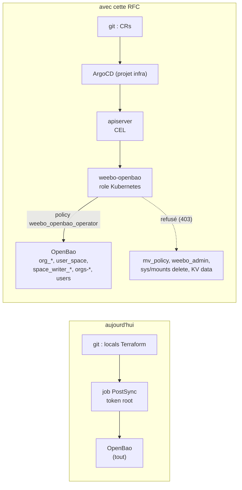
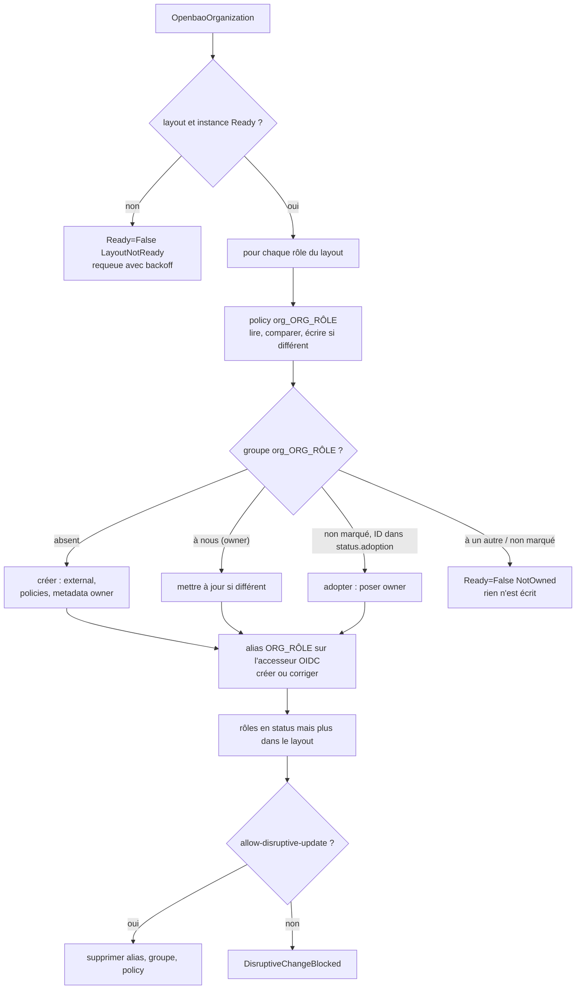
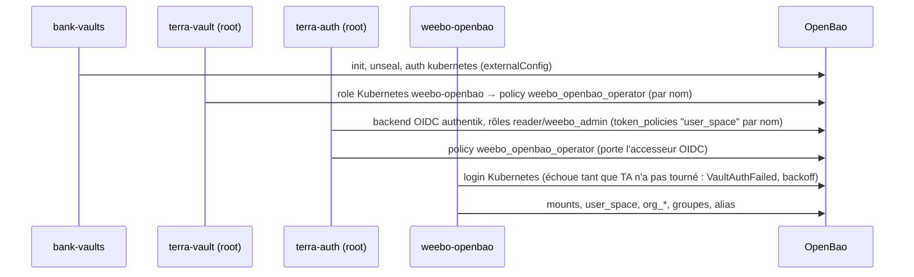
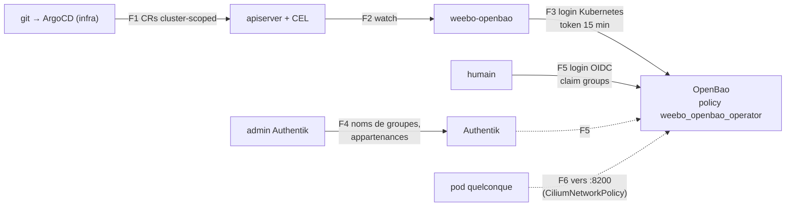

# RFC 0007 — Les espaces OpenBao en CRs : l'opérateur weebo-openbao

| Champ      | Valeur |
| ---------- | ------ |
| Statut     | Draft |
| Court      | Espaces OpenBao déclaratifs |
| Tranche    | Qui crée les mounts, policies, groupes et alias des espaces humains d'OpenBao, avec quels droits Vault, et comment on reprend ce que Terraform a posé sans rien recréer |
| Auteur     | Max Batleforc <maxleriche.60@gmail.com> |
| Co-auteur  | Claude Opus 5.5 |
| Créée      | 2026-11-06 |
| Remplace   | — |
| Touche     | `weebo-openbao` (nouveau dépôt), weebo-operator-kit, dans weebo-si : `2.terra/vault/terra-map/{spaces,forgejo,auth-base}.tf`, `2.terra/auth/terra-map/{vault,vault-spaces}.tf`, les deux `kustomization.yaml`, `2.argo/helm/vault/sub/values.yaml` (NetworkPolicy), `2.argo/app/values.yaml` (AppProject), un chart à ajouter sous `2.argo/helm`, `0.docs/content/docs/Infra/openbao.mdx` |
| Risque     | high (§7) |

> Document de référence (~8 900 mots avec le code) : §1 à §3, §7.1 et §15
> suffisent pour décider. Le reste sert à construire et à relire.

---

## 1. Résumé

Les espaces humains d'OpenBao (`users/<username>/…` et
`orgs-<env>/<org>/<repo>/…`, doc dans `Infra/openbao.mdx`, section « Espaces
humains ») sont décrits aujourd'hui par deux fichiers Terraform non commités :
`2.terra/vault/terra-map/spaces.tf` (les cinq mounts KV v2) et
`2.terra/auth/terra-map/vault-spaces.tf` (la policy templatée `user_space`, et
pour chaque couple `<org>_<rôle>` une policy, un groupe d'identité externe et
un alias). Ajouter une organisation, c'est éditer une liste `locals` et
attendre un job PostSync qui `apply` avec le token root.

Cette RFC remplace ce Terraform par un opérateur, **weebo-openbao**, bâti sur
weebo-operator-kit, et trois CRs cluster-scoped :

- `OpenbaoInstance` : la connexion à OpenBao et les bornes de nommage ;
- `OpenbaoSpaceLayout` : la configuration commune, c'est-à-dire les
  environnements (donc les mounts), les niveaux, la matrice rôle → env →
  niveau, l'espace utilisateur et les écrivains délégués (forgejo sur
  `users/+/forgejo-token`) ;
- `OpenbaoOrganization` : une organisation, rien d'autre que son nom côté
  Forgejo/Authentik.

L'opérateur ne lit ni n'écrit aucun secret des espaces. Il ne gère que des
objets de configuration Vault, sous des préfixes réservés que sa propre policy
Vault, posée par Terraform, est seule à borner. Il ne désactive jamais un
mount.

### Avant / après

```text
# aujourd'hui : 2.terra/auth/terra-map/vault-spaces.tf
locals {
  vault_orgs = ["batleforc-org"]
  vault_org_roles = { owner = {...}, maintainer = {...}, dev = {...} }
}
# + un job PostSync, token root, terraform apply

# avec cette RFC : un fichier par org, dans le chart des espaces
apiVersion: openbao.weebo.io/v1alpha1
kind: OpenbaoOrganization
metadata:
  name: batleforc-org
spec:
  layoutRef: { name: weebo }
  name: batleforc-org          # nom côté service (Forgejo, Authentik)
```



Le chemin du bas montre ce qui change en sécurité : la main qui écrit n'a plus
le token root, et les écritures hors des préfixes réservés sont refusées par
OpenBao lui-même, pas par l'opérateur.

---

## 2. Motivation

1. **Ajouter une organisation est un acte d'administrateur Terraform.** Il
   faut éditer `vault_orgs` (`vault-spaces.tf`), committer, et le job
   `terra-job-*` applique avec le token root lu dans `openbao-unseal-keys`
   (`2.terra/vault/job.yaml`, `main.tf` : `file("/var/run/vault/vault-root")`).
   Le geste le plus fréquent des espaces passe par le privilège le plus large
   du cluster.
2. **La configuration des espaces est dispersée entre deux workspaces
   Terraform qui se référencent.** Les mounts sont dans `2.terra/vault`, les
   policies dans `2.terra/auth`, et la liste des envs est recopiée à la main
   (« Same list as vault_org_roles », `spaces.tf`). `forgejo.tf` lit
   `vault_mount.users.path`, et `vault.tf` lit `vault_policy.user_space.name`.
   Retirer un de ces blocs casse l'autre workspace, ou planifie une
   suppression.
3. **Terraform ne dit rien quand ça casse.** Un `apply` raté laisse un job en
   échec, sans condition par organisation, sans métrique, sans Event. Un alias
   qui ne correspond plus à aucun groupe Authentik (renommage) ne se voit nulle
   part.
4. **Le motif « opérateur + CR » existe déjà et a fait ses preuves.**
   weebo-authentik (migration achevée le 2026-09-04), weebo-forgejo et
   weebo-angos partagent le kit, ses conditions, ses Events, ses métriques et
   son importeur. Les espaces sont le dernier bloc de configuration humaine
   d'OpenBao qui n'en profite pas.

---

## 3. Objectifs / non-objectifs

**Objectifs**

- Déclarer une organisation par une CR, sans toucher à Terraform.
- Garder la matrice rôle → env → niveau comme configuration, en un seul
  endroit, et la changer sans réécrire de HCL.
- Donner à l'opérateur le minimum de droits Vault, bornés par la policy Vault
  et non par son code.
- Reprendre les objets existants sans en recréer aucun : mêmes IDs de groupes
  et d'alias, même nombre d'objets avant et après.
- Rendre chaque échec visible : condition, Event, log `info`/`warn`, métrique.
- Ne pas ajouter de dépendance au redémarrage du cluster.

**Non-objectifs**

- **Gérer le backend OIDC `authentik` et ses rôles** (`vault.tf`). Ils dérivent
  du `client_secret` du provider Authentik, que Terraform lit directement. La
  migration Authentik les a déjà laissés en Terraform pour cette raison.
- **Lire, écrire ou supprimer des secrets dans `users` et `orgs-*`.** Les
  secrets appartiennent aux humains. L'opérateur n'a aucun droit sur
  `<mount>/data/*`, et c'est voulu (§7.2).
- **Désactiver un mount.** C'est une perte de données irréversible. Elle reste
  un geste manuel (`bao secrets disable`).
- **Déclarer les repos.** La policy utilise `+` pour le segment repo, comme
  aujourd'hui. Une liste de repos dans la CR devrait suivre Forgejo, et un
  retard bloquerait des écritures légitimes. Des rôles par repo seraient une
  autre RFC.
- **Créer les groupes Authentik.** Ils restent des `AuthentikGroup` dans
  `2.argo/helm/auth/sub/values.yaml`. L'opérateur vérifie leur existence et le
  signale (§4.3). Les générer est la question ouverte 6.
- **Des CRs namespacées, en libre-service pour les équipes.** Une organisation
  accorde des droits sur un mount partagé. La déclarer doit rester un geste
  d'administrateur (§7.2).
- **Resserrer `mv_policy`.** La policy du rôle `auth` (`auth-base.tf`) donne à
  l'opérateur Authentik `identity/*` et `sys/policies/acl/*` avec `sudo`. C'est
  un problème plus large que celui-ci, voir la question ouverte 9.

---

## 4. Conception côté utilisateur

### 4.1 Configuration

Les trois CRs, telles qu'elles reproduisent exactement le Terraform actuel :

```yaml
apiVersion: openbao.weebo.io/v1alpha1
kind: OpenbaoInstance
metadata:
  name: main
spec:
  address: https://openbao.vault:8200
  tls:
    caSecretRef: { namespace: vault, name: openbao-tls, key: ca.crt }
  auth:
    kubernetes: { mount: kubernetes, role: weebo-openbao }
  oidcMount: authentik            # l'accesseur est lu dans sys/auth
  bounds:                         # miroir de la policy Vault, voir 4.2
    mountPrefix: orgs-
    usersMount: users
    policyPrefix: org_
    writerPolicyPrefix: space_writer_
    usersPolicy: user_space
---
apiVersion: openbao.weebo.io/v1alpha1
kind: OpenbaoSpaceLayout
metadata:
  name: weebo
spec:
  instanceRef: { name: main }
  environments: [prod, preprod, recette, devenv]   # mounts orgs-<env>
  levels:
    read:  { data: [read],                          metadata: [read, list] }
    write: { data: [create, read, update, patch],   metadata: [read, list] }
    owner: { data: [create, read, update, patch, delete],
             metadata: [read, list, delete], versions: true }
  roles:
    owner:      { prod: owner, preprod: owner, recette: owner, devenv: owner }
    maintainer: { prod: write, preprod: write, recette: write, devenv: write }
    dev:        { preprod: read, recette: write, devenv: write }
  users:
    aliasMetadataKey: username     # claim_mappings preferred_username→username
  delegatedWriters:
    - name: forgejo                # policy space_writer_forgejo
      leaf: forgejo-token          # users/+/forgejo-token, rien d'autre
---
apiVersion: openbao.weebo.io/v1alpha1
kind: OpenbaoOrganization
metadata:
  name: batleforc-org
spec:
  layoutRef: { name: weebo }
  name: batleforc-org
  # aliasNames: { owner: batleforc-org_owner }   # par défaut <name>_<rôle>
```

- **Absent ≠ vide, partout où ça supprime quelque chose.** Un rôle absent de
  `roles` n'a pas d'objets, et le retirer les supprime (§4.2). Un rôle présent
  avec `{}` a un groupe et un alias, mais une policy sans aucun chemin : ses
  membres ne peuvent rien. C'est le cas de `reader` aujourd'hui, à ceci près
  que `reader` n'a même pas de groupe, donc on ne le déclare pas.
- `versions: true` ajoute les chemins `delete`, `undelete` et `destroy` en
  `update`, exactement comme le bloc `level != "owner"` de `vault-spaces.tf`.
- `aliasNames` est vide par défaut : l'alias vaut `<spec.name>_<rôle>`, le nom
  du groupe Authentik. Le champ ne sert qu'à suivre un groupe Authentik
  renommé (§7.2).
- `delegatedWriters` est vide par défaut. Un écrivain n'obtient qu'une policy :
  le lien avec un rôle Kubernetes reste dans Terraform (§6.4).
- **Défauts de sécurité.** `bounds` vaut par défaut exactement ce que la
  policy de bootstrap autorise. Le champ ne peut pas élargir les droits, il
  rend seulement un refus lisible avant tout appel. `OpenbaoInstance` n'a pas
  d'option `insecureSkipVerify`.

### 4.2 Règles de comportement

- **Création, toujours dans cet ordre : policy, groupe, alias.** L'accès
  n'existe que par l'alias. Il n'apparaît donc que quand le groupe et sa
  policy sont en place.
- **Suppression, toujours dans l'ordre inverse : alias, groupe, policy.** Le
  premier appel coupe l'accès. Si l'opérateur s'arrête au milieu, ce qui reste
  n'accorde rien.
- **Organisation supprimée** (finalizer `openbao.weebo.io/cleanup`) : ses
  alias, groupes et policies disparaissent. **Ses secrets restent** dans
  `orgs-<env>/<org>/`, que l'opérateur ne peut ni lire ni effacer. Un Event
  `Normal` le dit (« 4 mounts gardent orgs-*/batleforc-org/ »). Recréer la CR
  rend l'accès aux mêmes secrets. L'annotation du kit
  `openbao.weebo.io/force-orphan: "true"` libère le finalizer sans rien
  supprimer dans Vault.
- **Rôle retiré du layout** : ses objets sont supprimés dans toutes les
  organisations, mais **seulement si le layout porte
  `openbao.weebo.io/allow-disruptive-update: "true"`** (annotation du kit,
  `ALLOW_DISRUPTIVE_UPDATE`). Sans elle, le layout passe `Ready=False`, raison
  `DisruptiveChangeBlocked`, et rien n'est supprimé. C'est la leçon Authentik
  sur les listes : une `roles` vidée par erreur dans `values.yaml` ne doit pas
  couper l'accès de tout le monde.
- **Env retiré du layout** : les policies perdent les chemins de ce mount, ce
  qui ferme l'accès. **Le mount reste**, et le status du layout le liste dans
  `orphanedMounts` (advisory `MountOrphaned`).
- **Niveau changé** (`dev` passe de `read` à `write` en preprod) : seules les
  policies sont réécrites. Groupes et alias ne bougent pas.
- **Rien n'a changé** : l'opérateur lit, compare et n'écrit rien (RFC 0003).
  Le requeue est celui du kit, 5 min. En régime établi, le compteur
  d'écritures Vault reste plat (§10.1).
- **Dérive manuelle** : une policy `org_*` éditée à la main est réécrite au
  prochain passage. Un Event `Warning` `DriftCorrected` nomme l'objet. Les
  champs que la CR ne modélise pas ne sont pas envoyés. En particulier, la
  description d'un mount n'est posée qu'à la création et jamais comparée,
  pour ne pas se battre avec un `description` Terraform pendant la reprise.
- **Mount existant d'un autre type** (KV v1, ou autre moteur à `orgs-x`) :
  erreur dure `MountTypeMismatch`, aucune action. Le corriger demanderait un
  `disable`.

### 4.3 Validation

Refusé par l'apiserver (CEL dans le CRD, pas de webhook, voir §6.5) :

| Condition | Raison |
| --- | --- |
| `spec.name` d'une org hors `^[a-z0-9]([a-z0-9._-]{0,38}[a-z0-9])?$`, ou `.`/`..` | Il est interpolé dans du HCL et dans des chemins. La regex exclut `"`, `{`, `}`, `*`, `+`, `/`, les retours à la ligne et les majuscules (OpenBao compare les chemins à la casse près) |
| un nom de rôle hors `^[a-z]{1,16}$` | Sans `_` dans les rôles, `<org>_<rôle>` se découpe sans ambiguïté par la droite : `a_b` + `dev` ne peut pas rencontrer `a` + `b_dev` |
| un env hors `^[a-z]{1,16}$` | Il devient `orgs-<env>` |
| une cellule de la matrice qui nomme un niveau ou un env inconnu | Une faute de frappe accorderait « rien » en silence |
| une capacité hors `create, read, update, patch, delete, list` | `sudo`, `deny` et `subscribe` n'ont rien à faire dans un espace |
| `leaf` d'un écrivain hors `^[a-z0-9][a-z0-9._-]{0,62}$` | Pas de `/`, `+` ni `*` : un écrivain n'atteint qu'une feuille fixe par utilisateur, jamais `users/+/*` |
| `spec.name`, `layoutRef` ou `instanceRef` modifiés (`self == oldSelf`) | Renommer une org, c'est supprimer puis recréer, et donc couper l'accès. Il faut le faire exprès, avec une nouvelle CR |
| plus de 16 rôles, 8 envs, 8 niveaux ou 16 écrivains, ou `roles` vide (`minProperties: 1`) | Bornes de coût CEL, une policy reste lisible, et un `roles: {}` rendu par erreur ne peut pas atteindre l'opérateur |

Avertissements, et où on les voit :

| Condition | Comportement | Visible dans |
| --- | --- | --- |
| aucun `AuthentikGroup` n'a `spec.name` égal à un alias | l'alias est créé quand même : un groupe fait dans l'UI Authentik est légitime | advisory `AuthentikGroupUnknown` sur l'org, Event `Warning`, log `warn` |
| le rôle OIDC `reader` n'a pas `claim_mappings.preferred_username = <aliasMetadataKey>` | `user_space` est posée quand même. Vault laisse tomber le chemin templaté, donc personne n'a d'espace (fermé) | advisory `UserClaimMappingMissing` sur le layout |
| un mount `orgs-<env>` n'est plus dans `environments` | rien n'est supprimé | `status.orphanedMounts`, advisory `MountOrphaned` |
| deux orgs avec le même `spec.name` | la seconde n'écrit rien | `Ready=False`, raison `Conflict`, sur la seconde |

### 4.4 Surface d'API

Aucune API HTTP nouvelle. La surface est celle des trois CRDs (§4.1), plus
l'endpoint `/metrics` et les sondes du kit, sans authentification, sur le port
interne du pod comme chez les opérateurs frères.

---

## 5. Architecture

### 5.1 Ce que chaque couche fait

Même découpage hexagonal que weebo-forgejo (`crates/domain`, `api`,
`application`, `adapters-inbound`, `adapters-outbound`, `operator`, `crdgen`,
`importer`, `testkit`), généré par `cargo generate … templates/operator` du
kit :

- `domain` : le rendu des policies, pur et déterministe. Il prend
  `(layout, org, rôle, accesseur)` et rend un texte HCL. C'est le seul endroit
  qui écrit du HCL, et il n'interpole que des valeurs déjà validées.
- `application` : les use-cases `reconcile_layout`, `reconcile_organization`
  et `import`, sur un port `SpaceAdmin` (mounts, policies, groupes, alias).
- `adapters-outbound` : `OpenbaoSpaceAdmin`, sur `vaultrs` 0.8, la même
  dépendance que `weebo-kit-adapters::secret_vault`, avec la même connexion
  (login Kubernetes du kit, `VaultLogins`, `caSecretRef`, `REQUEST_TIMEOUT`
  de 30 s). Deux détails de `vaultrs` 0.8 comptent pour la policy :
  `sys::policy::set` frappe le chemin historique `sys/policy/<name>` (et non
  `sys/policies/acl/<name>`), et la recherche d'alias n'existe que par ID
  (`identity::group_alias::read_by_id`). L'adaptateur appelle donc
  `sys/policies/acl/*` lui-même, pour que la policy de l'opérateur n'ait
  qu'une surface, et il retrouve l'alias par la lecture du groupe par nom, qui
  le contient.
- `weebo-kit-*` sans changement, sauf le multi-mount des `secretTargets`
  (`SecretTarget.mount`, `VaultAdditionalMount`), en cours d'ajout au kit, dont
  cette RFC ne se sert que côté weebo-forgejo (§6.4).

### 5.2 La réconciliation d'une organisation



L'invariant : **parce qu'un alias n'est créé qu'après son groupe et sa policy,
et supprimé avant eux, aucun état intermédiaire n'accorde plus que l'état
déclaré.** Un arrêt à n'importe quelle flèche laisse moins d'accès, jamais
plus.

### 5.3 La propriété d'un objet Vault

Les objets Vault n'ont pas de propriétaire, et `create_or_update_by_name`
écrase n'importe quel groupe. L'opérateur pose donc une marque et la vérifie
avant toute écriture :

- **groupe** : `metadata = { managed-by = "weebo-openbao", owner =
  "OpenbaoOrganization/<metadata.name>" }` ;
- **policy** : une première ligne `# managed-by: weebo-openbao owner:
  OpenbaoOrganization/<metadata.name>` ;
- **alias** : pas de métadonnées utiles. L'alias appartient à qui possède le
  groupe vers lequel pointe son `canonical_id` ;
- **mount** : pas de marque. Un mount est identifié par son chemin, et
  l'opérateur ne fait que le créer (§4.2).

La marque est `<kind>/<name>`, pas l'UID de la CR. Après une reconstruction
du cluster et une restauration du snapshot raft, les CRs reviennent avec de
nouveaux UIDs mais les mêmes noms, et l'opérateur retrouve ses objets sans
rien adopter. L'unicité tient au fait que les CRs sont cluster-scoped : deux
CRs ne peuvent pas porter le même nom.

### 5.4 Amorçage et ordre de démarrage



Le diagramme montre qu'il n'y a pas de cycle. OpenBao accepte un
`token_policies` qui nomme une policy inexistante. Le rôle `reader` peut donc
référencer `user_space` avant que l'opérateur l'ait créée : un utilisateur qui
se connecte entre-temps n'a simplement pas d'espace (fermé). La policy de
l'opérateur dépend de l'accesseur OIDC, d'où sa place dans `2.terra/auth`. Le
rôle Kubernetes qui la référence par nom reste dans `2.terra/vault`, à côté
des autres (`auth-base.tf`).

---

## 6. Conception détaillée

### 6.1 La policy de l'opérateur (Terraform, à vie)

L'opérateur ne peut pas s'accorder ses propres droits, et c'est le but. Sa
policy reste dans Terraform, dans `2.terra/auth/terra-map/vault-spaces.tf`.
Le fichier ne garde plus que ce bloc :

```hcl
resource "vault_policy" "weebo_openbao_operator" {
  name   = "weebo_openbao_operator"
  policy = <<EOT
# Découverte : l'accesseur OIDC, l'état des mounts, le claim_mappings.
path "sys/auth"              { capabilities = ["read"] }
path "sys/mounts"            { capabilities = ["read"] }
path "auth/authentik/role/*" { capabilities = ["read"] }

# Mounts des espaces : créer et régler, jamais désactiver (pas de delete).
path "sys/mounts/users"  { capabilities = ["create", "read", "update"] }
path "sys/mounts/orgs-*" { capabilities = ["create", "read", "update"] }

# Policies des espaces, et elles seules.
path "sys/policies/acl"                { capabilities = ["list"] }
path "sys/policies/acl/user_space"     { capabilities = ["create", "read", "update", "delete"] }
path "sys/policies/acl/org_*"          { capabilities = ["create", "read", "update", "delete"] }
path "sys/policies/acl/space_writer_*" { capabilities = ["create", "read", "update", "delete"] }

# Groupes externes des espaces, qui ne portent que des policies org_*.
path "identity/group/name"   { capabilities = ["list"] }
path "identity/group/name/org_*" {
  capabilities       = ["create", "read", "update", "delete"]
  allowed_parameters = {
    "type"     = ["external"]
    "policies" = ["org_*"]
    "metadata" = []
  }
}

# Alias, bornés à l'accesseur OIDC. canonical_id ne se borne pas : §7.1 T1.
path "identity/group-alias" {
  capabilities       = ["create", "update"]
  allowed_parameters = {
    "name"           = []
    "mount_accessor" = ["${local.vault_oidc_accessor}"]
    "canonical_id"   = []
  }
}
path "identity/group-alias/id" { capabilities = ["list"] }
path "identity/group-alias/id/*" {
  capabilities       = ["read", "update", "delete"]
  allowed_parameters = {
    "name"           = []
    "mount_accessor" = ["${local.vault_oidc_accessor}"]
    "canonical_id"   = []
  }
}
EOT
}
```

Ce que cette policy refuse, et que §6.P vérifie un par un :

- aucun `<mount>/data/*` ni `<mount>/metadata/*` : pas un secret lisible ;
- aucun `delete` sur `sys/mounts/*`, ni `sys/remount` : pas de perte de
  données ;
- aucune policy hors `user_space`, `org_*` et `space_writer_*` : ni
  `weebo_admin`, ni `mv_policy`, ni `forgejo_operator_policy` ;
- `type = internal` refusé : un groupe interne prend des membres, un groupe
  externe ne tient que par son alias ;
- `policies = ["weebo_admin"]` sur un groupe `org_*` refusé ;
- aucun `sudo`, aucun `auth/*` en écriture, aucun `sys/auth/*`.

Le rôle Kubernetes, dans `2.terra/vault/terra-map/auth-base.tf` :

```hcl
resource "vault_kubernetes_auth_backend_role" "weebo-openbao" {
  role_name                        = "weebo-openbao"
  bound_service_account_names      = ["weebo-openbao"]
  bound_service_account_namespaces = ["weebo-openbao"]
  token_ttl                        = 900
  token_policies                   = ["weebo_openbao_operator"]
}
```

`token_ttl` vaut 15 min, contre 1 h pour les autres rôles : un token volé
expire vite, et le kit se reconnecte de lui-même (`with_relogin`).

### 6.2 Le rendu des policies

Pour `batleforc-org`, rôle `dev`, le domaine rend exactement le contenu actuel
de `vault_policy.org["batleforc-org_dev"]`, plus la ligne de marque :

```hcl
# managed-by: weebo-openbao owner: OpenbaoOrganization/batleforc-org
path "orgs-preprod/data/batleforc-org/+/*" { capabilities = ["read"] }
path "orgs-preprod/metadata/batleforc-org/*" { capabilities = ["read", "list"] }
path "orgs-recette/data/batleforc-org/+/*" { capabilities = ["create", "read", "update", "patch"] }
...
```

La comparaison avant écriture porte sur un texte normalisé (lignes triées par
mount puis par sous-chemin, espaces réduits). Un `bao policy read` renvoie
exactement le texte écrit, donc la normalisation ne sert qu'à absorber la
première réécriture d'une policy Terraform lors de la reprise. `user_space` se
rend à partir de l'accesseur lu dans `sys/auth` et de
`users.aliasMetadataKey`, comme le `heredoc` actuel.

### 6.3 Status et conditions

```yaml
status:
  observedGeneration: 3
  conditions:
    - type: Ready
      status: "True"
      reason: Synced
  roles:
    - role: owner
      policy: org_batleforc-org_owner
      groupId: 4f1c…            # ID Vault, stable
      aliasId: 9a07…
      aliasName: batleforc-org_owner
  adoption: []                  # rempli par l'importeur seulement (§13)
```

Raisons (`reason_codes!` du kit, une par variante, avec sa doc qui part dans le
site) : `Synced`, `VaultUnavailable`, `VaultSealed`, `VaultAuthFailed`,
`PermissionDenied`, `OutOfBounds`, `NotOwned`, `Conflict`, `AliasConflict`,
`MountTypeMismatch`, `LayoutNotReady`, `DisruptiveChangeBlocked`. Advisories :
`AuthentikGroupUnknown`, `UserClaimMappingMissing`, `MountOrphaned`,
`DriftCorrected`. `PermissionDenied` (un 403 avec un token valide, distingué
par `token_is_stale` du kit) n'est jamais réessayé en boucle serrée. Il veut
dire que la policy de bootstrap et `bounds` ne sont plus d'accord.

Le layout porte `status.mounts[]` (`path`, `accessor`, `adopted`),
`status.usersPolicy`, `status.writers[]` et `status.orphanedMounts[]`.

### 6.4 Les écrivains délégués

`delegatedWriters: [{name: forgejo, leaf: forgejo-token}]` produit
`space_writer_forgejo` :

```hcl
# managed-by: weebo-openbao owner: OpenbaoSpaceLayout/weebo
path "users/data/+/forgejo-token"     { capabilities = ["create", "read", "update", "delete"] }
path "users/metadata/+/forgejo-token" { capabilities = ["create", "read", "update", "delete"] }
```

C'est mot pour mot le bloc ajouté à `forgejo_operator_policy` dans
`forgejo.tf`, qui en sort. Le rôle `forgejo-operator` (Terraform) gagne
`"space_writer_forgejo"` dans `token_policies`, par nom. L'opérateur ne touche
jamais à un rôle d'authentification.

Côté weebo-forgejo, l'instance ouvre le mount avec la capacité multi-mount du
kit : `additionalMounts: [{mount: users, pathGrants: [{namespaces: […],
paths: ["+/forgejo-token"]}]}]`. Deux bornes indépendantes tiennent donc :
la policy Vault rendue ici, et les `pathGrants` du kit côté forgejo.

### 6.5 Pourquoi CEL et pas un webhook d'admission

Toutes les règles de §4.3 portent sur un seul objet, CEL suffit. Le
seul contrôle qui touche à plusieurs objets (deux orgs avec le même
`spec.name`) est fait par la marque de propriété (§5.3) au moment d'écrire.
Sans webhook, l'opérateur ne met aucun pod dans le chemin d'admission
d'aucun objet. Son absence ne bloque la création de rien, et il n'ajoute rien
au cycle kyverno ↔ vault-webhook du démarrage.

### 6.6 RBAC Kubernetes et déploiement

- Namespace `weebo-openbao`, un réplica, élection de leader du kit (deux
  réplicas possibles plus tard, sans changement de design).
- ClusterRole de l'opérateur : `get/list/watch` sur ses trois kinds,
  `update/patch` sur leur `status` et leurs finalizers, `create` d'Events,
  `get` du Secret `vault/openbao-tls` (via `resourceNames`), `list/watch` de
  `authentikgroups.authentik.weebo.io` pour l'advisory. Rien d'autre.
- Les trois kinds rejoignent le `clusterResourceWhitelist` du projet `infra`
  (`2.argo/app/values.yaml`), **et de lui seul**. Aucun ClusterRole livré ne
  porte les labels `rbac.authorization.k8s.io/aggregate-to-*`.
- `weebo-openbao` rejoint `networkPolicy.allowedNamespaces` de
  `2.argo/helm/vault/sub/values.yaml`. Sans ça, la CiliumNetworkPolicy
  d'OpenBao rejette la connexion, et on voit un `VaultUnavailable` qui ne dit
  pas pourquoi.
- Le pod ne porte aucune variable `vault:` : le webhook bank-vaults ne le
  mute pas. Il lit sa CA par `caSecretRef`, comme weebo-authentik.

### 6.P Preuve avec un vrai client

Clients : `bao` 2.7.1 (le CLI d'OpenBao, la même version que le serveur,
`vaultInstance.version` dans `2.argo/helm/vault/sub/values.yaml`), l'UI
OpenBao, `kubectl` 1.36 par `task k --`. Les observations 2 à 4 et 8 se
rejouent aussi dans `task test:live-openbao` du nouveau dépôt, contre un
OpenBao 2.7.1 jetable en podman. Les autres sont une preuve d'exploitation
sur le lab.

1. **Les espaces existent-ils en live ?** `spaces.tf` et `vault-spaces.tf`
   ne sont pas commités, et le job PostSync ne voit que le ConfigMap rendu
   depuis git. `bao secrets list | grep -E '^(users|orgs-)'` et
   `terraform state list | grep -E 'vault_(mount|policy|identity)'` sur les
   PVC `terra-job-vault` et `terra-job-authentik`. Le résultat choisit la
   branche de §13 : rien en live, rien à reprendre.
2. **Refus de la policy de bootstrap.** Avec un token `weebo_openbao_operator`
   (`bao token create -policy=weebo_openbao_operator -ttl=10m`, en root) :
   `bao policy write mv_policy -`, `bao secrets disable orgs-prod`,
   `bao kv get orgs-prod/batleforc-org/weebo-si/x`,
   `bao write identity/group/name/org_x type=internal`,
   `bao write identity/group/name/org_x type=external policies=weebo_admin`.
   Chacun doit répondre `Code: 403. Errors: * permission denied`, et
   `bao secrets list`, `bao policy list` et `bao read identity/group/name/org_x`
   doivent rester inchangés. À vérifier au passage sur 2.7.1 : que
   `allowed_parameters` contrôle bien **chaque élément** de la liste
   `policies` contre le glob `org_*`, et que `sys/mounts/orgs-*` en `create`
   n'exige pas `sudo`. Si l'un des deux ne tient pas, T2 change de forme (§7.1).
3. **Succès de la policy de bootstrap.** Le même token crée `orgs-test`,
   `org_test_dev`, le groupe et l'alias, puis les supprime. Le mount reste
   (`bao secrets disable` refusé, cf. 2).
4. **Parité du rendu.** `bao policy read org_batleforc-org_dev` (version
   Terraform) diffère du rendu de l'opérateur par la seule ligne de marque,
   après normalisation. Test unitaire sur la fixture, plus ce diff en live.
5. **Reprise sans recréation** (branche B de §13). Avant/après :
   `bao policy list | grep -c '^org_'` (3),
   `bao list identity/group/name | grep -c '^org_'` (3), le nombre d'alias de
   l'accesseur OIDC, et pour chaque groupe
   `bao read -field=id identity/group/name/org_batleforc-org_owner`, plus son
   `alias.id`. **Les IDs sont identiques** : c'est la preuve qu'il y a eu
   adoption et pas création. L'apply Terraform qui suit le commit doit
   afficher `0 to destroy`.
6. **Un humain, au travers du vrai login.** Un compte membre de
   `batleforc-org_dev` seul : `bao login -method=oidc -path=authentik`, puis
   `bao kv put orgs-devenv/batleforc-org/weebo-si/x a=b` (succès),
   `bao kv get orgs-preprod/batleforc-org/weebo-si/x` (succès),
   `bao kv put orgs-preprod/…` (403), `bao kv get orgs-prod/…` (403),
   `bao kv put users/<moi>/a b=c` (succès), `bao kv get users/<autre>/a` (403).
7. **Écrivain délégué.** Un token `space_writer_forgejo` :
   `bao kv put users/alice/forgejo-token t=1` (succès),
   `bao kv put users/alice/autre t=1` (403), `bao kv get users/alice/autre` (403).
8. **Refus de l'opérateur.** Une seconde `OpenbaoOrganization`
   `spec.name: batleforc-org` passe `Ready=False`, `Conflict`, et le compteur
   `weebo_openbao_vault_writes_total` ne bouge pas. Un layout dont on retire
   `dev` sans l'annotation passe `DisruptiveChangeBlocked`, et le nombre
   d'alias ne bouge pas.
9. **Suppression.** Supprimer la CR de test `orgs-test` : l'alias disparaît le
   premier (`bao read identity/group-alias/id/<id>` en 404 avant le groupe),
   et un `bao kv get` du membre, avec un token émis **avant** la suppression,
   échoue en 403. C'est ce qui montre que les policies d'identité se résolvent
   à chaque requête. Les secrets de `orgs-devenv/test/` sont toujours là pour
   le root.
10. **Scellé.** Sur l'instance jetable : `bao operator seal`. Les CRs passent
    `VaultSealed` en moins d'un cycle, aucune écriture n'est tentée, un log
    `warn` par CR et par backoff. Après `unseal`, `Ready=True` sans aucune
    écriture (rien n'avait changé).
11. **Calme.** Une heure après `Ready`, `weebo_openbao_vault_writes_total` est
    identique : aucune réécriture en régime établi.

**Délibérément non touché**, pour que la revue n'aille pas le chercher :

- `2.terra/auth/terra-map/vault.tf` : backend OIDC, rôles `reader` et
  `weebo_admin`, groupes `reader` et `weebo_admin` et leurs alias. Seul
  `token_policies = [vault_policy.user_space.name]` devient le littéral
  `["user_space"]`.
- `2.terra/vault/terra-map/auth-base.tf` : `mv_policy` et les rôles
  existants. Le rôle `weebo-openbao` s'ajoute à côté.
- `2.argo/helm/vault/sub/templates/vaultInstance/instance.yaml` :
  `externalConfig` de bank-vaults inchangé, sans `purgeUnmanagedConfig`.
- Le mount `mv` et tout ce qui y écrit (ESO, opérateurs authentik et forgejo).

---

## 7. Sécurité

**Note :** high. L'opérateur écrit des policies et des alias d'identité dans
OpenBao, le coffre de tout le lab. La policy de bootstrap empêche d'écraser
ce qui existe, mais **elle ne borne pas ce que contient une policy `org_*`
qu'il écrit, ni le groupe vers lequel pointe un alias qu'il crée**. Un
opérateur compromis vaut un OpenBao compromis (T1, T2).

### 7.1 Modèle de menace

Actifs : les secrets des espaces, l'intégrité des policies d'OpenBao (dont
`weebo_admin`, `path "*"`), la disponibilité de l'accès humain, le token Vault
de l'opérateur.

Acteurs : un auteur de manifeste dans git (ArgoCD, projet `infra`), un
administrateur du cluster, un administrateur Authentik, un membre d'un groupe
`<org>_<rôle>`, un pod quelconque, l'opérateur s'il est compromis.



| # | Menace (STRIDE) | Où | Mitigation | Risque résiduel |
| --- | --- | --- | --- | --- |
| T1 | Élévation : un alias créé ou modifié vers le groupe `weebo_admin` (`path "*"`) | F3 | `allowed_parameters` borne `mount_accessor`, pas `canonical_id`. OpenBao ne sait pas le borner. Côté code, l'alias ne vise qu'un `groupId` lu dans `status.roles` d'un groupe marqué `owner` (test `alias_never_targets_unowned_group`) | **Entier si l'opérateur est compromis**. Même chose pour `delete` sur l'alias de `weebo_admin` (déni d'accès admin, réparable en root). À accepter par Max, ou à fermer par un namespace OpenBao (question 1) |
| T2 | Élévation : une policy `org_*` écrite avec `path "*"` | F3 | Rendu dans `domain` à partir d'un gabarit fermé : chaque `path` commence par `orgs-<env>/` ou `users/`, prouvé par un test de propriété sur des entrées arbitraires (`rendered_paths_stay_in_spaces`) et par une fuzz target sur la validation des noms | Comme T1 : OpenBao ne borne pas le contenu d'une policy. Un code compromis contourne le test |
| T3 | Élévation par la CR : quelqu'un déclare une org pour s'octroyer des droits | F1 | Kinds cluster-scoped, dans le seul projet `infra`, sans agrégation. Une org ne donne de droits que sous `orgs-*/<son nom>/`, et seulement aux membres d'un groupe Authentik de ce nom | Il faut à la fois écrire dans git (infra) et être admin Authentik. Accepté |
| T4 | Altération : injection HCL ou chemin par `spec.name`, un rôle ou une `leaf` | F1 → F3 | Regex CEL de §4.3 (pas de `"`, `{`, `}`, `*`, `+`, `/`, `\n`). Le domaine revalide avant le rendu (`Failure` si la CR vient d'un schéma plus ancien) | Aucun connu |
| T5 | Élévation : un groupe Authentik renommé **vers** `<org>_owner` | F4 | Hors de l'opérateur : c'est un geste d'admin Authentik. L'advisory `AuthentikGroupUnknown` signale le cas inverse | Un admin Authentik est déjà, par construction, maître des espaces. Accepté |
| T6 | Déni de service : un groupe Authentik renommé **depuis** `<org>_owner` coupe l'accès | F4 → F5 | Advisory `AuthentikGroupUnknown` sur l'org dès que l'`AuthentikGroup` change de `spec.name`. Réparation par `aliasNames` (alias renommé en place, même ID) | Fermé, donc sûr. La coupure dure jusqu'au correctif |
| T7 | Fuite : recyclage d'un username. Un nouveau compte reprend `preferred_username` d'un ancien et lit `users/<nom>/` | F5 | Aucune dans l'opérateur : `user_space` est templatée sur la métadonnée d'alias. Règle d'exploitation proposée : désactiver un compte Authentik, ne jamais le supprimer | **Ouvert**, question 3 |
| T8 | Usurpation : un autre pod se connecte avec le rôle `weebo-openbao` | F3 | `bound_service_account_names/namespaces` exacts. Personne d'autre que l'opérateur n'a `create` sur `serviceaccounts/token` dans `weebo-openbao` | Un admin du cluster. Accepté |
| T9 | Répudiation : qui a écrit une policy, et quand ? | F3 | Event Kubernetes et log `info` par écriture, avec l'objet et la CR (§10.1) | **OpenBao n'a pas de device d'audit** (`instance.yaml` n'en déclare aucun). Une écriture faite hors de l'opérateur avec son token ne laisse rien. Question 5 |
| T10 | Déni de service : l'opérateur supprime des objets en masse (bug, `roles` vidé) | F1 → F3 | `allow-disruptive-update` obligatoire pour retirer un rôle. `minProperties: 1` sur `roles`. Aucun `delete` de mount dans la policy | Une suppression de CR d'org reste immédiate. Les secrets restent, l'accès revient en recréant la CR |
| T11 | Altération : une policy hors préfixe écrasée par erreur (collision de noms) | F3 | Préfixes réservés dans la policy Vault (403) **et** marque `owner` (§5.3, `NotOwned`) | Aucun |

### 7.2 Authentification et autorisation

- L'opérateur s'authentifie à OpenBao avec son ServiceAccount, sans token
  statique (login Kubernetes du kit). Il n'a jamais le token root.
- Refus par défaut : un rôle absent n'a pas d'objets, une org absente n'a pas
  d'alias, une `user_space` dont la métadonnée manque laisse tomber le chemin
  templaté (commentaire de `vault-spaces.tf`).
- **Qui peut créer quelle CR.** Les trois kinds sont cluster-scoped. Seul le
  contrôleur ArgoCD du projet `infra` et `cluster-admin` peuvent les écrire.
  `OpenbaoInstance` et `OpenbaoSpaceLayout` décident de la forme de tous les
  espaces. `OpenbaoOrganization` n'ouvre qu'un sous-arbre de nom fixé.
  Contourner ce RBAC donne exactement ce que donne déjà l'écriture de
  `vault_orgs` dans Terraform, en moins : pas de token root.
- **Les références se font par le nom côté service** (leçon Authentik) :
  `spec.name` est le nom Forgejo/Authentik, l'alias est le nom du groupe
  Authentik. `metadata.name` ne sert qu'à la marque de propriété.
- Une policy d'identité se résout à chaque requête. Retirer un alias coupe
  donc l'accès des tokens déjà émis, sans attendre leur expiration (§6.P n°9).

### 7.3 Entrées et injection

- Les seules entrées interpolées dans du HCL sont `spec.name`, les noms de
  rôles et d'envs, les `leaf`, et l'accesseur lu dans `sys/auth`. Toutes
  passent par les regex de §4.3, appliquées par l'apiserver puis revalidées
  dans `domain`. Aucun texte libre de la CR n'atteint une policy.
- Les capacités viennent d'une énumération fermée. `sudo` et `deny` n'en font
  pas partie.
- Taille : au plus 16 rôles × 8 envs, soit 128 blocs `path` par org. Une
  policy reste sous 16 Kio.
- Les réponses d'OpenBao sont désérialisées par `vaultrs`. L'opérateur n'en
  tire que des IDs, des noms et des textes de policy, qu'il compare sans les
  évaluer.

### 7.4 Secrets et cryptographie

- Aucun secret nouveau. Le token Vault de l'opérateur vit en mémoire, dure
  15 min, et n'apparaît dans aucun log (le kit ne logge que mount et rôle,
  voir le message d'erreur de `VaultSecretStore::new`).
- TLS vérifié avec la CA de `openbao-tls`, lue par `caSecretRef`. Aucune
  option pour désactiver la vérification.
- L'opérateur ne lit aucun secret des espaces : la policy ne lui en donne pas
  les moyens (§6.P n°2).

### 7.5 Abus et épuisement des ressources

- Une org coûte 3 objets par rôle, soit 9 avec le layout actuel. Une CR
  hostile ne peut créer que ses propres objets, et seul `infra` crée des CRs.
- Les appels à OpenBao ont le délai de 30 s du kit, et les requeues ont un
  backoff plafonné. Un OpenBao scellé ou lent ne reçoit pas de rafale (§10.2).
- Aucune surface non authentifiée hors `/metrics` et des sondes, qui ne font
  aucun appel à OpenBao.

### 7.6 Défenses existantes qui tiennent toujours

- La CiliumNetworkPolicy d'OpenBao (`networkPolicy.allowedNamespaces`) : un
  namespace de plus, rien d'élargi.
- Le rôle OIDC `weebo_admin` reste lié par `bound_claims = { groups =
  "weebo_admin" }` (`vault.tf`).
- Les `pathGrants` du kit, qui bornent forgejo indépendamment de la policy
  `space_writer_forgejo`.
- Point de comparaison, pas de défense : l'opérateur Authentik tient déjà
  `identity/*` et `sys/policies/acl/*` en `sudo` par `mv_policy`. Le risque de
  T1 et T2 existe donc déjà dans le cluster, sur un workload moins borné que
  celui-ci.

---

## 8. Chaîne d'approvisionnement

| Dépendance / image / outil | Version | Pourquoi celle-ci | Licence | CVE connues (`task audit`) | Maintenance |
| --- | --- | --- | --- | --- | --- |
| weebo-operator-kit (`weebo-kit-*`) | le tag qui embarque le multi-mount | Maison : tout ce que les opérateurs frères partagent | celle du kit | `task audit` du kit vert à la release | Max |
| `vaultrs` | 0.8.0 (déjà dans `Cargo.lock` du kit) | Déjà utilisé par `secret_vault.rs`. Couvre `sys::mount`, `identity::group`, `identity::group_alias` | MIT | à relever par `cargo deny` à la création du dépôt | dépendance existante, aucun ajout |
| `kube`, `k8s-openapi` | ceux du kit (`kube` 4.0) | Règle du kit : mêmes versions que les opérateurs | Apache-2.0 | idem | idem |
| image de base | `registry.access.redhat.com/hi/rust` (builder) et `hi/core-runtime`, épinglées par digest | Les mêmes que weebo-angos (`Containerfile`) | Red Hat | `trivy` dans `task audit` | Renovate |
| image `ghcr.io/batleforc/weebo-openbao-operator` | nouvelle | Le produit de cette RFC | celle du dépôt | `trivy` à chaque release (`publish.yml` du kit) | Renovate dans weebo-si |
| chart `oci://ghcr.io/batleforc/charts/weebo-openbao` | nouveau | Sur `weebo-operator-lib`, comme les frères | celle du dépôt | `helm lint` (`checks.yml`) | Renovate |

- **Construction et release** : le template du kit, avec `Containerfile`,
  `Containerfile.static`, `checks.yml`, `publish.yml` épinglés par tag, et les
  hooks cocogitto. Aucune action CI nouvelle.
- **Mises à jour** : Renovate sur GitHub, seul outil de montée de version
  (mémoire « Dependency update automation »). Les pins weebo-si portent un
  commentaire `# renovate:` comme `vaultInstance.version`.
- **Retrait** : le provider Terraform `hashicorp/vault` 5.13.0 reste, car
  d'autres fichiers l'utilisent. Rien n'est retiré de la chaîne.

---

## 9. Données et vie privée

| Donnée | Personnelle ? | Où | Rétention | Qui la lit | Sort du cluster ? |
| --- | --- | --- | --- | --- | --- |
| noms d'orgs, de rôles, de groupes Authentik | non : des noms d'organisations | CRs, status, Events, logs, policies OpenBao | durée de vie de la CR. Events : 1 h (défaut apiserver). Logs : rétention ClickStack | admins du cluster, ClickStack | non |
| IDs de groupes et d'alias OpenBao | non | `status.roles` | durée de vie de la CR | admins du cluster | non |
| usernames | oui | **nulle part dans l'opérateur** : `user_space` est un gabarit, et l'opérateur ne voit jamais un username | — | — | — |
| secrets des espaces | potentiellement | OpenBao seul. L'opérateur n'y a pas accès | celle des humains | leurs propriétaires | non |

- Aucun label de métrique ne porte un nom d'org (§10.1) : cardinalité bornée,
  et rien d'identifiant.
- Le recyclage d'un username (T7) est un sujet de vie privée : un nouveau
  compte peut lire les secrets personnels d'un ancien. Il est traité en
  question 3, parce que la parade relève d'Authentik, pas de l'opérateur.
- L'effacement des données d'une personne (RGPD art. 17) reste
  `bao kv metadata delete users/<nom>/…`, en root, comme aujourd'hui.

---

## 10. Exploitation

### 10.1 Observabilité

- **Métriques** (préfixe `weebo_openbao`, `ReconcileMetrics` du kit) :
  `weebo_openbao_reconcile_total{kind, reason}` et
  `weebo_openbao_reconcile_duration_seconds{kind}`, plus un compteur propre :
  `weebo_openbao_vault_writes_total{object="mount|policy|group|alias",
  action="create|update|delete"}`. Pas de label par org.
- **Logs** : la leçon Authentik est appliquée. **Chaque écriture dans OpenBao
  est logguée en `info`** (objet, action, CR, ID), chaque échec en `warn` ou
  `error` avec la raison. Le texte des policies n'apparaît qu'en `debug`. Il
  n'est pas secret, mais il est verbeux.
- **Events** : un Event par changement de `Ready` (kit), un par suppression,
  un `Warning` par dérive corrigée, par refus `NotOwned` et par
  `DisruptiveChangeBlocked`.
- **Alertes** (ClickStack) :
  - `Ready=False` depuis 30 min sur une CR de l'opérateur : prévenir ;
  - n'importe quel `reason="PermissionDenied"` : prévenir tout de suite, car la
    policy de bootstrap a changé sous l'opérateur ;
  - `weebo_openbao_vault_writes_total` qui augmente pendant 1 h sans
    changement de génération : une boucle de réécriture (RFC 0003) ;
  - `action="delete"` : notifier, sans réveiller personne.

### 10.2 Modes de défaillance

| Défaillance | Détectée par | Comportement | Reprise |
| --- | --- | --- | --- |
| OpenBao scellé (503 sur `sys/health`) | réponse 503 de n'importe quel appel | Ready=False `VaultSealed`, aucune écriture, backoff jusqu'à 5 min. **Les espaces existants continuent de servir** dès le descellement, puisqu'ils vivent dans OpenBao, pas dans l'opérateur | automatique au descellement |
| OpenBao injoignable (NetworkPolicy, pod absent) | délai de 30 s | `VaultUnavailable`, idem | automatique |
| login refusé (rôle absent, policy de bootstrap pas encore appliquée) | 403 au login | `VaultAuthFailed` sur l'instance | faire tourner `terra-vault` puis `terra-auth` |
| policy de bootstrap rétrécie | 403 avec un token valide | `PermissionDenied`, pas de nouvel essai serré, alerte | réaligner Terraform et `bounds` |
| opérateur arrêté | sonde, absence de reconcile | **figé** : rien ne change dans OpenBao, l'accès humain continue. Une nouvelle org attend | redémarrer |
| suppression de CR pendant le scellement | finalizer | la CR reste `Terminating` | descellement, ou `force-orphan` |
| `purgeUnmanagedConfig` activé un jour sur bank-vaults | — | bank-vaults supprimerait les policies et mounts qu'il ne déclare pas, ceux de Terraform comme ceux de l'opérateur | ne pas l'activer. Noté dans la doc |
| reconstruction du cluster et restauration raft | — | les CRs reviennent sous les mêmes noms, la marque `<kind>/<name>` correspond, rien n'est adopté ni recréé | aucune |

Direction : **tout échec fige l'état, rien ne s'ouvre.** L'opérateur n'est
dans le chemin d'aucune requête de lecture ou d'écriture de secret, ni dans
celui d'aucune admission. Au démarrage du cluster, il attend OpenBao, mais
personne ne l'attend lui.

### 10.3 Performances et capacité

- Une org = 9 objets, ~6 appels en lecture par reconcile en régime établi
  (3 policies, 3 groupes avec leur alias), soit environ 1 700 lectures par
  jour pour une org, et zéro écriture. C'est à mesurer par `weebo-kit-perf`
  dans le budget hebdomadaire du dépôt, comme les frères.
- Mémoire : le budget `Budget::small_cluster()` du kit (cible des frères).
- OpenBao : les objets identité et policies vivent dans raft, quelques Kio
  par org. La croissance est négligeable.

---

## 11. Autres sujets

- **Accessibilité** : pas d'interface. Le site de doc du dépôt suit
  `@weebo/operator-docs`, comme les frères.
- **Internationalisation** : pas de chaîne affichée aux utilisateurs finaux.
  Les messages de condition sont en anglais, comme dans les autres
  opérateurs. La doc weebo-si est en français.
- **Conformité** : touche la gestion des accès (ISO 27001 A.5.15, A.8.2) :
  qui accorde quoi devient une CR versionnée dans git, ce qui améliore la
  traçabilité. Le manque de device d'audit (T9) est le point faible.
- **Licences** : nouveau dépôt, même licence que weebo-forgejo et weebo-angos
  (`LICENSE.md`). Aucune obligation nouvelle pour weebo-si.
- **Documentation** : `Infra/openbao.mdx`, section « Espaces humains »,
  devient « Ajouter une org : une `OpenbaoOrganization` et les trois
  `AuthentikGroup` ». Elle gagne aussi « un mount n'est jamais supprimé par
  l'opérateur » et la règle de non-recyclage (selon la question 3). Le site du
  nouveau dépôt, avec ses pages CRD et ses raisons générées.

---

## 12. Alternatives écartées

| Alternative | Pourquoi écartée |
| --- | --- |
| Ne rien faire : garder `spaces.tf` et `vault-spaces.tf` | Chaque org passe par le token root et un job PostSync muet (motivations 1 et 3), et deux workspaces se référencent (motivation 2). C'est le point de comparaison. |
| `externalConfig` de bank-vaults (policies, groupes) | Le configurer réapplique tout en continu, sans état par objet ni condition par org. Les groupes d'identité et les alias n'y sont pas pris en charge comme ressources de premier rang. Et `purgeUnmanagedConfig` y ferait tout disparaître d'un coup. |
| Étendre weebo-authentik pour qu'il pose aussi les objets Vault | Il a déjà `mv_policy`, et lui ajouter les espaces concentrerait encore plus de pouvoir dans un opérateur dont le métier est Authentik. Une org Vault et un groupe Authentik ont des cycles de vie différents. |
| Policies statiques et templatées, sans opérateur | OpenBao ne sait pas itérer sur les groupes d'une entité dans un gabarit (`identity.groups.names.<nom>` exige le nom). Il faut une policy par org, donc quelqu'un pour l'écrire. |
| Une CR namespacée par org, créée par l'équipe | Le nom de l'org est un sous-arbre partagé de mounts communs, sans lien avec le namespace. Un namespace ne prouve rien sur la propriété de l'org (T3). |
| Une CR par repo | Voir les non-objectifs. Elle multiplierait les objets par le nombre de repos sans rien accorder de plus fin qu'aujourd'hui. |
| Un webhook d'admission au lieu de CEL | Un pod dans le chemin d'admission, avec sa dépendance au démarrage, pour des règles qui ne portent que sur un objet (§6.5). |
| Adopter par nom, sans importeur | Plus simple. Mais une CR qui arrive avant la fin du `state rm` prendrait des objets encore gérés par Terraform, et rien ne distinguerait une adoption d'une collision. L'importeur du kit (`Adopter`, `import-pending`) donne la même propriété que pour Authentik. |
| Un namespace OpenBao `spaces/` dédié | **Pas écartée** : c'est la seule option qui borne vraiment un opérateur compromis (T1, T2). Elle change le login des humains et oblige à un second backend OIDC. Question 1. |

---

## 13. Déploiement et compatibilité

- **Comportement par défaut** : sans CR, l'opérateur ne fait rien, à part se
  connecter quand une `OpenbaoInstance` existe.
- **Prérequis** : la policy `weebo_openbao_operator` et le rôle
  `weebo-openbao` appliqués (vérifiés en live, pas dans le `.tf`), le
  namespace dans la NetworkPolicy d'OpenBao, et les kinds dans l'AppProject
  `infra`.
- **Migration**, selon §6.P n°1 :
  - **Branche A, les espaces ne sont pas en live** (le cas probable : les deux
    fichiers ne sont pas commités). On ne commite jamais `spaces.tf`,
    `vault-spaces.tf` dans sa forme actuelle, ni le bloc `users` de
    `forgejo.tf`. L'opérateur crée tout. Il n'y a rien à reprendre, et le
    risque de suppression Terraform n'existe pas.
  - **Branche B, ils sont en live** (appliqués à la main ou commités entre-temps).
    Reprise sur le modèle Authentik :
    1. Suspendre l'auto-sync des deux Applications Terraform. C'est un patch
       live, un pense-bête, pas un verrou.
    2. Remplacer les références par des littéraux, **avant tout `state rm`** :
       `vault_mount.users.path` devient `"users"` (`forgejo.tf`), et
       `vault_policy.user_space.name` devient `"user_space"` (`vault.tf`).
    3. Lancer l'importeur `weebo-openbao-importer`. Il lit OpenBao et crée les
       CRs **en pause** (`openbao.weebo.io/import-pending`), avec
       `status.roles` et `status.adoption` déjà remplis des IDs de groupes et
       d'alias. L'opérateur ne voit jamais une CR sans ses IDs. `kubectl
       apply` laisse le subresource status tranquille, donc ArgoCD adopte
       ensuite une CR déjà prête.
    4. `terraform state rm` de `vault_mount.users`, `vault_mount.orgs`,
       `vault_policy.user_space`, `vault_policy.org`,
       `vault_identity_group.org` et `vault_identity_group_alias.org`, dans
       les deux PVC, avec une sauvegarde de state datée comme
       `2.terra/auth/migration/`.
    5. **Ensuite seulement**, committer : retrait des blocs, retrait des
       entrées des deux `kustomization.yaml`, ajout de la policy de
       l'opérateur, des CRs dans le chart. Puis sync. **Dans l'autre ordre,
       Terraform planifie une vraie suppression** des mounts, donc des
       secrets.
    6. Lever la pause (l'importeur le fait), puis vérifier §6.P n°5 : IDs et
       nombres d'objets identiques, apply `0 to destroy`.
- **Retour arrière** : supprimer les CRs avec `force-orphan` laisse tout en
  place dans OpenBao. On remet alors les blocs Terraform et on fait un
  `terraform import` par objet. Aucun risque fermé en §7 ne se rouvre, sauf
  que le token root redevient l'auteur des espaces.
- **Pas de feature flag** : un chart avec `enabled`, et des CRs ajoutées une
  par une.

---

## 14. Plan de test

- **Unitaires** (`crates/domain`) : rendu de chaque rôle, identique aux
  fixtures tirées de `vault-spaces.tf`. Normalisation. Découpage
  `<org>_<rôle>`. Propriété `rendered_paths_stay_in_spaces`, sur des noms
  arbitraires. Tables des règles de §4.2 (absent ou vide, rôle retiré, env
  retiré).
- **Use-cases** (`crates/application`, `FakeSpaceAdmin`) : ordre de création
  et de suppression (`grant_order_is_policy_group_alias`,
  `revoke_order_is_alias_group_policy`), `creates_then_stays_quiet_until_drift`
  (même nom que le test de weebo-forgejo), `NotOwned`, `Conflict`,
  `DisruptiveChangeBlocked`, adoption avec `status.adoption`, reprise après une
  restauration (marque `<kind>/<name>`).
- **Intégration** (`task test:all`, envtest) : CEL de §4.3, un cas refusé par
  règle. Finalizer et `force-orphan`. Status et Events.
- **Contrat contre un vrai OpenBao** (`task test:live-openbao`, podman,
  `openbao/openbao:2.7.1`, la policy de §6.1 chargée telle quelle) : §6.P n°2,
  3, 4, 7, 8 et 10.
- **Preuve** : §6.P.
- **Sécurité**, un test négatif par ligne de §7.1 : T1
  `alias_never_targets_unowned_group`, T2 `rendered_paths_stay_in_spaces` et
  la fuzz target `fuzz_org_name`, T3 test RBAC (un ServiceAccount d'un
  namespace applicatif ne crée pas d'`OpenbaoOrganization`, envtest), T4 CEL et
  revalidation du domaine, T6 `authentik_group_unknown_is_advisory`, T8 login
  avec un autre ServiceAccount refusé (live), T10 `roles_emptied_deletes_nothing`,
  T11 `foreign_policy_is_not_overwritten` (live, 403). T5, T7 et T9 n'ont pas
  de test dans l'opérateur : leur parade est ailleurs (§7.1).
- **Audit** : `task audit` vert à la création du dépôt.
- **Suites existantes** : `task test` du kit, avec le multi-mount ;
  weebo-forgejo avec `additionalMounts` ; le `helm template` de
  `2.argo/helm/vault`.

---

## 15. Décisions et questions ouvertes

### Tranchées

Aucune par Max à ce jour. Le brouillon fait ces choix, chacun contestable :

| Choix | Raison |
| --- | --- |
| Trois kinds cluster-scoped, aucun namespacé | Une org est un sous-arbre de mounts partagés. Seul `infra` doit pouvoir en créer (T3) |
| Pas de repos dans la CR | `+` suffit, et une liste suivrait Forgejo avec du retard |
| L'opérateur ne supprime jamais un mount et n'a aucun droit sur les données | La perte de données reste un geste humain |
| Retirer un rôle exige `allow-disruptive-update` | Leçon Authentik sur les listes vidées |
| Marque de propriété `<kind>/<name>`, pas l'UID | Survit à une reconstruction du cluster |
| CEL, pas de webhook | Rien dans le chemin d'admission, pas de dépendance au démarrage |
| Reprise par l'importeur du kit | Même propriété que pour Authentik : pas de collision, pas de doublon |

### Encore ouvertes

1. **Root namespace avec préfixes, ou namespace OpenBao `spaces/` ?** Les
   préfixes protègent contre les bugs et les collisions, pas contre un
   opérateur compromis (T1, T2). Un namespace dédié, où l'opérateur serait
   administrateur et nulle part ailleurs, le borne vraiment : `weebo_admin` et
   `mv` lui seraient invisibles. Le prix : un second backend OIDC dans ce
   namespace (TF `vault.tf`, et des redirect URIs Authentik en plus), un login
   humain qui change (`-namespace=spaces`, sélecteur dans l'UI), et des mounts
   à déplacer s'ils sont déjà en live (en branche A, ils ne le sont pas). À
   vérifier d'abord : que la 2.7.1 gère l'identité et les policies par
   namespace comme on l'attend. **Recommandation** : le sonder en phase 1, et
   le prendre s'il tient, puisqu'on est sans doute en branche A et qu'il n'y a
   rien à déplacer.
2. **Branche A ou B ?** C'est un fait à constater (§6.P n°1), mais la
   décision qui suit est à toi : en branche A, on jette les deux `.tf` du
   working tree sans jamais les committer. **Recommandation** : oui.
3. **Recyclage des usernames.** Garder `users/<preferred_username>/`, lisible
   et promis par la doc, avec la règle « un compte Authentik se désactive, il
   ne se supprime jamais » ? Ou templater sur le `sub` (haché, jamais
   recyclé), au prix de chemins illisibles ? **Recommandation** : garder le
   username et écrire la règle dans la doc Authentik. Une procédure de départ
   détruirait aussi `users/<nom>/`.
4. **Déclarer les repos un jour ?** Seulement si on veut des droits par repo
   (un dev limité à un repo). **Recommandation** : non pour la v1.
5. **Un device d'audit OpenBao ?** Il n'y en a aucun (`instance.yaml`). Sans
   lui, T9 n'a pas de réponse côté Vault, et on ne peut pas alerter sur une
   écriture d'alias hors de l'opérateur (seule détection possible de T1). Un
   device `file` vers stdout, ramassé par ClickStack, avec les valeurs HMAC
   d'OpenBao : volume à mesurer. **Recommandation** : oui, dans une RFC ou un
   changement à part, avant la phase 3.
6. **Qui crée les groupes Authentik d'une org ?** Aujourd'hui, trois entrées à
   la main dans `auth/sub/values.yaml`. L'opérateur pourrait générer les
   `AuthentikGroup`, ce qui ferait d'une org un seul objet, mais un opérateur
   écrirait alors les CRs d'un autre. **Recommandation** : à la main en v1,
   avec l'advisory `AuthentikGroupUnknown`.
7. **Nom et groupe d'API** : `weebo-openbao` et `openbao.weebo.io`, ou
   `weebo-vault-spaces` et `spaces.vault.weebo.io` ? Le premier laisse de la
   place pour d'autres objets OpenBao plus tard (rôles Kubernetes, par
   exemple), au risque de faire grossir l'opérateur.
8. **Écrivains délégués sur les mounts `orgs-*`** (une CI qui écrit
   `orgs-devenv/<org>/<repo>/…`) ? La v1 ne les permet que sur `users`, avec
   une feuille fixe.
9. **Resserrer `mv_policy`** (`identity/*`, `sys/policies/acl/*`, `auth/*` en
   `sudo`, liée au ServiceAccount de weebo-authentik) ? Hors de cette RFC,
   mais c'est aujourd'hui l'équivalent de T1 et T2 sans aucune borne.
   **Recommandation** : un ticket à part, une fois cet opérateur en place,
   pour vérifier ce dont weebo-authentik a vraiment besoin.

---

## 16. Phases d'implémentation

Chaque phase laisse ArgoCD synchronisé et vert. La phase 2 est utile à elle
seule, puisqu'elle prouve les bornes avant que l'opérateur n'écrive quoi que
ce soit. La policy de bootstrap (le contrôle de §7) arrive avant la première
CR (la surface).

| Phase | Contenu | Vérifiée par |
| --- | --- | --- |
| 0 | §6.P n°1 : constater la branche A ou B, et le noter ici. Le kit publie le multi-mount | référence |
| 1 | Dépôt `weebo-openbao` depuis le template : CRDs, CEL, rendu, use-cases, adaptateur, importeur, `test:live-openbao`. Sonde du namespace OpenBao (question 1) | §14 unitaires, intégration, contrat |
| 2 | weebo-si : policy `weebo_openbao_operator` et rôle `weebo-openbao` (Terraform), NetworkPolicy, AppProject, chart avec la seule `OpenbaoInstance` | §6.P n°2 et 3, T8, T11 |
| 3 | `OpenbaoSpaceLayout` et `OpenbaoOrganization/batleforc-org` : création (A) ou reprise (B, §13) | §6.P n°4, 5, 6 et 9 |
| 4 | Écrivain délégué forgejo : `space_writer_forgejo`, `token_policies` du rôle `forgejo-operator`, retrait du bloc `users` de `forgejo_operator_policy`, `additionalMounts` côté weebo-forgejo | §6.P n°7 |
| 5 | Doc `Infra/openbao.mdx`, alertes ClickStack, budget `weebo-kit-perf` | §6.P n°10 et 11 |
